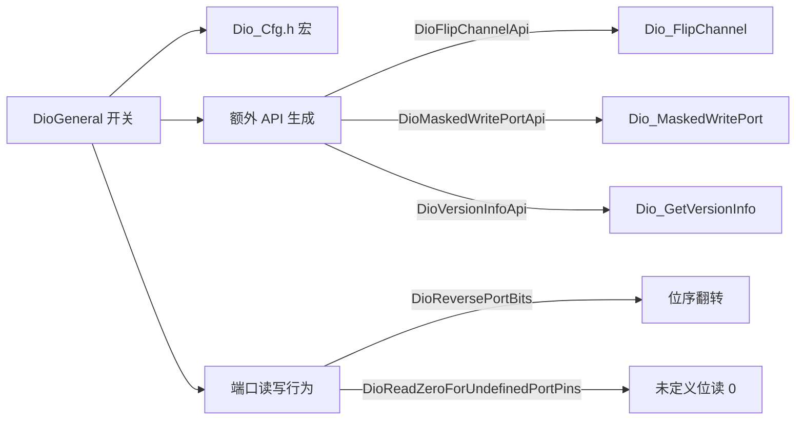

# AUTOSAR / S32K1xx MCAL · DIO 配置问答汇总

> 工程：`S32K1X_MCAL_Project`
> 驱动包：`TS_T40D2M10I1R0`（NXP S32K1xx MCAL / RTD 1.0.1），AUTOSAR 4.2.2
> 工具：EB tresos 24.0.1
>
> 说明：本文档专门汇总 **DIO（Dio）模块**相关的问答。后续关于 Dio 的回答继续追加到本文档。

## 目录

- [第 1 章 · 为什么 Port 与 Dio 支持的配置变体不同](#第-1-章--为什么-port-与-dio-支持的配置变体不同)
- [第 2 章 · `DioGeneral` 各配置项含义](#第-2-章--diogeneral-各配置项含义)

---

# 第 1 章 · 为什么 Port 与 Dio 支持的配置变体不同

> 现象：本工程 `Port.xdm` 的 `IMPLEMENTATION_CONFIG_VARIANT` 可选 `VariantPreCompile` / `VariantPostBuild`；而 `Dio.xdm` 只可选 `VariantPreCompile` / `VariantLinkTime`。

## 1.1 通俗理解

“配置变体（Config Variant）”就是回答一个问题：**这份配置信息在什么时候被“钉死”下来？**

- **PreCompile（预编译）**：写进头文件宏 → **编译时就钉死**。
- **LinkTime（链接时）**：放在独立的目标文件里 → **链接时才选定**。
- **PostBuild（构建后）**：生成成一份可加载的数据 → **运行时才套用**。

而**每个模块能支持哪几种变体，是驱动厂商在模块定义（ECUC）里写死的**，不是你随便勾选。你的 NXP S32K1xx RTD 驱动里：

- Port 实现了 **PreCompile + PostBuild**；
- Dio 实现了 **PreCompile + LinkTime**。

所以 Dio 里看不到 PostBuild，**根因是厂商只实现了这两个**，不是配置错了。

## 1.2 三种变体详解

| 变体 | 配置何时固定 | 改配置要做什么 | 代码形态 | 典型用途 |
|---|---|---|---|---|
| `VariantPreCompile` | 编译期 | **重编译** | 头文件宏/常量 | 固定不变的通道映射 |
| `VariantLinkTime` | 链接期 | **重新链接**（应用可不重编） | 独立 `.c/.o` 中的 const 表 | 多产品变体共用应用 |
| `VariantPostBuild` | 运行时 | **不重编不重链**，换配置数据即可 | 可加载的配置结构体（PB） | 同一软件适配多套硬件 |

- **PreCompile**：数量、通道号都是宏，编译器直接内联，最省开销。
- **LinkTime**：配置变成一个 `const` 结构体数组，编译应用时不依赖具体值，链接时挑不同的配置目标文件。
- **PostBuild**：配置作为数据块（常在 Flash），运行时通过指针传给驱动（如 `Port_Init(&config)` 传 PB 配置），支持现场/多板切换。

## 1.3 为什么 Dio 没有 PostBuild

### 直接原因

AUTOSAR 的 `IMPLEMENTATION_CONFIG_VARIANT` 参数虽然标准上列出三种候选值，但**具体允许值由厂商的 ECUC 定义决定**。NXP 在 S32K1xx 的 Dio 模块定义里只填了 `VariantPreCompile` 与 `VariantLinkTime`，所以你在 tresos 里看不到 PostBuild——**你无法通过配置把它“变出来”**，除非厂商插件支持。

### 技术原因（合理推断，非官方原文）

| 模块 | 特点 | PostBuild 价值 |
|---|---|---|
| **Dio** | 极薄的 GPIO 抽象，`DioChannelId` 是**编译期符号**，直接映射到 GPIO 寄存器位 | 低：若运行时要解析 ID→端口/引脚，需额外查表与间接层，增加代码/RAM/耗时 |
| **Port** | 涉及引脚复用、上下拉、驱动强度等**板级/硬件相关**配置 | 高：同一软件可通过 PB 配置适配不同板子，无需重编 |

> 以上是“为什么这样设计合理”的解释，**不是 NXP 官方声明**。确切原因以厂商文档为准。

### 标准层面是否允许这种不对称？

允许。AUTOSAR 允许不同 BSW 模块支持不同的配置变体子集；集成时只要各自按自己支持的变体工作即可，不存在“必须统一”的要求。

## 1.4 能不能改成 PostBuild

| 想做的事 | 能否 |
|---|---|
| 在 tresos 里给 Dio 选 `VariantPostBuild` | **不能**，下拉框里没有该项 |
| 手改 xdm 强行写 `VariantPostBuild` | **不建议**，会与插件定义不符，生成/校验可能失败或行为未定义 |
| 让 Dio 具备 PostBuild | 需**厂商提供支持该变体的驱动版本** |

## 1.5 对本工程的配置影响

| 模块 | 当前变体 | 含义 |
|---|---|---|
| Port | `VariantPostBuild` | 引脚配置可在生成后以 PB 数据形式加载，适配多板 |
| Dio | `VariantPreCompile` | 通道 ID / 映射编译期固定 |

**集成注意点**：两者变体不同是合法的，但必须保证 **Dio 的 `DioChannel` 所指向的 port/pin，与 Port 中配好的物理引脚一致**。Port 走 PostBuild、Dio 走 PreCompile 时，尤其要人工核对这份映射，避免“Dio 以为在 PTA0、Port 实际配到别的脚”。

## 1.6 代码/配置形态示意

### 1.6.1 PreCompile（Dio 当前形态）

```c
/* Dio_Cfg.h 中直接定义宏，编译期固定 */
#define DioConf_DioChannel_LED    (0u)
```

### 1.6.2 LinkTime（Dio 可选的另一种）

```c
/* 配置放在独立目标文件的 const 表中，链接时选择不同 .o */
extern const Dio_ConfigType Dio_Config;
```

### 1.6.3 PostBuild（Port 当前形态，概念示意）

```c
/* 配置作为数据块，运行时通过指针传入 */
extern const Port_ConfigType Port_PBConfig;
Port_Init(&Port_PBConfig);
```

## 1.7 常见坑

1. **以为所有模块都支持三种变体** —— 错，各模块支持集合由厂商定义。
2. **手改 xdm 强写不支持的变体** —— 可能校验失败或生成异常。
3. **Port 用 PostBuild、Dio 用 PreCompile 却不核对映射** —— 通道实际落到错误引脚。
4. **以为 PreCompile 改配置只重链接** —— PreCompile 必须重编译；只有 LinkTime 才只需重链接。
5. **以为 PostBuild 改配置要重编** —— PostBuild 正是为了不重编不重链，换配置数据即可。

---

# 第 2 章 · `DioGeneral` 各配置项含义

> 依据：本工程 `config/Dio.xdm` 中 `DioGeneral` 实际存在的 7 个配置项（当前均为 `false`）。
> 展开为「通俗 → 原理 → 选项 → 代码 → 坑」。

## 2.1 通俗理解

`DioGeneral` 是整个 **DIO 驱动**的“总开关面板”。它不管“某个通道映射到哪个引脚”（那是 `DioPort` / `DioChannel` 的事），而是管：

- 要不要带**参数错误自检**（DET）；
- 要不要**生成额外的运行时 API**（翻转、掩码写等）；
- **读端口时的边界行为**（未定义引脚怎么处理）；
- 端口读写要不要**位序翻转**；
- 是否支持在**用户态（User Mode）** 调用。

类比：`DioChannel` 是“每个开关怎么接”，`DioGeneral` 是“这个开关面板的全局规则”。

## 2.2 总览

| 配置项 | 类型 | 当前值 | 一句话作用 | 标准/厂商 |
|---|---|---|---|---|
| `DioDevErrorDetect` | BOOLEAN | `false` | 开启 DET 参数检查 | AUTOSAR 标准 |
| `DioVersionInfoApi` | BOOLEAN | `false` | 生成 `Dio_GetVersionInfo()` | AUTOSAR 标准 |
| `DioReversePortBits` | BOOLEAN | `false` | 端口读写位序翻转 | 厂商扩展 |
| `DioFlipChannelApi` | BOOLEAN | `false` | 生成 `Dio_FlipChannel()` | AUTOSAR 标准（可选） |
| `DioReadZeroForUndefinedPortPins` | BOOLEAN | `false` | 未定义引脚读回 `0` | AUTOSAR 标准 |
| `DioMaskedWritePortApi` | BOOLEAN | `false` | 生成 `Dio_MaskedWritePort()` | AUTOSAR 标准（可选） |
| `DioEnableUserModeSupport` | BOOLEAN | `false` | 支持用户态调用 | 厂商扩展 |

---

## 2.3 逐项详解

### 2.3.1 `DioDevErrorDetect` —— 开发错误检测

**通俗**：仪表盘报警灯。打开后，DIO 的每个 API 会检查“通道号/端口号/指针合不合法”，出错就上报（DET），方便开发期抓 bug。

**原理**：
- 置 `TRUE` → 生成 `DIO_DEV_ERROR_DETECT = STD_ON`；
- API 入口生成参数检查（`#if (DIO_DEV_ERROR_DETECT == STD_ON)`），典型错误码：
  - `DIO_E_PARAM_INVALID_CHANNEL_ID`：通道号非法；
  - `DIO_E_PARAM_INVALID_PORT_ID`：端口号非法；
  - `DIO_E_PARAM_INVALID_GROUP`：通道组非法；
  - `DIO_E_PARAM_POINTER`：空指针；
  - `DIO_E_PARAM_INVALID_CHANNEL_DIRECTION`：翻转子方向不符（仅 Flip 相关）。
- 出错调用 `Det_ReportError(DIO_MODULE_ID, 0, API_ID, ERROR_ID)`。

**选项**：
- `true`：安全，开发期建议开；需工程里配好 DET 模块。
- `false`（本体当前）：省代码/CPU，量产常关；但误传参数会静默跑飞。

**代码示例**：

```c
/* Dio_Cfg.h */
#define DIO_DEV_ERROR_DETECT   (STD_ON)

/* Dio.c 典型片段 */
Dio_LevelType Dio_ReadChannel(Dio_ChannelType ChannelId)
{
#if (DIO_DEV_ERROR_DETECT == STD_ON)
    if (ChannelId >= DIO_NUMBER_OF_CHANNELS)
    {
        Det_ReportError(DIO_MODULE_ID, DIO_INSTANCE_ID,
                        DIO_READCHANNEL_SID, DIO_E_PARAM_INVALID_CHANNEL_ID);
        return STD_LOW;
    }
#endif
    return Dio_Ip_ReadChannel(ChannelId);
}
```

---

### 2.3.2 `DioVersionInfoApi` —— 版本信息 API

**通俗**：给你一个“查 DIO 驱动版本号”的函数。

**原理**：置 `TRUE` → 生成 `Dio_GetVersionInfo(Std_VersionInfoType *VersionInfo)`，返回 vendorID / moduleID / 软件版本。

**选项**：
- `true`：便于版本追踪/诊断；多一个小函数。
- `false`（本体当前）：不生成，省代码。

**代码示例**：

```c
Std_VersionInfoType ver;
Dio_GetVersionInfo(&ver);
```

---

### 2.3.3 `DioReversePortBits` —— 端口位序翻转

**通俗**：让“端口读写”的 bit 顺序**反过来**。当硬件接线是反着布的，或你想把逻辑 bit0 对应到物理高位引脚时，打开它能省去软件里手工 reverse。

**原理**：
- 影响 **端口级 API**（`Dio_ReadPort` / `Dio_WritePort` / `Dio_MaskedWritePort`）的 bit 映射：
  - 关闭：value 的 bit0 ↔ 端口逻辑 bit0（通常对应 PCR0）；
  - 打开：value 的 bit0 ↔ 端口最高位，依次反转。
- **不影响通道级 API**（`Dio_ReadChannel` / `Dio_WriteChannel`）。

**选项**：
- `false`（本体当前）：正常位序。
- `true`：反转。

**不确定性标注**：反转的**跨度（8/16/32 位）与具体方向以实现为准**，不同驱动版本可能不同；建议生成代码后验证或查驱动文档。

**代码示意**：

```c
/* 设 DioReversePortBits = true 时（概念示意） */
/* Dio_WritePort(PortId, 0x00000001) 可能实际点亮端口的最高位引脚 */
```

---

### 2.3.4 `DioFlipChannelApi` —— 翻转通道 API

**通俗**：给一个“按下就翻转”的按钮——把一个输出脚从高变低（或低变高），并返回翻转后的电平。

**原理**：置 `TRUE` → 生成 `Dio_FlipChannel(Dio_ChannelType ChannelId)`：
- 读当前输出电平 → 取反 → 写回；
- 返回翻转后的电平；
- 一般要求该通道配置为**输出**，否则可能报 `DIO_E_PARAM_INVALID_CHANNEL_DIRECTION`（由 DET 检查）。

**选项**：
- `false`（本体当前）：不生成，可用 `Dio_WriteChannel` 手写翻转。
- `true`：方便，适合 LED 闪灯/心跳电平。

**代码示例**：

```c
/* 需要 DioFlipChannelApi = true */
Dio_LevelType newLevel = Dio_FlipChannel(DioConf_DioChannel_LED);
```

---

### 2.3.5 `DioReadZeroForUndefinedPortPins` —— 未定义引脚读回 0

**通俗**：读整个端口时，对那些“本型号/本封装根本没引出或未配置”的引脚，寄存器位可能是垃圾值；打开它就把这些位当 `0` 返回，让读取结果稳定可预测。

**原理**：
- 置 `TRUE` → `Dio_ReadPort()` 对**未定义引脚**的位屏蔽为 `0`；
- 置 `FALSE`（本体当前）→ 直接返回寄存器原值，未定义位可能是不确定值。

**选项**：
- `true`：读取确定，便于做全端口判断。
- `false`：省一点处理，但未定义位不可依赖。

**代码示意**：

```c
Dio_PortLevelType lvl = Dio_ReadPort(DioConf_DioPort_0);
/* 设 DioReadZeroForUndefinedPortPins = true，未定义引脚对应位为 0 */
```

---

### 2.3.6 `DioMaskedWritePortApi` —— 掩码写端口 API

**通俗**：一次性写整个端口，但**只改你指定的那几位**，其他位保持不动。适合“多引脚共用一端口、只想改其中一部分”的场景。

**原理**：置 `TRUE` → 生成：

```c
void Dio_MaskedWritePort(Dio_PortType PortId,
                         Dio_PortLevelType Level,
                         Dio_PortLevelType Mask);
```

- 对 `Mask` 为 1 的位：写入 `Level` 对应位；
- 对 `Mask` 为 0 的位：保持原值不变。

**选项**：
- `false`（本体当前）：不生成，可“读-改-写”实现，但有多任务竞争风险。
- `true`：原子性更好、代码更简洁。

**代码示例**：

```c
/* 只改 bit0 和 bit3，其余位不变 */
Dio_MaskedWritePort(DioConf_DioPort_0,
                    0x09u,   /* Level: bit0=1, bit3=1 */
                    0x09u);  /* Mask : 只改这两位 */
```

---

### 2.3.7 `DioEnableUserModeSupport` —— 用户模式支持

**通俗**：允许**非特权（用户态）代码**调用 DIO 接口，配合 MPU 做安全隔离时用。

**原理**：置 `TRUE` → 生成的接口适配用户态访问（寄存器访问方式/权限调整），可能需配合 MPU 配置；置 `FALSE`（本体当前）→ 假定特权态调用。

**选项**：
- `false`（本体当前）：常规裸机/RTOS 特权态。
- `true`：仅当 OS 把 DIO 调用方放用户态且已规划 MPU 时。

---

## 2.4 对生成代码的影响图



- **裁剪类**（`...Api` / `DioVersionInfoApi`）：决定函数是否存在，不生成则链接会报 `undefined reference`。
- **行为类**（`DioReversePortBits`、`DioReadZeroForUndefinedPortPins`）：函数都在，只是实现/结果不同。
- **检查类**（`DioDevErrorDetect`）：决定 API 内是否带参数检查与上报。
- **访问权限类**（`DioEnableUserModeSupport`）：影响寄存器访问方式/MPU 要求。

## 2.5 常见坑

1. **关掉 `...Api` 却仍在调用** → 链接 `undefined reference`。
2. **开 `DioDevErrorDetect` 没配 DET** → `Det_ReportError` 未实现，链接失败。
3. **误以为 `DioReversePortBits` 影响单通道 API** → 它只影响端口级读写。
4. **`DioFlipChannel` 用于输入脚** → 方向不符，可能报 `DIO_E_PARAM_INVALID_CHANNEL_DIRECTION`。
5. **依赖未定义引脚的读值** → 未开 `DioReadZeroForUndefinedPortPins` 时结果不确定。
6. **多任务下用读-改-写代替 `Dio_MaskedWritePort`** → 有竞争风险。
7. **裸机场景误开 `DioEnableUserModeSupport`** → 可能引入 MPU 配置要求。


