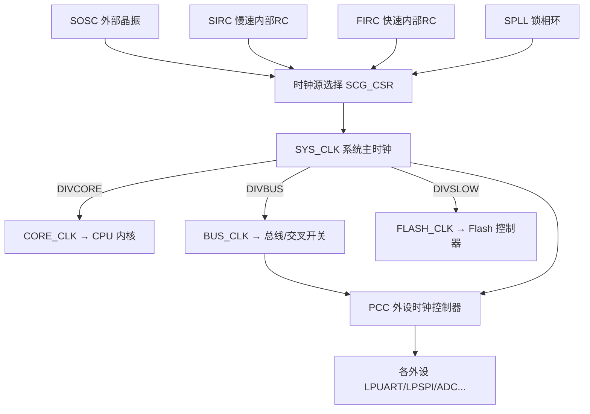
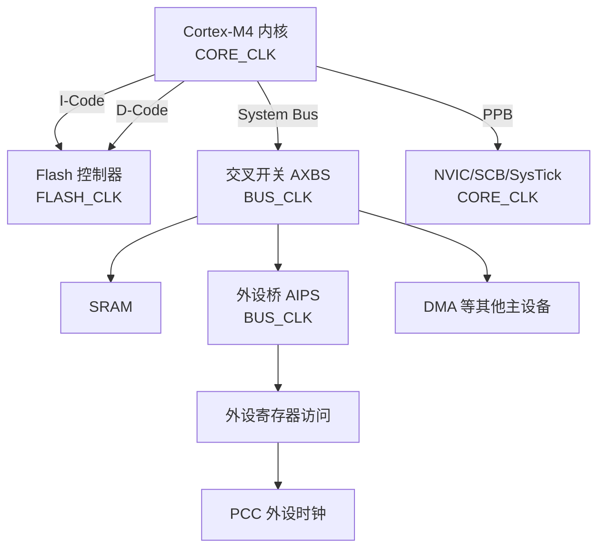
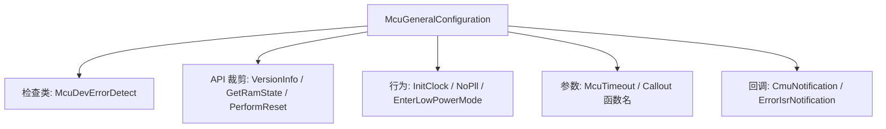
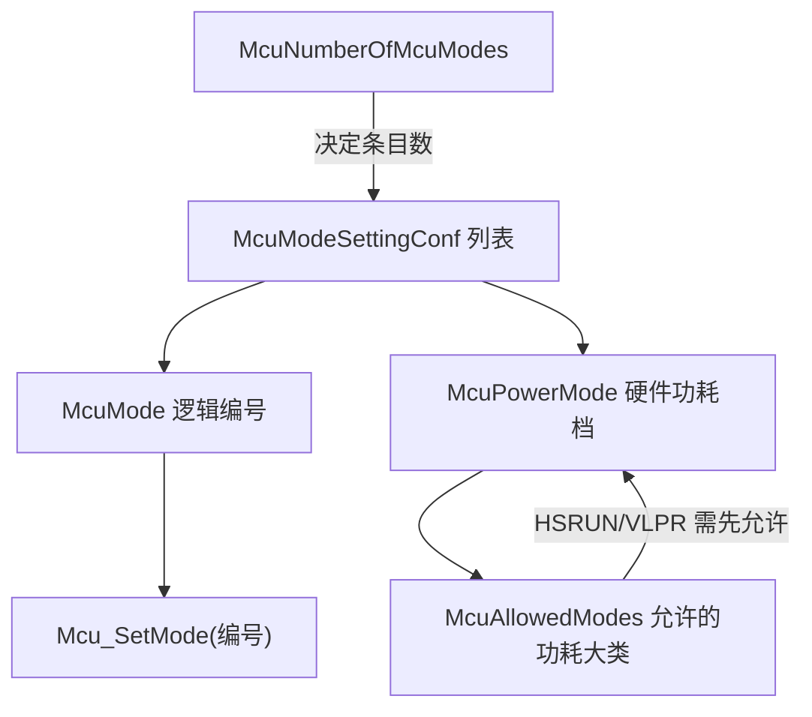
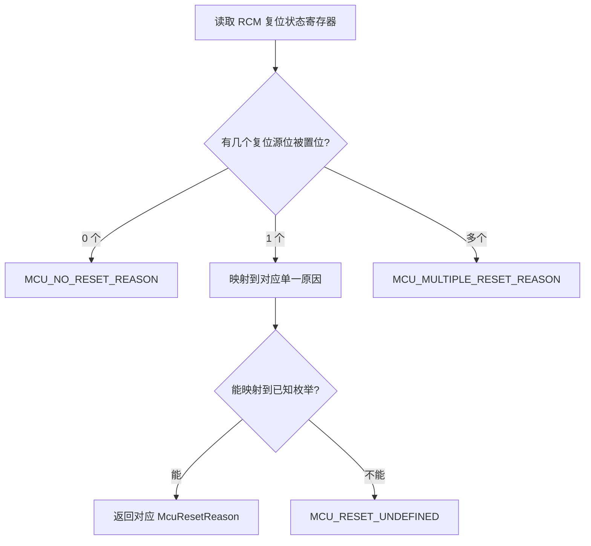
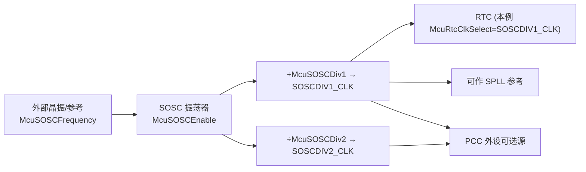
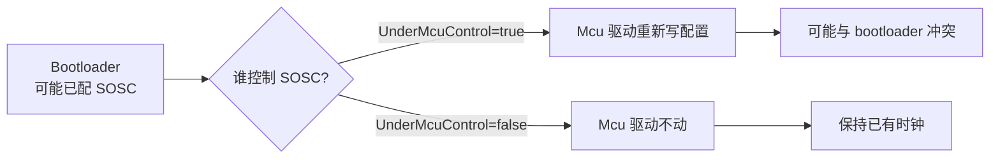
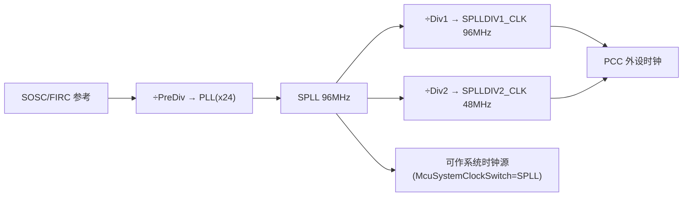
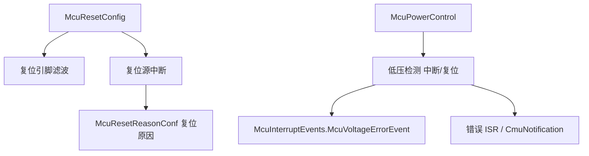

# AUTOSAR / S32K1xx MCAL · MCU 配置问答汇总

> 工程：`S32K1X_MCAL_Project`
> 驱动包：`TS_T40D2M10I1R0`（NXP S32K1xx MCAL / RTD 1.0.1），AUTOSAR 4.2.2
> 工具：EB tresos 24.0.1
>
> 说明：本文档专门汇总 **MCU 模块**相关的问答。后续关于 MCU 的回答继续追加到本文档。

## 目录

- [第 1 章 · CORE_CLK / SYS_CLK / BUS_CLK / FLASH_CLK 的含义、用途与区别](#第-1-章--core_clk--sys_clk--bus_clk--flash_clk-的含义用途与区别)
- [第 2 章 · 各总线与四个时钟的关系](#第-2-章--各总线与四个时钟的关系)
- [第 3 章 · `McuGeneralConfiguration` 各配置项含义](#第-3-章--mcugeneralconfiguration-各配置项含义)
- [第 4 章 · McuDebugConfiguration / McuModuleConfiguration / McuAllowedModes / McuInterruptEvents](#第-4-章--mcudebugconfiguration--mcumoduleconfiguration--mcuallowedmodes--mcuinterruptevents)
- [第 5 章 · `McuModeSettingConf` 配置项详解](#第-5-章--mcumodesettingconf-配置项详解)
- [第 6 章 · `McuResetReasonConf` 各值含义与成因](#第-6-章--mcuresetreasonconf-各值含义与成因)
- [第 7 章 · `McuSIMConfig` 配置详解](#第-7-章--mcusimconfig-配置详解)
- [第 8 章 · `McuClockSettingConfig` 配置详解](#第-8-章--mcuclocksettingconfig-配置详解)
- [第 9 章 · `McuClockReferencePoint` 与外设时钟的意义](#第-9-章--mcuclockreferencepoint-与外设时钟的意义)
- [第 10 章 · `McuScgClkOutSelect` 的含义与选择](#第-10-章--mcuscgclkoutselect-的含义与选择)
- [第 11 章 · `McuSystemOSCClockConfig` 配置详解](#第-11-章--mcusystemoscclockconfig-配置详解)
- [第 12 章 · 晶振起振原理](#第-12-章--晶振起振原理)
- [第 13 章 · `McuSOSCUnderMcuControl` 原理与意义](#第-13-章--mcusoscundermcucontrol-原理与意义)
- [第 14 章 · `McuSystemPll` 配置详解](#第-14-章--mcusystempll-配置详解)
- [第 15 章 · SPLL 参考分频器、参数来源与 ÷2 的由来](#第-15-章--spll-参考分频器参数来源与-2-的由来)
- [第 16 章 · `McuPeripheralClockConfig` 的时钟源选择逻辑](#第-16-章--mcuperipheralclockconfig-的时钟源选择逻辑)
- [第 17 章 · `McuResetConfig` 与 `McuPowerControl` 详解](#第-17-章--mcuresetconfig-与-mcupowercontrol-详解)

---

# 第 1 章 · CORE_CLK / SYS_CLK / BUS_CLK / FLASH_CLK 的含义、用途与区别

> 适用：NXP S32K1xx（SCG 时钟发生器 + PCC 外设时钟控制器）。
> ⚠️ 说明：`SYS_CLK` 在不同 NXP 文档中有时指“系统主时钟（分频前的源）”，有时与 core clock 同义；本章按 S32K1xx 时钟树常见定义解释，**具体 MCU 配置项定义以 tresos 工具为准**。

## 1.1 通俗理解

把芯片比作一座城市：

| 时钟 | 城市类比 | 直觉 |
|---|---|---|
| `SYS_CLK` | 城市总发电厂 | 一切时钟的“源头基准” |
| `CORE_CLK` | 给“大脑”（CPU）供电的主干线 | 最快，决定 CPU 多快 |
| `BUS_CLK` | 给“道路/公交系统”（总线、外设互联）供电 | 稍慢，决定数据搬运多快 |
| `FLASH_CLK` | 给“仓库”（Flash 存储）供电 | 最慢但够用，决定取指/读 Flash 多快 |

核心观念：**它们不是四个独立时钟源，而是同一个系统时钟经过不同分频器得到的“兄弟时钟”。**

## 1.2 逐个含义与用途

### 1.2.1 `CORE_CLK`（核心时钟）

- **是什么**：供给 **Cortex-M4 内核**（CPU、NVIC、内核私有总线）的时钟。
- **用途**：决定指令执行速率、内核总线访问速度。CPU 跑多快就看它。
- **来源**：S32K1xx 的 SCG 选择时钟源（FIRC / SOSC+PLL / SIRC）后，经 `DIVCORE` 分频得到。
- **典型**：S32K14x 系列一般在数十 MHz 量级（具体上限以型号数据手册为准）。
- **影响**：改它，会连带影响由它派生的 BUS/FLASH 时钟（见 1.4）。

### 1.2.2 `SYS_CLK`（系统时钟）

- **是什么**：通常指**经时钟源选择器选出、分频前的“系统主时钟”基准**（S32K1xx 中对应 SCG 的 system clock）。
- **用途**：作为 CORE/BUS/FLASH 三个分频分支的“总输入”。
- **关系**：`CORE_CLK`、`BUS_CLK`、`FLASH_CLK` 都可看作 `SYS_CLK` 经不同分频系数得到。
- **注意**：部分文档/驱动里 `SYS_CLK` 被当作 core clock 的别名；**在 MCU 配置项里看到它时，先确认工具 tooltip 的定义**，不要直接假设。

### 1.2.3 `BUS_CLK`（总线时钟）

- **是什么**：供给**系统总线/交叉开关（crossbar）以及总线映射的外设**的时钟。
- **用途**：CPU 与内存/外设之间搬运数据、总线外设寄存器访问的节拍。
- **来源**：`SYS_CLK` 经 `DIVBUS` 分频（或 `CORE_CLK / DIVBUS`，视实现）。
- **典型关系**：**`BUS_CLK` 通常 ≤ `CORE_CLK`**，常见配置为 `CORE_CLK / 2`。
- **影响**：BUS 太慢会拖累外设访问与 DMA 吞吐。

### 1.2.4 `FLASH_CLK`（闪存时钟）

- **是什么**：供给 **Flash 存储器控制器**（以及部分“慢速”外设）的时钟。
- **用途**：决定 Flash 取指、读写的速率。CPU 从 Flash 取指令时受它约束。
- **来源**：`SYS_CLK` 经 `DIVSLOW`（慢时钟分频）得到。
- **典型关系**：通常是四者中**最慢**的，常见为 `CORE_CLK / 3` 或更低。
- **影响**：Flash 时钟过高会超出 Flash 允许频率，导致取指失败/不稳定。

## 1.3 四者区别对比

| 时钟 | 主要服务对象 | 相对速度 | 典型分频字段 | 影响面 |
|---|---|---|---|---|
| `SYS_CLK` | 作为基准源 | 基准（最高） | 源选择/无（分频前） | 决定下游全部 |
| `CORE_CLK` | Cortex-M4 内核 | 快 | `DIVCORE` | CPU 执行速率 |
| `BUS_CLK` | 总线/交叉开关/总线外设 | 中 | `DIVBUS` | 数据搬运、外设访问 |
| `FLASH_CLK` | Flash 控制器/慢速外设 | 慢 | `DIVSLOW` | 取指、Flash 读写 |

## 1.4 时钟树示意



> SPLL 的输入可来自 SOSC 或 FIRC。PCC 为每个外设选择时钟源并分频，是外设时钟的“最后一个开关”。

## 1.5 频率约束与联动

1. **`CORE_CLK` 不能超过型号允许的最大核心频率**（具体值查数据手册）。
2. **`BUS_CLK` 一般 ≤ `CORE_CLK`**，且总线/外设有自己的上限。
3. **`FLASH_CLK` 有严格上限**，超过会导致 Flash 访问错误。很多工程把 flash 分频设得较保守。
4. **改动 `SYS_CLK` 源或 `DIVCORE` 会同时改变 BUS/FLASH**：例如把 core 从 40 MHz 提到 80 MHz，若不改分频，BUS/FLASH 也会翻倍，可能超限。
5. **外设时钟独立于以上三者**：外设经 PCC 从 SOSC/SIRC/FIRC/SPLL/BUS 等另选源，需要单独配。

## 1.6 MCAL 配置上的注意

- 在 NXP S32K1xx 的 **MCU 模块**里配置 SCG（时钟源、PLL、分频）与 PCC（外设时钟选择）。
- `CORE_CLK / BUS_CLK / FLASH_CLK` 的数值并非各自独立填，而是**由时钟源 + 分频系数推导**；工具里通常通过设置 SCG 寄存器字段间接得到。
- `SYS_CLK` 的呈现方式随驱动版本不同，**以 tresos 中该参数 tooltip/生成代码为准**，不要仅凭名字推断。
- 修改后务必核对：内核频率、总线频率、Flash 频率三者是否都在各自允许范围内。

## 1.7 常见坑

1. **把四个时钟当独立时钟源分别乱填** → 实际它们由同一源分频，互相联动，容易超限。
2. **只提 CORE 忘了 FLASH** → Flash 分频没跟上，取指出错。
3. **BUS 设得比 CORE 还快** → 违反时序约束，总线异常。
4. **混淆 `SYS_CLK` 与 `CORE_CLK`** → 配置项含义理解错，导致频率算错。
5. **忘了外设还走 PCC** → 以为 core/bus 改了就够，结果外设频率不对（如 UART 波特率错）。
6. **跨型号照搬频率** → 不同 S32K1xx 派生型号上限不同，必须查对应数据手册。

---

# 第 2 章 · 各总线与四个时钟的关系

> 本章 = **ARM Cortex-M4 总线架构通用描述** + **S32K1xx 常见时钟域映射**。
> ⚠️ 具体到你的派生型号，请以 RM 的「Bus Matrix / Clock Distribution」章节为准；本章不臆造寄存器细节。

## 2.1 通俗理解

CPU 不是只有一条“嘴”去取东西，它有几条专用的“通道”：

- 一条专门“拿指令”（I-Code）；
- 一条专门“拿数据/常量”（D-Code）；
- 一条“通往外设和 RAM 的大路”（System Bus）；
- 一条“内部私房路”（PPB，访问 NVIC/SysTick 等）。

每条通道都归 CPU 的节拍（`CORE_CLK`）指挥，但**终点的仓库（Flash/总线/外设）有各自更慢的节拍（`FLASH_CLK`/`BUS_CLK`）**。所以一条通道最快的速度 = **MIN(起点节拍, 终点节拍)**。

## 2.2 Cortex-M4 的四条总线接口

| 总线 | 全称 | 访问区域 | 典型目标 |
|---|---|---|---|
| **I-Code** | Instruction Code bus | 代码区（0x0000_0000–0x1FFF_FFFF） | Flash（取指） |
| **D-Code** | Data Code bus | 代码区（数据/字面量访问） | Flash（常量/数据读） |
| **System** | System bus (AHB-Lite) | SRAM、外设 | 交叉开关/外设桥 |
| **PPB** | Private Peripheral Bus | 内核私有区 | NVIC、SCB、SysTick、调试组件 |

补充：
- I-Code / D-Code / System 都是 **AHB-Lite 主接口**，与内核同步。
- PPB 是内核私有总线，**不经交叉开关**。

## 2.3 S32K1xx 上的时钟域映射（常见）

| 总线 | 主侧（Master）时钟 | 目标侧（Target）时钟 | 有效带宽受限于 | 说明 |
|---|---|---|---|---|
| **I-Code** | `CORE_CLK` | `FLASH_CLK` | MIN(CORE, FLASH) | 取指走 Flash 控制器 |
| **D-Code** | `CORE_CLK` | `FLASH_CLK` | MIN(CORE, FLASH) | 读常量/字面量 |
| **System Bus** | `CORE_CLK` | `BUS_CLK`（交叉开关/外设桥） | MIN(CORE, BUS) | 访问 SRAM/外设/寄存器 |
| **PPB** | `CORE_CLK` | `CORE_CLK` | `CORE_CLK` | 私有，不走交叉开关 |

延伸（S32K1xx 常见）：
- **交叉开关 AXBS**：挂在 `BUS_CLK`，仲裁多个主设备（内核、DMA 等）。
- **外设桥 AIPS**：挂在 `BUS_CLK`，再分到各外设（外设另有 PCC 时钟）。
- **Flash 控制器**：挂在 `FLASH_CLK`。
- **SRAM**：一般随总线/平台时钟访问（具体以 RM 为准）。

## 2.4 “带宽由谁决定”的核心规则

$$
\text{有效带宽} \propto \min(\text{主设备时钟},\ \text{目标端口时钟})
$$

举例理解：
- CPU 跑 80 MHz（`CORE_CLK`），Flash 只有 26 MHz（`FLASH_CLK`）→ **取指（I-Code）最多按 Flash 节拍走**，CPU 要等。
- CPU 80 MHz，总线 40 MHz（`BUS_CLK`）→ **访问 SRAM/外设（System Bus）最多按 40 MHz 走**。
- 这就是为什么“提高 CORE_CLK”不一定线性提升性能：瓶颈常常在 Flash 或总线。

## 2.5 总线 / 时钟关系图



| 图中元素 | 含义 |
|---|---|
| CPU | 内核，按 `CORE_CLK` 运行，发出四条总线访问 |
| I-Code / D-Code | 内核到 Flash 的专用通道 |
| Flash 控制器 | 按 `FLASH_CLK` 服务 Flash 数组 |
| System Bus | 内核到交叉开关的通用通道 |
| AXBS | 多主设备仲裁，按 `BUS_CLK` |
| PPB | 内核私有总线，不经 AXBS |
| AIPS | 外设桥，挂 `BUS_CLK` |
| PCC | 外设自己的时钟选择/分频 |

## 2.6 对 MCAL / 工程的实际影响

1. **Flash 频率决定取指性能**：`FLASH_CLK` 过低会让高频 `CORE_CLK` “饿着”（频繁等 Flash）。
2. **总线频率决定外设访问与 DMA 吞吐**：`BUS_CLK` 过低，寄存器访问、DMA 搬运变慢。
3. **多主竞争**：DMA 与 CPU 同时访问 AXBS 时，带宽共享，实际有效带宽低于单主。
4. **外设寄存器访问走 System Bus**，但外设本身工作频率由 **PCC** 另配，两者别混。
5. **调试/内核组件（PPB）不受 BUS/FLASH 影响**，只跟 `CORE_CLK`。

## 2.7 常见坑

1. **以为提 CORE_CLK 就一定提速** → 受 Flash/BUS 瓶颈限制。
2. **把外设频率算成本 BUS_CLK** → 外设实际频率由 PCC 决定。
3. **忽略 I-Code/D-Code 共用 Flash 端口** → 取指与常量读会互相争抢 Flash 带宽。
4. **DMA 与 CPU 抢总线没评估** → 高负载时吞吐下降。
5. **照搬其它型号的“某总线挂某时钟”** → 不同派生型号总线/时钟映射可能不同，以 RM 为准。

---

# 第 3 章 · `McuGeneralConfiguration` 各配置项含义

> 依据：本工程 `config/Mcu.xdm` 中 `Mcu` → `McuGeneralConfiguration` 实际存在的 13 个配置项。
> 注：tresos 界面上这一组通常就显示为 Mcu 的 **General** 页。

## 3.1 总览

| 配置项 | 类型 | 本工程当前值 | 一句话作用 | 分类 |
|---|---|---|---|---|
| `McuDevErrorDetect` | BOOLEAN | `false` | DET 参数/状态检查 | 检查 |
| `McuVersionInfoApi` | BOOLEAN | `false` | 生成 `Mcu_GetVersionInfo()` | API 裁剪 |
| `McuGetRamStateApi` | BOOLEAN | `false` | 生成 `Mcu_GetRamState()` | API 裁剪 |
| `McuInitClock` | BOOLEAN | `true` | 初始化时是否配置时钟 | 行为 |
| `McuNoPll` | BOOLEAN | `true` | 声明不使用 PLL | 行为 |
| `McuEnterLowPowerMode` | BOOLEAN | `true` | 是否支持低功耗模式 | 行为 |
| `McuTimeout` | INTEGER | `50000` | 时钟/振荡器等待超时（循环数） | 参数 |
| `McuEnableUserModeSupport` | BOOLEAN | `false` | 用户态调用支持 | 厂商 |
| `McuPerformResetApi` | BOOLEAN | `false` | 生成 `Mcu_PerformReset()` | API 裁剪 |
| `McuCalloutBeforePerformReset` | BOOLEAN | `false` | 复位前是否调回调 | 行为 |
| `McuPerformResetCallout` | FUNCTION-NAME | `NULL_PTR` | 复位前回调函数名 | 参数 |
| `McuCmuNotification` | FUNCTION-NAME | `NULL_PTR`（禁用） | CMU 事件通知回调 | 回调 |
| `McuErrorIsrNotification` | FUNCTION-NAME | `NULL_PTR`（禁用） | 错误 ISR 通知回调 | 回调 |

## 3.2 逐项详解

### 3.2.1 `McuDevErrorDetect`

- **通俗**：Mcu 驱动的“参数校验开关”。
- **原理**：置 `true` → `MCU_DEV_ERROR_DETECT = STD_ON`，API 入口检查空指针/未初始化/参数非法，出错调 `Det_ReportError`。
- **选项**：`true` / `false`（本体 `false`）。开发期建议开，量产可关。

### 3.2.2 `McuVersionInfoApi`

- **通俗**：是否生成“查驱动版本号”的函数。
- **原理**：置 `true` → 生成 `Mcu_GetVersionInfo(Std_VersionInfoType* )`。
- **选项**：`true` / `false`（本体 `false`）。

### 3.2.3 `McuGetRamStateApi`

- **通俗**：是否生成“查 RAM 状态”的函数。用来判断上次复位后 RAM 内容是否还可信（做热启动/快速恢复用）。
- **原理**：置 `true` → 生成 `Mcu_GetRamState()`，返回 `Mcu_RamStateType`（`MCU_RAMSTATE_INVALID` / `MCU_RAMSTATE_VALID`）。
- **选项**：`true` / `false`（本体 `false`）。

```c
Mcu_RamStateType st = Mcu_GetRamState();
if (st == MCU_RAMSTATE_VALID) { /* RAM 可继续用，可做热启动 */ }
```

### 3.2.4 `McuInitClock`

- **通俗**：`Mcu_Init()` 要不要顺手把时钟也配好？
- **原理**：置 `true` → 初始化流程中包含时钟配置（按 `McuClockSettingConfig`）；置 `false` → 时钟需另外处理。
- **选项**：`true`（本体）/ `false`。
- **影响**：关系到上电后时钟何时生效，与 `Mcu_InitClock()` API 的调用时序相关。

### 3.2.5 `McuNoPll`

- **通俗**：告诉驱动“本工程不使用 PLL（锁相环）”。
- **原理**：置 `true`（本体）→ 时钟初始化不配置 `SPLL`，系统时钟源不用 PLL（本工程 `McuSystemClockSwitch=FIRC`）；置 `false` → 允许使用 SPLL 做系统时钟源。
- **选项**：`true` / `false`。
- **影响**：与时钟配置强耦合；要开 PLL（高主频）时必须置 `false`。

### 3.2.6 `McuEnterLowPowerMode`

- **通俗**：是否允许驱动处理**低功耗模式切换**。
- **原理**：置 `true`（本体）→ 使能低功耗模式相关支持（配合 `Mcu_SetMode` 等）；置 `false` → 不生成/不支持低功耗切换。
- **选项**：`true` / `false`。
- **注意**：即使为 `true`，具体能进哪些低功耗模式还受 `McuAllowedModes`（如 `McuAllowVeryLowPowerModes`）约束。

### 3.2.7 `McuTimeout`

- **通俗**：等时钟/振荡器“稳定”时，最多等多久。
- **原理**：单位是**循环次数**（不是毫秒）；用于振荡器启动/PLL 锁定的轮询等待上限，超时则报错或返回失败。
- **选项**：正整数（本体 `50000`）。
- **影响**：太小可能误判超时；太大则启动变慢。本体未用 PLL，影响较小。

### 3.2.8 `McuEnableUserModeSupport`

- **通俗**：允许非特权（用户态）代码调用 Mcu 接口，配合 MPU 隔离。
- **选项**：`false`（本体，常规特权态）/ `true`。

### 3.2.9 `McuPerformResetApi`

- **通俗**：是否生成“软件复位”函数——让程序能主动把 MCU 复位。
- **原理**：置 `true` → 生成 `Mcu_PerformReset()`。
- **选项**：`false`（本体，不生成）/ `true`。
- **注意**：`Mcu_PerformReset()` 执行后芯片复位，需配合看门狗/复位原因分析使用。

### 3.2.10 `McuCalloutBeforePerformReset`

- **通俗**：软件复位**前**，要不要先调用一个用户回调（比如保存现场、写日志）。
- **原理**：置 `true` → `Mcu_PerformReset()` 前会调用 `McuPerformResetCallout` 指定的函数。
- **选项**：`false`（本体）/ `true`。

### 3.2.11 `McuPerformResetCallout`

- **通俗**：上面那个“复位前回调”的函数名。
- **类型**：`FUNCTION-NAME`，本体为 `NULL_PTR`（未指定）。
- **注意**：仅当 `McuCalloutBeforePerformReset = true` 时才有意义。

```c
/* 启用回调时，需实现并在此填写函数名，例如 MyResetCallout */
void MyResetCallout(void) { /* 保存现场/写日志 */ }
```

### 3.2.12 `McuCmuNotification`

- **通俗**：时钟监控单元（CMU）检测到异常时，通知哪个回调函数。
- **类型**：`FUNCTION-NAME`，本体为 `NULL_PTR` 且 `ENABLE=false`（未启用）。
- **注意**：需与 CMU 相关配置（如 `McuDisableCmuApi` / `McuEnablePeripheralCMU`）配合；具体以驱动实现为准。

### 3.2.13 `McuErrorIsrNotification`

- **通俗**：MCU 错误中断触发时，通知哪个回调函数。
- **类型**：`FUNCTION-NAME`，本体为 `NULL_PTR` 且 `ENABLE=false`（未启用）。

## 3.3 分类总结



- **检查类**：决定 API 内是否带参数/状态校验。
- **API 裁剪类**：决定函数是否存在（不生成则链接报 `undefined reference`）。
- **行为类**：函数都在，改变初始化/时钟/低功耗行为。
- **参数类**：给上述行为提供数值/函数名。
- **回调类**：事件发生时调用用户函数。

## 3.4 常见坑

1. **`McuNoPll=true` 却想要高主频** → 不用 PLL，系统时钟只能靠 FIRC 等，达不到高频。
2. **`McuInitClock=false` 却没自己初始化时钟** → 系统跑在默认时钟，频率与预期不符。
3. **`McuTimeout` 当毫秒用** → 它其实是循环次数，调太小会误超时。
4. **开了 `McuPerformResetApi` 但没处理复位原因** → 复位后无法区分是软件复位还是看门狗复位，建议配合复位原因查询。
5. **`McuCalloutBeforePerformReset=true` 但 `McuPerformResetCallout=NULL_PTR`** → 无实际回调或异常，需填有效函数名。
6. **开了 `McuEnterLowPowerMode` 就以为能进任意低功耗** → 还受 `McuAllowedModes` 限制。
7. **回调类函数名未实现** → 链接失败；启用前确认函数存在。

---

## 3.5 深入：`McuGetRamStateApi` 的原理

### 3.5.1 它到底回答什么问题

一句话：**“这次复位之后，RAM 里原来的内容还可不可信？”**

- 它不是“把 RAM 读一遍做完整校验”，而是返回一个**状态结论**：
  - `MCU_RAMSTATE_VALID`：RAM 内容可视为有效（未被重新初始化/未丢失）；
  - `MCU_RAMSTATE_INVALID`：RAM 内容不可信，需重新初始化。

### 3.5.2 为什么需要它

复位有很多种：上电复位（Power-On）、看门狗复位、软件复位、外部引脚复位……

| 复位类型 | RAM 内容是否可能保留 | `Mcu_GetRamState` 期望 |
|---|---|---|
| 上电复位（掉电后） | 一般不保留 | `INVALID` |
| 热复位 / 功能复位 | 可能保留 | `VALID`（若未被破坏） |

应用据此决定：**做完整冷启动初始化，还是走热启动快速恢复**。

### 3.5.3 典型实现机制（AUTOSAR MCU SWS 概念）

标准只规定了“返回状态”，具体怎么判断由驱动实现。**常见做法**是“RAM 签名/魔数”：

```text
1. 驱动在 RAM 中预留一小块“签名区”（通常不放启动代码清零的段，或链接脚本标记为 no-init）
2. 正常初始化/正常关机时，向签名区写入一个已知图案（magic）
3. 复位后 Mcu_GetRamState 读取签名区：
     图案完好且匹配  → MCU_RAMSTATE_VALID
     图案缺失/被改写 → MCU_RAMSTATE_INVALID
```

> ⚠️ 具体签名位置、是否依赖 `no-init` 段、是否结合复位原因寄存器，**因 S32K1xx 驱动实现版本而异**，本处为避免臆造不给出具体地址/变量名，请以驱动源码/生成代码为准。

### 3.5.4 返回 `VALID` 的前提条件（关键）

1. **RAM 必须真的保住了电**：上电掉电后 SRAM 内容丢失 → 必然 `INVALID`。
2. **启动代码不能把签名区清零**：若启动时整个 `.bss/.data` 被初始化，签名被抹掉 → `INVALID`。
3. **签名区不能被越界写/栈溢出破坏**：被踩了也会 `INVALID`（这反而是个好处，能发现部分内存破坏）。
4. **驱动实现支持**：该 API 与签名机制是驱动提供的，不是硬件自动给的。

### 3.5.5 它**不是**什么（常见误解）

| 误解 | 事实 |
|---|---|
| 它做了全 RAM 测试 | 不，只反映一个状态标记 |
| `VALID` 就说明业务数据一定对 | 不，业务数据仍需应用层 CRC/校验 |
| `INVALID` 就一定是硬件坏了 | 不，上电复位本来就是 `INVALID` |
| 开不开这个 API 都一样 | 不开就不生成 `Mcu_GetRamState()`，应用无法查 |

### 3.5.6 使用示例

```c
Mcu_RamStateType ramState = Mcu_GetRamState();

if (ramState == MCU_RAMSTATE_VALID)
{
    /* 热启动：可尝试复用保持的数据，但仍建议应用层校验 */
}
else
{
    /* 冷启动：完整初始化 */
}
```

---

## 3.6 `McuPerformResetCallout` 的 `NULL_PTR` 能否修改、改不了怎么办

### 3.6.1 `NULL_PTR` 是什么

它不是一个“错误值”，而是参数的**默认占位值**，含义是“**没有指定回调函数**”。类型是 `FUNCTION-NAME`，本质就是让你填一个 **C 函数名**。所以：**可以改**，改成合法函数名即可。

### 3.6.2 为什么你改不了（最常见原因：被使能条件锁住）

tresos 里很多参数是**条件使能**的，父参数没满足条件时，子参数会**变灰/只读**，值被强制回 `NULL_PTR`。对“复位前回调”这一组，常见依赖是：

```text
McuPerformResetApi        = true   ← 得先启用复位 API
McuCalloutBeforePerformReset = true ← 再启用“复位前回调”
        ↓
McuPerformResetCallout 才变为可编辑，可填函数名
```

> 证据：本工程 `Mcu.xdm` 里 `McuCmuNotification` / `McuErrorIsrNotification` 带 `ENABLE="false"` 标记（表示被禁用/置灰），而 `McuPerformResetCallout` 没有该标记——它更可能由 `McuCalloutBeforePerformReset` 的值控制使能。

### 3.6.3 正确操作步骤

1. 先把 `McuPerformResetApi` 设为 `true`（若你确实需要软件复位）；
2. 把 `McuCalloutBeforePerformReset` 设为 `true`；
3. 此时 `McuPerformResetCallout` 应可编辑，在其中填入合法 C 函数名，例如 `App_McuResetCallout`；
4. 在应用代码中**实现该函数**，签名通常为无参无返回：

```c
void App_McuResetCallout(void)
{
    /* 保存现场、写日志、置标志等 */
}
```

5. 确保该函数**声明可见且参与链接**（放对源文件、头文件声明、不被静态裁掉）。

### 3.6.4 如果仍然改不了，排查清单

| 可能原因 | 处理 |
|---|---|
| 父参数（`McuCalloutBeforePerformReset` / `McuPerformResetApi`）为 `false` | 先置 `true` |
| 参数被当前配置变体（PostBuild）或模式锁定 | 确认变体与必选项 |
| 未进入 Expert Mode / 参数被设为只读 | 检查 tresos 视图与参数属性 |
| 插件版本不支持该回调 | 查该版本 MCU 驱动文档 |
| `FUNCTION-NAME` 需要引用已存在的函数而非自由文本 | 用界面浏览/选择，或先声明函数 |

### 3.6.5 实在改不了时的替代方案（推荐且稳妥）

即使驱动回调填不进去，你也完全可以在**应用层自己包一层**，效果等价：

```c
static void App_McuResetCallout(void)
{
    /* 保存现场 / 写日志 / 置重启标志 */
}

void App_PerformReset(void)
{
    App_McuResetCallout();   /* 先做自己的事 */
    Mcu_PerformReset();      /* 再触发复位（需 McuPerformResetApi=true） */
}
```

- 优点：不依赖 tresos 回调参数是否可编辑；
- 代价：需确保所有复位路径都走 `App_PerformReset()`，避免绕过回调；
- 注意：`Mcu_PerformReset()` 执行后芯片复位，回调内不能依赖复位后的状态。

### 3.6.6 小结

| 问题 | 结论 |
|---|---|
| `NULL_PTR` 能改吗 | 能，改成合法函数名即可 |
| 为什么改不了 | 多半被 `McuCalloutBeforePerformReset` / `McuPerformResetApi` 的使能条件锁住 |
| 改不了怎么办 | 先开使能条件；仍不行则用应用层包装函数替代 |

---

# 第 4 章 · McuDebugConfiguration / McuModuleConfiguration / McuAllowedModes / McuInterruptEvents

> 依据：本工程 `config/Mcu.xdm` 实际内容。
> ⚠️ 其中带 *(厂商扩展)* 的项为 NXP 扩展，确切行为以驱动文档/生成代码为准。

## 4.1 `McuDebugConfiguration`（调试/诊断相关）

### 4.1.1 总览

| 配置项 | 类型 | 当前值 | 一句话作用 |
|---|---|---|---|
| `McuDisableDemReportErrorStatus` | BOOLEAN | `false` | 是否禁止向 DEM 上报错误状态 |
| `McuGetPeriphStateApi` | BOOLEAN | `false` | 是否生成“查外设状态”的调试 API |
| `McuGetMidrStructureApi` | BOOLEAN | `false` | 是否生成读取内核 MIDR 结构的 API |
| `McuDisableCmuApi` | BOOLEAN | `false` | 是否禁用 CMU 相关 API |
| `McuEnablePeripheralCMU` | BOOLEAN | `false` | 是否启用外设时钟监控（CMU） |

### 4.1.2 逐项

- **`McuDisableDemReportErrorStatus`**：控制 MCU 驱动是否把错误状态上报给 **DEM**（Diagnostic Event Manager）。`false` = 允许上报；`true` = 禁止上报（调试时可屏蔽）。
- **`McuGetPeriphStateApi`** *(厂商扩展)*：置 `true` 会生成一个查询外设/模块状态的调试用 API（具体函数名以生成头文件为准）。用于开发期确认外设是否被正确使能。
- **`McuGetMidrStructureApi`** *(厂商扩展)*：MIDR = ARM 内核的 **Main ID Register**（CPU 型号/版本标识）。置 `true` 生成读取 MIDR 结构的 API，用于识别内核版本/调试。
- **`McuDisableCmuApi`** *(厂商扩展)*：CMU = **Clock Monitor Unit**（时钟监控单元）。置 `true` 禁用 CMU 相关 API（与启用监控互斥）。
- **`McuEnablePeripheralCMU`** *(厂商扩展)*：置 `true` 启用对外设时钟的监控（某些外设时钟丢失时能报警）。需与 `McuCmuNotification` 配合。

> 这组基本都是**调试/诊断开关**，量产通常保持关闭以省代码。

## 4.2 `McuModuleConfiguration`（模块主体配置）

`McuModuleConfiguration` 是 Mcu 模块的“主体”，下面既有直接参数，也有多个子容器。

### 4.2.1 直接参数

| 配置项 | 类型 | 当前值 | 含义 |
|---|---|---|---|
| `McuNumberOfMcuModes` | INTEGER | `1` | 配置的 MCU 模式（功耗模式）数量，驱动 `McuModeSettingConf` 数组尺寸（`@CALC`） |
| `McuRamSectors` | INTEGER | `0` | RAM 扇区数量（用于 RAM 状态/初始化相关），驱动 `McuRamSectorSettingConf`（`@CALC`） |
| `McuResetSetting` | INTEGER | `1`（`ENABLE=false`） | 选择使用哪套复位设置；本工程**未启用** |
| `McuRTCCLKINFrequencyHz` | FLOAT | `32000.0` | RTC 时钟输入频率（Hz） |
| `McuRtcClkSelect` | ENUM | `SOSCDIV1_CLK` | RTC 时钟源选择 |
| `McuLPOClockSelect` | ENUM | `LPO_CLK_128K` | 低功耗振荡器 LPO 时钟选择 |
| `McuLPO32KClockEnable` | BOOLEAN | `true` | 是否使能 32K LPO 时钟 |
| `McuLPO1KClockEnable` | BOOLEAN | `true` | 是否使能 1K LPO 时钟 |
| `McuClockSrcFailureNotification` | ENUM | `ENABLED` | 时钟源失效时是否通知 |

说明：
- **`McuNumberOfMcuModes` / `McuRamSectors`** 通常由工具按下面列表条目数**自动计算**（`@CALC`），不手改。
- **`McuRtcClkSelect` / `McuLPOClockSelect` / LPO 使能** 决定 RTC 与低功耗定时器的时钟来源。
- **`McuClockSrcFailureNotification`**：打开后时钟源失效（如外部晶振失效）会走通知机制（配合 `McuCmuNotification`）。

### 4.2.2 子容器概览

| 子容器 | 作用 | 本工程现状 |
|---|---|---|
| `McuAllowedModes` | 允许进入哪些功耗模式 | 见 4.3 |
| `McuSIMConfig` | SIM 相关：芯片控制、FTM、ADC、外设时钟、时钟参考点 | 大量参数，基本默认 |
| `McuDemEventParameterRefs` | DEM 事件引用（超时/时钟失效） | `ENABLE=false`，未启用 |
| `McuModeSettingConf` | 各 MCU 模式的功耗模式定义 | `McuModeSettingConf_0`: Mode0 → `RUN` |
| `McuRamSectorSettingConf` | RAM 扇区定义 | 空（`McuRamSectors=0`） |
| `McuInterruptEvents` | 电压/备用复位事件使能 | 见 4.4 |
| `McuResetConfig` | 复位引脚滤波、各类复位中断使能 | 基本默认关了 |
| `McuPowerControl` | 低压检测、LPO 微调、偏置控制等 | 基本默认 |
| `McuClockSettingConfig` | 时钟设置（Run/VLPR/HSRUN、SOSC/SIRC/FIRC/PLL、外设时钟） | 见第 1、2 章 |

### 4.2.3 `McuModeSettingConf` 示例

本工程只配了一个模式：

```text
McuModeSettingConf_0:
  McuMode       = 0      # Mcu_ModeType 的数值
  McuPowerMode  = RUN    # 该模式对应 RUN
```

`McuMode` 是传给 `Mcu_SetMode()` 的模式号，`McuPowerMode` 是该模式实际对应的功耗状态（RUN / VLPR / HSRUN 等）。

## 4.3 `McuAllowedModes`（允许的功耗模式）

| 配置项 | 类型 | 当前值 | 含义 |
|---|---|---|---|
| `McuAllowHighSpeedRunMode` | BOOLEAN | `false` | 是否允许进入 **HSRUN**（高速运行）模式 |
| `McuAllowVeryLowPowerModes` | BOOLEAN | `false` | 是否允许进入 **VLPR/VLPS** 等超低功耗模式 |

说明：
- 这是**安全闸门**：即使 `McuModeSettingConf` 定义了某模式，若这里不允许对应大类，也不应进入。
- **HSRUN** 通常允许更高核心频率（如部分型号可到 112 MHz），但需更高电压/功耗。
- **VLPR/VLPS** 为超低功耗运行/停止模式，外设与时钟受限。
- 本工程两者均 `false` → 只跑普通 RUN，符合 `McuNoPll=true`、48 MHz FIRC 的现状。

```c
/* 切到模式 0（需 McuModeSettingConf 中存在，且功耗大类被允许） */
Mcu_SetMode(0u);
```

## 4.4 `McuInterruptEvents`（中断/事件使能）

| 配置项 | 类型 | 当前值 | 含义 |
|---|---|---|---|
| `McuVoltageErrorEvent` | BOOLEAN | `false` | 是否使能**电压错误事件** |
| `McuAlternateResetEvent` | BOOLEAN | `false` | 是否使能**备用复位事件** |

说明 *(厂商相关)*：
- **`McuVoltageErrorEvent`**：与低压/电压检测（LVD）相关，使能后电压异常可产生事件/中断；常与 `McuPowerControl` 里的 `McuLowVoltageDetectInterruptEnable` 等配合。
- **`McuAlternateResetEvent`**：使能“备用复位”事件处理（某些复位源/备用复位路径）。
- 本工程两者 `false` → 不使能这两类事件。

> 注意区分：`McuInterruptEvents` 管的是“电压/备用复位”这两个事件；而 `McuResetConfig > McuSystemInterruptEnable` 里管的是各类**复位源中断**（软件复位、看门狗复位、外部引脚复位等），是另一组。

## 4.5 常见坑

1. **只改 `McuModeSettingConf` 不改 `McuAllowedModes`** → 模式定义存在但大类不允许，进不去。
2. **`McuAllowHighSpeedRunMode=true` 但时钟没配到 HSRUN 频率** → 进 HSRUN 后频率/电压不匹配。
3. **手改 `McuNumberOfMcuModes` / `McuRamSectors`** → 它们是 `@CALC`，应与列表条目数一致。
4. **把 `McuInterruptEvents` 与 `McuResetConfig` 的复位中断混为一谈** → 两组是不同事件。
5. **调试开关（MIDR/PeriphState/CMU）量产忘了关** → 白白占代码/资源。
6. **`McuDisableCmuApi=true` 又想要 CMU 监控** → 自相矛盾，选了禁用 API 就无监控接口。

---

# 第 5 章 · `McuModeSettingConf` 配置项详解

> 依据：本工程 `config/Mcu.xdm` 中 `McuModuleConfiguration > McuModeSettingConf`。
> 本工程实际只有 1 个条目 `McuModeSettingConf_0`，含 2 个配置项。

## 5.1 通俗理解：模式就是芯片的“运行档位”

把 MCU 比作一台变频空调：

- **`McuMode`** = 遥控器上的“档位编号”（第几档）；
- **`McuPowerMode`** = 这一档实际对应的工作状态（强劲/普通/省电/待机）。

应用层通过 `Mcu_SetMode(档位号)` 切档，驱动根据本表把“档位号”翻译成“真实功耗模式”。

## 5.2 结构

```text
McuModuleConfiguration
└─ McuModeSettingConf (MAP)
   ├─ McuModeSettingConf_0
   │  ├─ McuMode      = 0      # INTEGER
   │  └─ McuPowerMode = RUN    # ENUMERATION
   └─ ...（可新增多个条目）
```

- 每个 `McuModeSettingConf_n` 条目 = **一个可切换的运行模式**。
- 条目数量由 `McuNumberOfMcuModes` 体现（`@CALC` 自动计算）。

## 5.3 `McuMode` —— 模式编号

| 项 | 内容 |
|---|---|
| 类型 | INTEGER |
| 本工程值 | `0` |
| 含义 | 该模式的**逻辑编号**，即传给 `Mcu_SetMode()` 的值 |
| 约束 | 各条目的 `McuMode` 应唯一、连续（通常 0,1,2…） |
| 影响 | 生成 `Mcu_ModeType` 的枚举/宏；应用用它选择模式 |

- 它是一个“逻辑索引”，**不直接等于**硬件功耗模式。
- 多个逻辑模式完全可以映射到同一个 `McuPowerMode`（例如“正常模式1”和“正常模式2”都跑 RUN，但可搭配不同外设状态）。

## 5.4 `McuPowerMode` —— 实际功耗模式

| 项 | 内容 |
|---|---|
| 类型 | ENUMERATION |
| 本工程值 | `RUN` |
| 含义 | 该逻辑模式对应的硬件功耗状态 |

S32K1xx 常见的功耗模式大类（具体枚举字面以驱动为准，不同版本可能不同）：

| 功耗模式 | 含义 | 特点 |
|---|---|---|
| `RUN` | 正常运行 | 全速、全外设可用 |
| `HSRUN` | 高速运行 | 更高主频，需电压/允许位支持 |
| `VLPR` | 超低功耗运行 | 降频、部分外设受限 |
| `VLPW` | 超低功耗等待 | 低功耗 + 等待 |
| `VLPS` | 超低功耗停止 | 停止大部分时钟，保留唤醒 |
| `STOP1` / `STOP2` | 停止模式 | 不同唤醒源/功耗等级 |

> ⚠️ 枚举的具体名称（如 `McuConf_McuPowerMode_RUN`）与可用集合由驱动定义，**以 tresos 下拉框/生成头文件为准**，本章不臆造字面名。

## 5.5 与其它配置项的关系



三道关系必须一起看：

1. **`McuNumberOfMcuModes`**：列表条数要和它一致（`@CALC`）。
2. **`McuAllowedModes`**：即使这里定义了某个功耗模式，若对应大类未被允许（`McuAllowHighSpeedRunMode` / `McuAllowVeryLowPowerModes`），也不应/不能真正进入。
3. **`McuClockSettingConfig`**：进入不同功耗模式往往需要不同时钟配置（如 RUN 用 48 MHz，VLPR 降频），两者需配套。

## 5.6 `Mcu_SetMode()` 使用与代码示例

```c
#include "Mcu.h"

/* 切到逻辑模式 0（本工程定义为 RUN） */
Mcu_SetMode(0u);
```

- 参数就是 `McuMode` 的数值，不是硬件功耗模式宏。
- 调用前驱动应已 `Mcu_Init()`。
- 若模式不存在或未允许，可能报 DET 错误或被拒绝（取决于驱动与 `McuDevErrorDetect`）。

### 5.6.1 新增一个低功耗模式的典型步骤

```text
1. McuAllowedModes.McuAllowVeryLowPowerModes = true
2. 新增 McuModeSettingConf_1: McuMode=1, McuPowerMode=VLPS
3. 确认 McuNumberOfMcuModes 自动变为 2
4. 配套 McuClockSettingConfig（VLPR/VLPS 时钟）
5. 应用中调用 Mcu_SetMode(1u) 进入
```

> 具体 VLPS 进入/唤醒还需系统级配合（唤醒源、EcuM 等），超出 Mcu 单模块范围。

## 5.7 本工程现状

| 条目 | McuMode | McuPowerMode |
|---|---|---|
| `McuModeSettingConf_0` | `0` | `RUN` |

- 只有“模式 0 = RUN”一个档位；
- `McuAllowedModes` 两个允许位均为 `false`，即不打算跑 HSRUN/VLPR；
- 与“未用 PLL、FIRC 48 MHz”一致，属于最简单的单模式配置。

## 5.8 常见坑

1. **把 `McuMode` 当硬件功耗模式传** → 它只是逻辑编号，硬件功耗在 `McuPowerMode`。
2. **新增了模式却没开 `McuAllowedModes`** → 进不去对应功耗大类。
3. **`McuMode` 编号重复/不连续** → 生成的模式表混乱，`Mcu_SetMode` 行为异常。
4. **只改 `McuModeSettingConf` 不改时钟** → 进入模式后频率不对。
5. **手改 `McuNumberOfMcuModes`** → 它是 `@CALC`，应与条目数一致。
6. **以为设了 VLPS 就能自动唤醒** → 唤醒源/系统集成需另外配置。

---

# 第 6 章 · `McuResetReasonConf` 各值含义与成因

> 依据：本工程 `config/Mcu.xdm` 中 `McuPublishedInformation > McuResetReasonConf`，只读（`READONLY=true`），共 15 个值。
> 这些值对应 S32K1xx 的 **RCM（Reset Control Module）** 复位状态位；具体位名/位序以 RM 为准。

## 6.1 通俗理解

`McuResetReasonConf` 就是芯片的“复位原因清单”：每次复位，RCM 会在状态寄存器里“盖章”记下是谁导致的，驱动再把这个记录翻译成一个枚举值，让软件知道**为什么重启了**。

类比：监控摄像头记录“案发原因”——是停电（掉电）、手动拉闸（复位脚）、还是闹钟响没人管（看门狗）。

## 6.2 这个容器是什么

- 它属于 `McuPublishedInformation`（发布信息），`READONLY=true`，**不由你手填**；
- 它把“复位原因枚举”与“整数值”绑定，供驱动/上层使用；
- 对应 API：`Mcu_GetResetReason()`（返回 `Mcu_ResetType`）与 `Mcu_GetResetRawValue()`。

## 6.3 各值详解

| 值 | 名称 | 触发原因（逻辑） | 典型场景 / 排查 |
|---|---|---|---|
| 0 | `MCU_STOP_ACKNOWLEDGE_ERROR_RESET` | 进入 STOP 模式时，某模块**未在规定时间内应答停止**（Stop Acknowledge Error），硬件为避免卡死而复位 | 进低功耗前外设/时钟未就绠；查哪些模块不兼容 STOP |
| 1 | `MCU_MDM_AP_SYSTEM_RESET` | 调试器通过 **MDM-AP**（调试访问端口）发起系统复位 | 调试器点了“系统复位”；量产少见 |
| 2 | `MCU_SW_RESET` | **软件复位**（写 AIRCR 的 SYSRESETREQ / 调 `Mcu_PerformReset()`） | 应用主动重启、升级跳转、复位验证 |
| 3 | `MCU_CORE_LOCKUP_RESET` | 内核进入 **lockup** 状态（严重异常/无法处理的 fault）后由硬件复位 | HardFault 升级、非法指令、错误中断向量；查故障现场 |
| 4 | `MCU_JTAG_RESET` | 由 **JTAG/调试逻辑**触发的复位 | 调试器 JTAG 复位；注意与 MDM-AP 区分 |
| 5 | `MCU_POWER_ON_RESET` | **上电复位**（POR）：供电上电或欠压恢复 | 正常上电；也可能是供电不稳反复上电 |
| 6 | `MCU_EXTERNAL_PIN_RESET` | 外部 **复位引脚（nRESET）** 被拉低 | 复位按键、外部看门狗/监控芯片拉复位 |
| 7 | `MCU_WATCHDOG_RESET` | **看门狗超时**未及时喂狗 | 程序跑飞/死循环/阻塞；查卡死点与喂狗周期 |
| 8 | `MCU_LOSS_OF_LOCK_RESET` | **PLL 失锁**（Loss of Lock） | 晶振/参考时钟异常、PLL 配置不稳；查 SOSC/参考源 |
| 9 | `MCU_LOSS_OF_CLOCK_RESET` | **时钟丢失**（Loss of Clock）：被监控的时钟停掉 | 外部晶振失效/停振；查 SOSC 与时钟监控配置 |
| 10 | `MCU_LOW_OR_HIGH_VOLTAGE_DETECT_RESET` | **低压/高压检测**触发的复位（LVD/HVD） | 供电跌落/过压；查电源与 LVD 阈值配置 |
| 11 | `MCU_NO_RESET_REASON` | **没有记录到复位原因**（状态位全空/已读清） | 原因已被先前读取清除；或上电时序异常 |
| 12 | `MCU_MULTIPLE_RESET_REASON` | **多个复位源同时/先后置位**，无法归因为单一原因 | 多次复位未清状态就再次复位；需逐个排查 |
| 13 | `MCU_RESET_UNDEFINED` | 驱动**无法将状态映射**到已知原因（未知位/未定义组合） | 驱动/型号不匹配、RCM 状态异常 |
| 14 | `MCU_CMU_LOC_RESET` | **CMU（时钟监控单元）**检测到时钟丢失并产生的复位 | 与 9 类似，但走 CMU 监控通路；查 CMU 使能与监控对象 |

## 6.4 判定逻辑（重要）

驱动并不是“随便挑一个”，而是按下面的思路聚合：



| 情况 | 结果 |
|---|---|
| 状态位无任何置位 | `MCU_NO_RESET_REASON` |
| 仅一个位置位且已知 | 对应的单一原因（0~10,14） |
| 多个位置位 | `MCU_MULTIPLE_RESET_REASON` |
| 置位但驱动无对应映射 | `MCU_RESET_UNDEFINED` |

补充：状态寄存器可能“读后清除/或粘滞（sticky）”，**如果早先某段代码已读过并清除，再查就会得到 `MCU_NO_RESET_REASON`**。因此建议在启动最早处读取一次并保存。

## 6.5 代码示例

```c
#include "Mcu.h"

Mcu_ResetType reason;

/* 建议在系统启动早期调用一次并保存 */
reason = Mcu_GetResetReason();

switch (reason)
{
    case MCU_POWER_ON_RESET:
        /* 正常上电：做完整初始化 */
        break;
    case MCU_WATCHDOG_RESET:
        /* 看门狗：记录故障、限制重启次数 */
        break;
    case MCU_SW_RESET:
        /* 软件主动复位：可能是升级/重启请求 */
        break;
    case MCU_EXTERNAL_PIN_RESET:
        /* 外部复位按键/监控芯片 */
        break;
    default:
        /* 其它/多原因/未知：保守处理 */
        break;
}
```

> 是否生成 `Mcu_GetResetReason()` 取决于驱动/配置（部分版本需开启复位原因 API）。本工程 `McuPerformResetApi=false`，但复位原因查询与是否生成复位 API 不一定同源，**以生成头文件为准**。

## 6.6 工程上的用法建议

1. **启动最早处读一次**：避免被后续读取/清除。
2. **保存到 RAM/日志**：重启后分析（配合 `Mcu_GetRamState` 判断能否保留）。
3. **按原因分级处理**：
   - 上电/外部复位 → 正常启动；
   - 看门狗/fault → 累加故障计数，超限进安全模式；
   - 时钟/电压复位 → 记录硬件异常；
   - 多原因/未知 → 保守全初始化。

## 6.7 常见坑

1. **反复读状态寄存器** → 读到已被清除的空状态，误判为 `MCU_NO_RESET_REASON`。
2. **把 `MCU_MULTIPLE_RESET_REASON` 当单一原因处理** → 掩盖真正问题，需逐个排查。
3. **`MCU_RESET_UNDEFINED` 就以为芯片坏了** → 可能是驱动/型号不匹配或未映射位。
4. **混淆 `MCU_LOSS_OF_CLOCK_RESET` 与 `MCU_CMU_LOC_RESET`** → 一个是 SCG 监控通路，一个是 CMU 监控通路。
5. **手改 `McuResetReasonConf` 的整数值** → 它是 `READONLY` 的发布信息，手改会与驱动枚举错位。
6. **靠 `Mcu_GetResetReason` 做安全判定却忘了上电复位也是复位** → 首次上电不应当成异常。

---

# 第 7 章 · `McuSIMConfig` 配置详解

> 依据：本工程 `config/Mcu.xdm` 中 `McuModuleConfiguration > McuSIMConfig`（行 290–572）。
> 它下面含 3 个子容器：`McuChipControlConfiguration`、`McuFlexTimerConfiguration`、`McuAdcOptionsConfiguration`。
> 这些属于 S32K1xx 的 **SIM（System Integration Module）** 级联/路由/时钟门控选项，虽在 Mcu 模块里配，但直接影响 FTM/ADC/QSPI/ENET 等外设。

## 7.1 通俗理解：SIM 是芯片内部的“连线开关面板”

外设（FTM 定时器、ADC、QSPI、ENET）之间、外设与引脚之间的信号并不是硬接死的，而是经过 SIM 里的**多路选择器/触发矩阵/时钟门控**。`McuSIMConfig` 就是让你决定：

- 哪个外部引脚当 FTM 的外部时钟/故障输入；
- 哪个引脚做 ADC 交错的通道；
- ADC 由谁触发（PDB / 软件 / TRGMUX）；
- QSPI、RMII（以太网）的时钟从哪来；
- FTM 的输出使能（OBE）、同步、全局时基怎么接。

> ⚠️ 具体枚举选项与位域以器件 RM 的 SIM 章节为准；本章不臆造寄存器位号。

## 7.2 结构

```text
McuSIMConfig
├─ McuChipControlConfiguration   # 芯片级模拟/ADC 供电路由
├─ McuFlexTimerConfiguration     # FTM 外部时钟/故障/调制/输入/同步/OBE
└─ McuAdcOptionsConfiguration    # ADC 触发源选择
```

> 注意区分：**`McuSIMConfig`**（在 `McuModuleConfiguration` 下）≠ **`McuSIMClockConfig`**（在 `McuClockSettingConfig` 下，管总线/Flash/时钟输出等分频）。名字像，位置与用途不同。

## 7.3 `McuChipControlConfiguration`

| 配置项 | 类型 | 当前值 | 含义 |
|---|---|---|---|
| `McuEnableAdcSupplyMonitoring` | BOOLEAN | `false` | 是否使能 ADC 供电监控 |
| `McuAdcSupply` | ENUM | `VDD` | 被监控的 ADC 供电轨道（VDD / VDDA 等） |
| `McuPDBBackToBackSelect` | BOOLEAN | `false` | PDB 背靠背（back-to-back）模式选择 |
| `McuPTB14InterleaveChannelSelect` | BOOLEAN | `false` | PTB14 的 ADC 交错通道选择 |
| `McuPTB13InterleaveChannelSelect` | BOOLEAN | `false` | PTB13 的 ADC 交错通道选择 |
| `McuPTB1InterleaveChannelSelect` | BOOLEAN | `false` | PTB1 的 ADC 交错通道选择 |
| `McuPTB0InterleaveChannelSelect` | BOOLEAN | `false` | PTB0 的 ADC 交错通道选择 |

说明：
- **ADC 供电监控**：监控 ADC 的供电（VDD/VDDA），异常时可报警/复位（与 `McuInterruptEvents.McuVoltageErrorEvent` 相关）。
- **PDB 背靠背**：PDB（可编程延时块）连续/背靠背触发 ADC，提高采样吞吐；用于多路快速采样。
- **PTBx 交错通道**：S32K1xx 部分引脚支持 **ADC 交错采样（interleave）**，这四个开关选择 PTB0/1/13/14 作为交错通道的配置，主要用于 ADC 并行/交替采样场景。

## 7.4 `McuFlexTimerConfiguration`（FTM 相关）

这组项数量多，按功能归类（命名中的 `x` = FTM 实例号 0~7，`y` = 通道号 0~7）：

### 7.4.1 外部时钟引脚选择

| 配置项 | 当前值 | 含义 |
|---|---|---|
| `McuFTMxExternalClockPinSelect`（x=0~7） | `TCLK0_PIN` | 选择 FTMx 的外部时钟输入引脚（TCLK0/TCLK1/TCLK2…） |

- **用途**：当 FTM 不用内部时钟而用**外部时钟源**计数时，指定从哪个引脚（TCLKx）输入。
- **选项**：各 `TCLKx_PIN`，以芯片引脚复用为准。

### 7.4.2 故障输入选择

| 配置项 | 当前值 | 含义 |
|---|---|---|
| `McuFTMxFault0/1/2Select`（x=0~3） | `FTMx_FLTy_PIN` | 选择 FTMx 的故障输入引脚（FLT0/1/2） |

- **用途**：故障输入可用于**硬件急停/PWM 保护**（如过流、过压时立即封锁输出）。
- **注意**：本工程只列出 FTM0~3 的故障选择，FTM4~7 未配（型号/实例差异）。

### 7.4.3 通道输入选择（输入捕获）

| 配置项 | 当前值 | 含义 |
|---|---|---|
| `McuFTM2Ch1InputSelect` | `FTM2_CHI1_INPUT` | FTM2 通道 1 的输入选择 |
| `McuFTM2Ch0InputSelect` | `FTM2_CH0_INPUT` | FTM2 通道 0 的输入选择 |
| `McuFTM1Ch0InputSelect` | `FTM1_CH0_INPUT` | FTM1 通道 0 的输入选择 |

- **用途**：决定通道的**输入捕获信号**来自哪个内部/外部源（用于测频、测占空比、编码器）。

### 7.4.4 通道调制选择

| 配置项 | 当前值 | 含义 |
|---|---|---|
| `McuFTMxChyModulationSelect`（x=0,3；y=0~7） | `false` | 是否把通道输出与调制器（modulator）结合 |

- **用途**：FTM 的**调制功能**，可把 PWM 与另一路信号做逻辑组合（常用于电机/特殊波形）。
- 本工程全 `false`，即不使用调制。

### 7.4.5 同步 / 全局时基 / 全局加载

| 配置项 | 当前值 | 含义 |
|---|---|---|
| `McuFTMxSyncBit`（x=0~7） | `false` | FTMx 的硬件触发同步位（配合 TRGMUX 同步） |
| `McuFTMGlobalLoadEnable` | `false` | FTM 全局加载（GLDOK）使能，同步寄存器更新 |
| `McuFTM_GTBControl` | `false` | FTM 全局时基（GTB）控制，多个 FTM 计数器同步 |

- **用途**：做**多路 PWM 相位同步**、多个 FTM 同时启动/更新，避免各自跑偏。
- 本工程全关，即各 FTM 独立运行。

### 7.4.6 输出使能（OBE）控制

| 配置项 | 当前值 | 含义 |
|---|---|---|
| `McuFTMxOBEControl`（x=0~7） | `false` | 是否让 FTMx 控制引脚输出使能（OBE） |

- **用途**：打开后，引脚的**输出使能由 FTM 硬件控制**（而不是 GPIO/PORT），便于硬件级安全封锁输出。
- 本工程全关。

### 7.4.7 其他时钟选择

| 配置项 | 当前值 | 含义 |
|---|---|---|
| `McuQspiClkSelect` | `false` | QSPI 时钟选择 |
| `McuRMII_ClkSelect` | `false` | RMII（以太网 PHY）时钟选择 |
| `McuRMII_Clk_OBE` | `false` | RMII 时钟输出使能 |

- **QSPI**：选择 QuadSPI 的时钟来源/模式。
- **RMII**：以太网 RMII 接口的 50MHz 参考时钟来源选择，以及是否输出。

## 7.5 `McuAdcOptionsConfiguration`（ADC 触发源）

> 注意：本工程参数名里拼写为 `Trigeer`（少一个 r），在 tresos 里按原名找。

| 配置项 | 类型 | 当前值 | 含义 |
|---|---|---|---|
| `McuADC0PreTrigeerSourceSelect` | ENUM | `PDB_PRE_TRIGGER` | ADC0 预触发源选择 |
| `McuADC0TrigeerSourceSelect` | ENUM | `PDB` | ADC0 主触发源选择 |
| `McuADC0SoftwarePreTrigeerSourceSelect` | ENUM | `SW_PRE_TRIGGER_DISABLE` | ADC0 软件预触发源 |
| `McuADC1PreTrigeerSourceSelect` | ENUM | `PDB_PRE_TRIGGER` | ADC1 预触发源选择 |
| `McuADC1TrigeerSourceSelect` | ENUM | `PDB` | ADC1 主触发源选择 |
| `McuADC1SoftwarePreTrigeerSourceSelect` | ENUM | `SW_PRE_TRIGGER_DISABLE` | ADC1 软件预触发源 |
| `McuSoftwareTriggerToTRGMUX` | BOOLEAN | `false` | 是否允许软件触发路由到 TRGMUX |

说明：
- **预触发（Pre-Trigger）**：ADC 采样前的准备触发（如 PDB 预触发），常用于**多 ADC 同步/交错**。
- **主触发（Trigger）**：真正启动转换的触发源，`PDB` 表示由可编程延时块触发。
- **软件预触发**：本工程为 `SW_PRE_TRIGGER_DISABLE`，即禁用软件预触发。
- **TRGMUX**：触发多路复用器，可把多种触发源路由到外设；本工程软件触发到 TRGMUX 关闭。

## 7.6 与时钟配置的区别

| 容器 | 位置 | 管什么 |
|---|---|---|
| `McuSIMConfig` | `McuModuleConfiguration` 下 | SIM 级**信号路由/触发/FTM/ADC**选项 |
| `McuSIMClockConfig` | `McuClockSettingConfig_0` 下 | SIM 级**时钟分频/时钟输出/Flash/总线**相关 |
| `McuPeripheralClockConfig` | `McuClockSettingConfig_0` 下 | 各外设的 **PCC 时钟选择/分频** |

三者都在 SIM/时钟层面，但职责不同，不要混。

## 7.7 常见坑

1. **把 `McuSIMConfig` 与 `McuSIMClockConfig` 搞混** → 一个管路由/触发，一个管时钟分频。
2. **FTM 用外部时钟却没选对 TCLK 引脚** → 计数器不跑或频率不对。
3. **故障输入选错 FLT 引脚** → 硬件急停失效，PWM 无法保护。
4. **开了 FTM 同步却各 FTM 时钟源不同** → 同步无效，相位仍偏。
5. **ADC 预触发/主触发源配得不一致** → 采样不启动或时序错。
6. **ADC 交错通道与引脚复用冲突** → 采样结果错乱。
7. **QSPI/RMII 时钟选错** → 外设不通（本工程都关，使用时需专门配）。
8. **以为这些选项只影响 Mcu** → 实际要求与 Ftm/Adc/Eth 等驱动配置保持一致。

---

# 第 8 章 · `McuClockSettingConfig` 配置详解

> 依据：本工程 `config/Mcu.xdm` 中 `McuModuleConfiguration > McuClockSettingConfig`（行 573–2424）。
> 本工程只有 `McuClockSettingConfig_0` 一个时钟设置。

## 8.1 通俗理解

`McuClockSettingConfig` 是整颗芯片的**时钟总菜单**：

- 顶层选“用哪套时钟设置”（`McuClockSettingId`）；
- 下面分别给出 **RUN / VLPR / HSRUN** 三种功耗模式各自的频率；
- 再给出各**时钟源**（SOSC/SIRC/FIRC/SPLL）的开关与分频；
- 还管 **Trace、CLKOUT、时钟门控、时钟监控（CMU）、外设 PCC 时钟、时钟参考点**。

一句话：**你在这里把“时钟树”完整描述一遍，驱动据此写 SCG/PCC/SIM 寄存器。**

## 8.2 结构总览

```text
McuClockSettingConfig
└─ McuClockSettingConfig_0
   ├─ McuClockSettingId
   ├─ McuSysClockUnderMcuControl
   ├─ McuScgClkOutSelect
   ├─ McuRunClockConfig          # RUN 模式频率
   ├─ McuVlprClockConfig         # VLPR 模式频率
   ├─ McuHsrunClockConfig        # HSRUN 模式频率
   ├─ McuSystemOSCClockConfig    # SOSC 外部晶振
   ├─ McuSIRCClockConfig         # SIRC 慢速内部 RC
   ├─ McuFIRCClockConfig         # FIRC 快速内部 RC
   ├─ McuSystemPll               # SPLL 锁相环
   ├─ McuSIMClockConfig          # Trace / CLKOUT / 时钟门控
   ├─ McuClkMonitor_0 / _1       # CMU 时钟监控
   ├─ McuPeripheralClockConfig   # 各外设 PCC 时钟（41 条）
   └─ McuClockReferencePoint     # 时钟参考点
```

## 8.3 顶层配置项

| 配置项 | 类型 | 当前值 | 含义 |
|---|---|---|---|
| `McuClockSettingId` | INTEGER | `0` | 时钟设置的 ID；`Mcu_InitClock(id)` 用它选套 |
| `McuSysClockUnderMcuControl` | BOOLEAN | `true` | 系统时钟是否由 Mcu 驱动控制（true=驱动配置） |
| `McuScgClkOutSelect` | ENUM | `SCG_SLOW_CLK` | SCG 的 CLKOUT 输出选哪一路时钟 |

- `McuClockSettingId` 是 `Mcu_InitClock()` 的参数，可支持多套时钟配置。
- `McuScgClkOutSelect`：可选 `SCG_SLOW_CLK` / `SCG_BUS_CLK` / `SCG_SPLL_CLK` 等，决定 CLKOUT 引脚（若使能）输出哪路时钟。

## 8.4 三种功耗模式的时钟（核心）

### 8.4.1 对比表

| 配置项 | RUN | VLPR | HSRUN |
|---|---|---|---|
| `McuPreDivSystemClockFrequency` | 48 MHz | 8 MHz | 48 MHz |
| `McuCoreClockFrequency` | 48 MHz | 4 MHz | 48 MHz |
| `McuSystemClockFrequency` | 48 MHz | 4 MHz | 48 MHz |
| `McuBusClockFrequency` | 48 MHz | 4 MHz | 48 MHz |
| `McuFlashClockFrequency` | 24 MHz | 1 MHz | 24 MHz |
| `McuSystemClockSwitch` | `FIRC` | `SIRC` | `FIRC` |
| `McuCoreClockDivider` | 1 | 2 | 1 |
| `McuBusClockDivider` | 1 | 1 | 1 |
| `McuSlowClockDivider` | 2 | 4 | 2 |
| `McuScgClkOutFrequency` | 24 MHz | 1 MHz | 24 MHz |

### 8.4.2 各字段含义

| 字段 | 含义 | 与第 1 章对应 |
|---|---|---|
| `McuPreDivSystemClockFrequency` | 分频前的系统时钟频率 | `SYS_CLK` |
| `McuCoreClockFrequency` | 内核频率 | `CORE_CLK` |
| `McuSystemClockFrequency` | 系统频率 | `SYS_CLK` |
| `McuBusClockFrequency` | 总线频率 | `BUS_CLK` |
| `McuFlashClockFrequency` | Flash 频率 | `FLASH_CLK` |
| `McuSystemClockSwitch` | 系统时钟源选择（FIRC/SIRC/SOSC/SPLL） | 源选择 |
| `McuCoreClockDivider` | 内核分频系数 | `DIVCORE` |
| `McuBusClockDivider` | 总线的分频系数 | `DIVBUS` |
| `McuSlowClockDivider` | 慢时钟（Flash）分频系数 | `DIVSLOW` |
| `McuScgClkOutFrequency` | SCG CLKOUT 输出频率（`@CALC`） | 输出 |

> 频率类参数大多为 `@CALC`：由“时钟源频率 ÷ 分频”自动算出，**不要手改**，改源和分频即可。

## 8.5 `McuSystemOSCClockConfig`（SOSC 外部晶振）

| 配置项 | 当前值 | 含义 |
|---|---|---|
| `McuSOSCUnderMcuControl` | `true` | 是否由 Mcu 驱动控制 SOSC |
| `McuSOSCFrequency` | 8 MHz | 晶振/参考频率 |
| `McuSOSCDiv1Frequency` / `McuSOSCDiv2Frequency` | 8 / 8 MHz | 分频后输出（`@CALC`） |
| `McuSOSCEnable` | `true` | 是否使能 SOSC |
| `McuSOSCClockMonitorEnable` | `false` | 是否使能 SOSC 时钟监控 |
| `McuSOSCClockMonitorResetEnable` | `false` | 监控失败是否触发复位 |
| `McuSOSCDiv1` / `McuSOSCDiv2` | 1 / 1 | 分频系数 |
| `McuSOSCRangeSelect` | `HIGH_FREQ_RANGE` | 频率范围选择 |
| `McuSOSCHighGainOscillatorSelect` | `false` | 高增益振荡器选择 |
| `McuSOSCExternalReferenceSelect` | `false` | 外部参考（方波输入）而非晶体 |

## 8.6 `McuSIRCClockConfig`（SIRC 慢速内部 RC）

| 配置项 | 当前值 | 含义 |
|---|---|---|
| `McuSIRCUnderMcuControl` | `true` | 是否由 Mcu 控制 |
| `McuSIRCFrequency` | 8 MHz | SIRC 基础频率 |
| `McuSIRCDiv1/Div2Frequency` | 8 / 4 MHz | 分频后输出（`@CALC`） |
| `McuSIRCEnable` | `true` | 是否使能 |
| `McuSIRCLowPowerEnable` | `false` | 低功耗版本使能 |
| `McuSIRCStopEnable` | `false` | 在 STOP 模式是否保持 |
| `McuSIRCDiv1` / `McuSIRCDiv2` | 1 / 2 | 分频系数 |
| `McuSIRCRangeSelect` | `HIGH_RANGE_CLOCK` | 频率范围 |

> VLPR 模式就是用 SIRC 作源（见 8.4）。

## 8.7 `McuFIRCClockConfig`（FIRC 快速内部 RC）

| 配置项 | 当前值 | 含义 |
|---|---|---|
| `McuFIRCUnderMcuControl` | `true` | 是否由 Mcu 控制 |
| `McuFIRCFrequency` | 48 MHz | FIRC 基础频率 |
| `McuFIRCDiv1/Div2Frequency` | 48 / 24 MHz | 分频后输出（`@CALC`） |
| `McuFIRCEnable` | `true` | 是否使能 |
| `McuFIRCRegulatorEnable` | `false` | FIRC 稳压器使能 |
| `McuFIRCDiv1` / `McuFIRCDiv2` | 1 / 2 | 分频系数 |
| `McuFIRCRangeSelect` | `TRIMMED_TO_48MHZ` | 频率范围/ trimming |

> 本工程 RUN/HSRUN 都用 FIRC 作为系统时钟源，所以 48 MHz 来自 FIRC。

## 8.8 `McuSystemPll`（SPLL 锁相环）

| 配置项 | 当前值 | 含义 |
|---|---|---|
| `McuSystemPllUnderMcuControl` | `false` | 是否由 Mcu 控制 SPLL |
| `McuSPLLEnable` | `false` | 是否使能 SPLL（本工程**未用**） |
| `McuSPLLInputFrequency` | 8 MHz | 输入参考频率 |
| `McuSPLLInputClkPreDivider` | 1 | 输入预分频 |
| `McuSPLLMultiplier` | 24 | 倍频系数 |
| `McuSPLLFrequency` | 96 MHz | 输出频率（`@CALC`） |
| `McuSPLLDiv1/Div2Frequency` | 96 / 48 MHz | 分频输出（`@CALC`） |
| `McuSPLLDiv1` / `McuSPLLDiv2` | 1 / 2 | 分频系数 |
| `McuSPLLClockMonitorEnable` | `false` | SPLL 时钟监控 |
| `McuSPLLClockMonitorResetEnable` | `false` | 监控失败复位 |

> 本工程 `McuNoPll=true` 且 `McuSPLLEnable=false`，**PLL 完全未启用**；想上高主频才需要启用并配 SOSC/倍频。（`@CALC` 频率的具体计算公式以 RM 为准，不在此断言。）

## 8.9 `McuSIMClockConfig`（Trace / CLKOUT / 时钟门控）

| 配置项 | 当前值 | 含义 |
|---|---|---|
| `McuDebugTraceDividerEnable` | `true` | 调试 Trace 分频使能 |
| `McuTraceClockDivider` | 1 | Trace 时钟分频 |
| `McuTraceClockFraction` | 0 | Trace 时钟小数分频 |
| `McuTraceClockSelect` | `CORE_CLK` | Trace 时钟源（CORE_CLK） |
| `McuClockOutEnable` | `false` | CLKOUT 引脚输出使能 |
| `McuClockOutDivider` | 1 | CLKOUT 分频 |
| `McuClockOutSelect` | `SCG_CLKOUT` | CLKOUT 时钟源 |
| `McuEIMClockGatingEnable` | `true` | EIM（错误注入）时钟门控 |
| `McuERMClockGatingEnable` | `true` | ERM（错误记录）时钟门控 |
| `McuDMAClockGatingEnable` | `true` | DMA 时钟门控 |
| `McuMPUClockGatingEnable` | `true` | MPU 时钟门控 |
| `McuMSCMClockGatingEnable` | `true` | MSCM 时钟门控 |
| `McuGPIOClockGatingEnable` | `false` | GPIO 时钟门控 |

> 时钟门控（clock gating）的真/假语义（“允许门控省电”还是“强制开时钟”）以驱动文档为准；本工程 GPIO 为 `false`（与其他项相反），使用 GPIO 时尤其要确认。

## 8.10 `McuClkMonitor_0` / `McuClkMonitor_1`（CMU 时钟监控）

两条结构相同，当前值也相同：

| 配置项 | 当前值 | 含义 |
|---|---|---|
| `McuClkMonitorEn` | `false` | 是否使能该时钟监控 |
| `McuFrequencyHigherInterrupt` | `false` | 频率偏高时是否产生中断 |
| `McuFrequencyLowerInterrupt` | `false` | 频率偏低时是否产生中断 |
| `McuReferenceCountConfiguration` | `65535` | 监控参考计数（窗口） |
| `McuHighFrequencyRef` | `16777215` | 频率上限参考值 |
| `McuLowFrequencyRef` | `0` | 频率下限参考值 |

- 用于 **CMU（Clock Monitor Unit）**：把被监控时钟与参考比较，超出 `[LowFrequencyRef, HighFrequencyRef]` 窗口可报警。
- 本工程两路均未使能。

## 8.11 `McuPeripheralClockConfig`（外设 PCC 时钟，41 条）

每条 `McuPeripheralClockConfig_n` 结构相同：

| 字段 | 含义 |
|---|---|
| `McuPerName` | 外设名（如 `FTFC`、`ENET`、`LPUART0`…），`@CALC` |
| `McuPeripheralClockEnable` | 是否使能该外设时钟 |
| `McuPeripheralClockSelect` | 时钟源选择（`EXT_CLK_OR_CLK_OFF` / `SOSC` / `SIRC` / `FIRC` / `SPLL` / `BUS` 等） |
| `McuPeripheralClockDivider` | 整数分频 |
| `McuPeripheralFractionalDivider` | 小数分频（部分外设支持） |
| `McuPeripheralClockFrequency` | 最终外设频率（`@CALC`） |

- 这就是 **PCC（Peripheral Clock Controller）** 的配置：每个外设从哪路源取时钟、分频多少、频率多少。
- 本工程例如 `McuPeripheralClockConfig_0`：`McuPerName=FTFC`，`McuPeripheralClockEnable=true`，`McuPeripheralClockSelect=EXT_CLK_OR_CLK_OFF`。
- 具体 41 个外设列表以 tresos 展开为准（数量随型号）。

## 8.12 `McuClockReferencePoint`（时钟参考点）

本工程 1 条：

| 配置项 | 当前值 | 含义 |
|---|---|---|
| `McuClockReferencePointFrequency` | 48 MHz | 该参考点的频率（`@CALC`） |
| `McuClockFrequencySelect` | `RUN_SYS_CLK` | 该参考点绑定哪路时钟（RUN 模式系统时钟） |

- 供其它模块（OS、其他 MCAL）引用“时钟参考点频率/类型”，保证全局时钟认知一致。

## 8.13 本工程时钟树小结

```text
FIRC 48MHz ──McuSystemClockSwitch=FIRC──▶ SYS_CLK(48MHz)
   ├─ DIVCORE=1 ─▶ CORE_CLK = 48MHz
   ├─ DIVBUS =1 ─▶ BUS_CLK  = 48MHz
   └─ DIVSLOW=2 ─▶ FLASH_CLK= 24MHz
SOSC 8MHz  : 使能，但未作为系统源
SIRC 8MHz  : 使能，VLPR 时作源（4MHz 核）
SPLL       : 未使能（McuNoPll=true）
```

## 8.14 常见坑

1. **手改频率类 `@CALC` 参数** → 会被工具重算或被驱动忽略，应改源/分频。
2. **RUN 与 HSRUN 用了同一套频率** → 本工程确实相同，但若要真用 HSRUN 高主频，需配 SPLL 并改频率。
3. **`McuSystemClockSwitch` 改成 SPLL 但 SPLL 未使能** → 系统挂死/回退。
4. **外设 PCC 时钟与波特率/采样率不匹配** → UART 波特率错、ADC 时序错。
5. **改了一路时钟却忘了对应的频率项与分频一致性** → 校验报错。
6. **CLKOUT 使能却没配分频/选源** → 引脚无输出或频率不对。
7. **时钟门控项极性与预期相反** → 某模块无时钟不工作。
8. **VLPR 用 SIRC 但 `McuAllowedModes` 未允许 VLPR** → 进不了低功耗模式（见第 4、5 章）。

---

# 第 9 章 · `McuClockReferencePoint` 与外设时钟的意义

> 依据：本工程 `Mcu.xdm` 中 `McuClockReferencePoint_0`（频率 48MHz，`RUN_SYS_CLK`）与 `McuPeripheralClockConfig`（41 条）。

## 9.1 为什么会有 `McuClockReferencePoint` 这个概念

### 9.1.1 通俗理解

想象一个公司：每个人干活都需要知道“现在几点”，但大家不应该各自买一个可能不准的表。正确做法是公司有一个**统一授时点**，所有人对表。

`McuClockReferencePoint` 就是这个“统一授时点”：**Mcu 把某一路时钟的频率与类型公布成一个具名参考点，其他模块直接引用它，而不是各自硬编码“我的时钟是 48MHz”。**

### 9.1.2 它解决的具体问题

| 不用参考点 | 用参考点 |
|---|---|
| 每个模块自己写死频率 | 统一由 MCU 一处给出 |
| 改时钟后要逐个模块改 | 改一处，引用方自动跟随 |
| 多套时钟设置（RUN/VLPR/HSRUN）易不一致 | 参考点按设置解析 |
| 模块之间时钟认知不一致 | 单一事实源 |

### 9.1.3 原理（AUTOSAR 层面）

- `McuClockReferencePoint` 是一个 **ECUC 可引用的具名时钟参考**，包含：
  - `McuClockReferencePointFrequency`：该时钟的频率；
  - `McuClockFrequencySelect`：它绑定哪一路时钟（如 RUN 模式系统时钟）。
- 其他 BSW 模块（如 OS 计数器、其他驱动）可通过 **ECUC 引用**指向这个参考点，从而获取“我的时钟频率/类型”，用于计算定时、波特率、超时等。
- 它是 **配置期的解耦机制**，不是运行时一个硬件寄存器。

## 9.2 需要选择哪一路时钟

`McuClockFrequencySelect` 决定这个参考点“代表哪一路”。常见选项（具体枚举以驱动为准）：

| 选项 | 代表的时钟 | 适用场景 |
|---|---|---|
| `RUN_SYS_CLK`（本工程） | RUN 模式下的系统时钟 | 大多通用定时/系统时基 |
| `VLPR_SYS_CLK` | VLPR 模式系统时钟 | 低功耗模式下的定时 |
| `HSRUN_SYS_CLK` | HSRUN 模式系统时钟 | 高速模式下定时 |
| `BUS_CLK` / `CORE_CLK` | 总线/内核时钟 | 需要按总线/内核计时时 |

**选择原则**：

1. **谁引用它，就选那个消费者实际跑的时钟域**（系统级定时选 `RUN_SYS_CLK`）。
2. **多功耗模式**：若低功耗下也要计时，可能需要额外的参考点绑定 `VLPR_SYS_CLK`。
3. **频率必须与实际一致**：本工程选 `RUN_SYS_CLK`，其频率 48MHz 与第 8 章 RUN 时钟一致。

> 本工程只有一个参考点：48MHz / `RUN_SYS_CLK`，满足普通 RUN 场景。

## 9.3 为什么每个外设都需要配置时钟

### 9.3.1 硬件事实：外设没时钟 = 不工作

S32K1xx 上每个外设（LPUART、LPSPI、ADC、FTM、ENET…）都有自己的 **PCC（Peripheral Clock Controller）时钟门**：

```text
时钟源(SOSC/SIRC/FIRC/SPLL/BUS) ──PCC 选择/分频──▶ 外设
                                        ▲
                                  使能位（不开=没时钟）
```

- **没开时钟**：外设寄存器访问可能异常，外设逻辑不运行。
- **源/分频错**：波特率、采样率、计数器频率全错。

### 9.3.2 为什么不一刀切，而要每个外设单独配

| 原因 | 说明 |
|---|---|
| **需求不同** | UART 要特定波特率、ADC 要采样时钟、FTM 要计数时钟、ENET 要 RMII 50MHz——频率/源各异 |
| **省电** | 不用的外设关时钟，降功耗 |
| **时钟域限制** | 某些外设只能从特定源取时钟，必须逐项选 |
| **集中管理** | 由 MCU 驱动统一在 `Mcu_Init` 阶段把时钟配好，后续外设驱动直接用 |

### 9.3.3 `McuPeripheralClockConfig` 每条的内涵

```text
McuPeripheralClockConfig_n:
  McuPerName                  = LPUART0      # 哪个外设
  McuPeripheralClockEnable    = true          # 开不开时钟
  McuPeripheralClockSelect    = FIRC          # 从哪路源取
  McuPeripheralClockDivider   = 1             # 整数分频
  McuPeripheralFractionalDivider = 0          # 小数分频
  McuPeripheralClockFrequency = <@CALC>       # 最终频率
```

- 最终频率 = 源频率 ÷ (整数分频 × 小数分频)，由工具 `@CALC`。
- 这些值必须与使用该外设的驱动（Uart/Spi/Adc…）的配置**保持一致**。

## 9.4 参考点 vs 外设时钟：别混

| 维度 | `McuClockReferencePoint` | `McuPeripheralClockConfig` |
|---|---|---|
| 本质 | **配置期的具名时钟引用** | **硬件 PCC 时钟门配置** |
| 作用对象 | 其他 BSW/驱动“引用频率” | 具体外设“拿到时钟” |
| 是否直接改硬件 | 否（是抽象） | 是（写 PCC） |
| 数量 | 少量（按需） | 每个外设一条 |
| 本工程 | 1 条（48MHz, RUN_SYS_CLK） | 41 条 |

一句话：**参考点是“告诉大家现在是几点”，外设时钟是“给每个房间通电”。**

## 9.5 配置/代码示例

```text
/* 参考点：告诉别人 RUN 系统时钟是 48MHz */
McuClockReferencePoint_0:
  McuClockReferencePointFrequency = 48MHz
  McuClockFrequencySelect         = RUN_SYS_CLK

/* 外设时钟：给 LPUART0 供时钟（示意） */
McuPeripheralClockConfig_n:
  McuPerName               = LPUART0
  McuPeripheralClockEnable = true
  McuPeripheralClockSelect = FIRC
  McuPeripheralClockDivider= 1
```

```c
/* 一般由 Mcu_Init/Mcu_InitClock 统一完成，外设驱动不重复配 */
Mcu_Init(&Mcu_Config);
/* 之后 Uart_Init 等直接使用已使能的时钟 */
```

## 9.6 常见坑

1. **外设没在 `McuPeripheralClockConfig` 里使能** → 外设驱动访问寄存器异常或完全不工作。
2. **参考点频率与实际时钟不一致** → 引用方算出的定时/波特率错。
3. **多功耗模式只配了 `RUN_SYS_CLK` 参考点** → 低功耗下引用方频率错。
4. **外设时钟源选错** → UART 波特率偏、ADC 采样率偏、FTM 计数不对。
5. **把参考点当成“给外设供电”** → 参考点只是抽象引用，不使能任何硬件时钟。
6. **改了 RUN 频率却忘了改参考点** → 单事实源失效（若工具未自动联动）。

---

# 第 10 章 · `McuScgClkOutSelect` 的含义与选择

> 依据：本工程 `Mcu.xdm` 中 `McuClockSettingConfig_0 > McuScgClkOutSelect = SCG_SLOW_CLK`。

## 10.1 通俗理解

`McuScgClkOutSelect` 就是选“**SCG 这个时钟发生器要把哪一路时钟送到 CLKOUT 输出口**”。

打个比方：SCG 里面有好几路电（快电、慢电、PLL 电），这个参数选“用哪一路去接示波器/外部设备”。

## 10.2 它在时钟链里的位置


关键：**两段选择要分清**

| 参数 | 所在 | 作用 |
|---|---|---|
| `McuScgClkOutSelect` | `McuClockSettingConfig` 顶层 | 选 SCG 的 CLKOUT 输出哪一路时钟源 |
| `McuClockOutSelect` | `McuSIMClockConfig` | 选 SIM 的 CLKOUT 引脚从哪取（本工程 = `SCG_CLKOUT`） |
| `McuClockOutEnable` | `McuSIMClockConfig` | 是否真的把 CLKOUT 驱动到引脚（本工程 `false`） |
| `McuClockOutDivider` | `McuSIMClockConfig` | CLKOUT 分频 |

## 10.3 常见可选项

具体枚举字面以驱动/ RM 为准，通常包括：

| 选项 | 含义 | 适用场景 |
|---|---|---|
| `SCG_SLOW_CLK`（本工程） | 慢时钟（“Flash/慢速时钟”域） | 默认/安全输出，低速便于观察 |
| `SCG_BUS_CLK` | 总线时钟 | 验证总线频率 |
| `SCG_SPLL_CLK` | PLL 输出 | 验证 PLL 是否锁在目标频率 |
| 其他（`CORE_CLK` 等，视驱动） | 内核等 | 按需 |

> 不确定项：该参数在不同 SDK 版本下枚举可能略有差异，以 tresos 下拉框/RM 的 SCG CLKOUT 寄存器为准，本章不臆造字面名。

## 10.4 应该选哪一路？

选择取决于**你要用 CLKOUT 干什么**：

| 目的 | 推荐选择 |
|---|---|
| 不使用 CLKOUT 引脚（本工程 `McuClockOutEnable=false`） | 选哪路**对外无影响**，保持默认 `SCG_SLOW_CLK` 即可 |
| 调试/验证 PLL | 选 `SCG_SPLL_CLK`，用示波器/频率计量 PLL 输出 |
| 观察总线频率 | 选 `SCG_BUS_CLK` |
| 给外部器件供低速参考时钟 | 选 `SCG_SLOW_CLK`（低速、功耗低） |
| 需要高频输出 | 选 `SCG_SPLL_CLK` 或对应高速源，并注意引脚/分频能力 |

**实用建议**：

1. 本工程 CLKOUT 未使能（`McuClockOutEnable=false`），**不必纠结**，默认 `SCG_SLOW_CLK` 即可；
2. 想实际输出到引脚，还需：`McuClockOutEnable=true` + `McuClockOutSelect=SCG_CLKOUT` + 合适 `McuClockOutDivider`；
3. 输出频率 = 所选源频率 ÷ CLKOUT 分频，需在引脚/外部器件可接受范围内。

## 10.5 与 `McuScgClkOutFrequency` 的关系

第 8 章里的 `McuScgClkOutFrequency`（本工程 24MHz，`@CALC`）就是 SCG CLKOUT 的**频率结果**，它由“所选源频率 ÷ CLKOUT 分频”算出；你改 `McuScgClkOutSelect` 或分频，它会跟着变。

## 10.6 常见坑

1. **以为改了 `McuScgClkOutSelect` 引脚就有输出** → 还要 `McuClockOutEnable=true` 并配好 `McuClockOutSelect`/分频。
2. **把 `McuScgClkOutSelect` 与 `McuClockOutSelect` 搞混** → 前者选 SCG 内部哪路，后者选 SIM 引脚从哪取。
3. **选了高速源却没降分频** → 输出频率超引脚/外部器件能力。
4. **用 CLKOUT 验证 PLL 却选了 SLOW_CLK** → 测不到 PLL。

---

# 第 11 章 · `McuSystemOSCClockConfig` 配置详解

> 依据：本工程 `config/Mcu.xdm` 中 `McuClockSettingConfig_0 > McuSystemOSCClockConfig`。
> OSC = Oscillator（振荡器）；SOSC = **System Oscillator（系统振荡器）**，即外部晶振/外部参考时钟。

## 11.1 通俗理解

SOSC 就是“**外部晶振那一根时钟**”。如果板子上座了 8MHz 晶振（或外部给了方波时钟），SOSC 就是管理它的开关、分频、监控。

本工程：SOSC 已使能（8MHz），但**没有拿它当系统时钟源**（系统用 FIRC），它主要作为 RTC / PCC 可选的参考源。

## 11.2 配置项逐个详解

| 配置项 | 类型 | 当前值 | 含义 |
|---|---|---|---|
| `McuSOSCUnderMcuControl` | BOOLEAN | `true` | SOSC 是否由 Mcu 驱动控制 |
| `McuSOSCFrequency` | FLOAT | 8 MHz | 外部晶振/参考频率 |
| `McuSOSCDiv1` | INTEGER | 1 | SOSCDIV1 分频系数 |
| `McuSOSCDiv2` | INTEGER | 1 | SOSCDIV2 分频系数 |
| `McuSOSCDiv1Frequency` | FLOAT | 8 MHz | DIV1 输出频率（`@CALC`） |
| `McuSOSCDiv2Frequency` | FLOAT | 8 MHz | DIV2 输出频率（`@CALC`） |
| `McuSOSCEnable` | BOOLEAN | `true` | 是否使能 SOSC |
| `McuSOSCClockMonitorEnable` | BOOLEAN | `false` | 是否使能 SOSC 时钟监控 |
| `McuSOSCClockMonitorResetEnable` | BOOLEAN | `false` | 监控失败是否触发复位 |
| `McuSOSCRangeSelect` | ENUM | `HIGH_FREQ_RANGE` | 频率范围选择 |
| `McuSOSCHighGainOscillatorSelect` | BOOLEAN | `false` | 高增益振荡器选择 |
| `McuSOSCExternalReferenceSelect` | BOOLEAN | `false` | 是否用外部参考（方波）而非晶体 |

### 11.2.1 `McuSOSCUnderMcuControl`

- **含义**：SOSC 是否由 MCU 驱动负责初始化/使能。
- `true`（本工程）：`Mcu_InitClock` 会配 SOSC；
- `false`：SOSC 由 bootloader/其他软件负责，MCU 驱动不动它。

### 11.2.2 `McuSOSCFrequency`

- **含义**：板子上晶振的实际标称频率（Hz）。本工程 8MHz。
- **影响**：用于计算 Div1/Div2 输出频率、以及作为 PLL 参考时算倍频。**必须与硬件实际晶振一致**。

### 11.2.3 `McuSOSCDiv1` / `McuSOSCDiv2` 与对应 Frequency

- SOSC 可输出两路分频时钟：**SOSCDIV1_CLK** / **SOSCDIV2_CLK**。
- 分频系数典型为 1/2/4/8/16…（以 RM 为准）；本工程都 ÷1 → 8MHz。
- `McuSOSCDiv1Frequency` / `McuSOSCDiv2Frequency` = `McuSOSCFrequency / 分频`，`@CALC` 自动算，**不手改**。

> 这两路输出会被 PCC 选作部分外设时钟源；本工程 `McuRtcClkSelect = SOSCDIV1_CLK`，RTC 从这里取。

### 11.2.4 `McuSOSCEnable`

- **含义**：是否开启 SOSC。本工程 `true`。
- 若外部没有晶振却把它设 `true`，可能启动时振荡器起振失败/超时。

### 11.2.5 `McuSOSCClockMonitorEnable` / `ResetEnable`

- `McuSOSCClockMonitorEnable`：开启对 SOSC 的时钟监控（检测停振/频率异常）。
- `McuSOSCClockMonitorResetEnable`：监控判定失败时是否**直接产生复位**。
- 本工程两者均 `false`：不监控、不因 SOSC 异常复位。

### 11.2.6 `McuSOSCRangeSelect`

- **含义**：告诉振荡器当前晶振频率属于哪个**频段**（低/中/高/超高），影响振荡器驱动强度/稳定性。
- 本工程 `HIGH_FREQ_RANGE`（8MHz 属高频段）。
- **选错**：可能起振困难或不稳；频段划分以 RM 的振荡器章节为准。

### 11.2.7 `McuSOSCHighGainOscillatorSelect`

- **含义**：高增益模式，用于难起振/高 ESR 的晶体或较高频率。
- 本工程 `false`（普通增益）。
- 开启会增加功耗，但提升起振可靠性。

### 11.2.8 `McuSOSCExternalReferenceSelect`

- **含义**：为 `true` 时，EXTAL 引脚接收**外部方波时钟**（旁路模式），不使用晶体（XTAL 不用）；为 `false`（本工程）时使用**晶体**。
- **用途**：板上已有外部时钟源（如时钟芯片）时选 true。

## 11.3 SOSC 输出与去向



| 去向 | 说明 |
|---|---|
| SOSCDIV1_CLK | RTC / PLL 参考 / 部分外设 |
| SOSCDIV2_CLK | 作为部分外设的 PCC 时钟源 |

## 11.4 频率计算关系

```text
SOSCDIV1_CLK = McuSOSCFrequency / McuSOSCDiv1
SOSCDIV2_CLK = McuSOSCFrequency / McuSOSCDiv2
```

本工程：8MHz ÷ 1 = 8MHz（Div1、Div2 都是 8MHz）。

## 11.5 本工程现状小结

| 方面 | 状态 |
|---|---|
| 是否使能 | 是（8MHz） |
| 是否作系统时钟源 | 否（系统用 FIRC） |
| 是否作 RTC 源 | 是（`SOSCDIV1_CLK`） |
| 时钟监控 | 关闭 |
| 高增益 | 关闭 |
| 外部参考模式 | 关闭（用晶体） |

## 11.6 常见坑

1. **`McuSOSCFrequency` 与板上晶振不一致** → 分频输出、RTC、PLL 参考全错。
2. **没接晶振却 `McuSOSCEnable=true`** → 起振失败/启动超时。
3. **`McuSOSCRangeSelect` 选错频段** → 起振不稳或不起振。
4. **手改 `McuSOSCDiv1Frequency`/`Div2Frequency`** → 它们是 `@CALC`，应改分频。
5. **开了 `McuSOSCClockMonitorResetEnable` 但没配监控/参考** → 可能误触发复位。
6. **板子给的是方波时钟却没用 `McuSOSCExternalReferenceSelect=true`** → 接晶体模式无法工作。

---

# 第 12 章 · 晶振起振原理

> 本章解释外部晶体（SOSC）为什么能从“没电”自动“长出”一个稳定时钟，以及它和前一章 SOSC 配置的对应关系。

## 12.1 通俗理解

“起振”就是：**上电后晶体从“静止”自己“荡”起来，并稳定在一个固定频率。**

类比：一个秋千，你只需轻轻推一下并让它与节奏同步，它就会越荡越高，最后在“推力”和“损耗”平衡处稳定下来。晶体就是那个秋千，放大器就是推它的手。

## 12.2 核心电路：皮尔斯振荡器（Pierce）

MCU 的 SOSC 内部集成一个**反相放大器**，外部接**晶体**和**两个负载电容**（有时加串联电阻）：

```text
                Rf (反馈电阻)
         ┌──────/\/\/\──────┐
         │                    │
 EXTAL ──┤▷o─ 反相放大器 ─────── XTAL
  (in)   │                    (out)
         │                    │
        C1                   C2
         │                    │
        GND                  GND

     晶体跨接在 EXTAL 与 XTAL 之间
```

| 元件 | 作用 |
|---|---|
| 反相放大器 | 提供增益（能量），把微弱振荡放大 |
| 反馈电阻 Rf | 把反相器偏置在线性区，使其当“放大器”而非“开关” |
| 晶体（石英） | 高 Q 谐振器，只对它的谐振频率“放行” |
| 负载电容 C1/C2 | 与晶体组成谐振回路，决定实际振荡频率 |
| 串联电阻 Rs（可选） | 限制驱动功率，防过驱 |

## 12.3 起振的三个条件

### 条件一：巴克豪森判据（Barkhausen）

环路增益与相位满足：

$$
|A \cdot \beta| \ge 1 \quad \text{且} \quad \varphi = 0^\circ \ (\text{或 } 360^\circ)
$$

- **增益 ≥ 1**：环路“损失多少能量就补回至少那么多”；
- **相位 360°**：信号绕一圈回到起点时“同相”，才能越积越强。

### 条件二：负阻（Negative Resistance）

从晶体两端看进去，振荡电路呈现一个**负电阻** $R_{neg}$，用来抵消晶体的等效串联电阻 ESR 与电容损耗：

$$
|R_{neg}| > ESR \quad(\text{工程上常要求 } 3\sim5 \text{ 倍裕量})
$$

- 满足则振幅**增长**；不满足则振幅**衰减**（不起振）。
- 放大器的增益越大、负载电容越合适，负阻越强。

### 条件三：初始噪声种子

上电瞬间，热噪声/扰动里包含各种频率。晶体高 Q 会把“谐振频率附近”的成分不断放大，其它频率被抑制。**没有噪声种子也无法从绝对零开始起振**（实际总有噪声）。

## 12.4 起振过程三阶段


| 阶段 | 现象 |
|---|---|
| 起振期 | 噪声中谐振频率成分开始占优，振幅很小 |
| 增长期 | |Rneg|>ESR，振幅指数增长 |
| 稳态 | 放大器进入非线性/限幅，能量补充=损耗，振幅稳定 |

The startup time（起振时间）由 **Q 值**和**环路余量** 决定：Q 越高、余量越小，起振越慢。

## 12.5 关键参数（影响起振）

| 参数 | 含义 | 影响 |
|---|---|---|
| **ESR** | 晶体等效串联电阻 | ESR 大 → 需要更强负阻（更大增益）才起振 |
| **CL**（负载电容） | 晶体规定的负载电容 | 实际 CL = C1·C2/(C1+C2) + 杂散；不匹配 → 频偏/难起振 |
| **Drive Level** | 驱动功率 | 过小不起振，过大损伤晶体/加速老化 |
| **Q 值** | 品质因数 | 高 Q → 频率稳但起振慢 |
| **增益/负阻** | 放大器能力 | 不足 → 不起振；过大 → 过驱 |
| **温度** | 环境 | 影响晶体参数与起振可靠性 |

## 12.6 与 `McuSystemOSCClockConfig` 的对应

| 配置项 | 在起振中的角色 |
|---|---|
| `McuSOSCRangeSelect` | 选频段，影响内部放大器驱动强度/偏置 → 决定负阻 |
| `McuSOSCHighGainOscillatorSelect` | 高增益模式，提高负阻，用于难起振/高 ESR 晶体 |
| `McuSOSCFrequency` | 晶体标称频率，必须与实际一致 |
| `McuSOSCExternalReferenceSelect` | 为 true 时“旁路”：外部直接给方波，**不需要起振** |
| `McuSOSCClockMonitorEnable` | 监控起振后是否停振/异常 |
| `McuSOSCClockMonitorResetEnable` | 停振时是否复位 |

> 所以“难起振”时，除了换晶体/调电容，也可以评估 `McuSOSCHighGainOscillatorSelect=true` 或校准 `McuSOSCRangeSelect`。

## 12.7 常见起振故障与排查

| 现象 | 可能原因 | 排查方向 |
|---|---|---|
| 完全不起振 | ESR 过大/增益不足、晶振坏、焊点/走线问题 | 换低 ESR 晶体、开高增益、查焊接 |
| 起振很慢 | Q 高、负阻余量小、负载电容偏大 | 调小负载电容、提高增益 |
| 起振后又停 | 驱动不足、温度/电压异常、干扰 | 查电源/温度、开监控定位 |
| 频率偏移 | 负载电容不匹配、杂散电容 | 按晶体 CL 重算 C1/C2 |
| 偶发不起振 | 负阻裕量刚好在临界 | 增大增益/换晶体，留 3~5 倍裕量 |

## 12.8 设计建议

1. **按晶体规格选 CL**：`CL ≈ C1·C2/(C1+C2) + 杂散`，留频偏余量。
2. **负阻裕量 ≥ 3~5 倍 ESR**，别卡在临界。
3. **高 ESR/高频晶体**优先评估高增益配置。
4. **驱动功率不要超标**，必要时加串联电阻 Rs。
5. **板上已有方波时钟源** → 用旁路模式（`McuSOSCExternalReferenceSelect=true`），免去起振问题。
6. **量产一致性**：不同批次晶体 ESR 有差异，验证时要留裕量并做温度/电压角测试。

## 12.9 与 MCAL 的关系

- 起振是**硬件/模拟电路**行为，MCAL 只能通过 `McuSOSCRangeSelect`、`McuSOSCHighGainOscillatorSelect` 等配置**间接影响**（改变内部放大器驱动强度）。
- 驱动在启动时会**等待起振稳定**（受 `McuTimeout` 这类超时参数影响）。
- 起振失败会导致时钟监控报警/超时，进而影响系统时钟切换。

---

# 第 13 章 · `McuSOSCUnderMcuControl` 原理与意义

> 依据：本工程 `Mcu.xdm` 中该值为 `true`。

## 13.1 通俗理解

`McuSOSCUnderMcuControl` 回答一个“**谁说了算**”的问题：

> 这个外部晶振（SOSC），到底由 **Mcu 驱动** 来初始化/使能/配置分频，还是由 **别人**（bootloader、安全固件、硬复位默认）已经管好了，Mcu 驱动不要插手？

- `true`（本工程）：**Mcu 驱动负责 SOSC**，初始化时会去配它。
- `false`：**Mcu 驱动不碰 SOSC**，假定它已由其他人配好。

## 13.2 两种取值的行为

| 取值 | Mcu_InitClock 行为 | 风险 |
|---|---|---|
| `true` | 写 SCG 的 SOSC 配置（使能、频段、分频、监控等） | 若 bootloader 已配了不同参数，会被覆盖 |
| `false` | **跳过** SOSC 配置，保持现状 | 若实际没人配，晶振没开 → RTC/PLL 拿不到时钟 |

```text
if (McuSOSCUnderMcuControl == true)
    → 配置并使能 SOSC
else
    → 不写 SOSC 寄存器（假定已就绪）
```

## 13.3 为什么需要这个开关（核心原因）

### 13.3.1 避免“多头写时钟”冲突



时钟寄存器是**全局共享资源**。如果 bootloader 已经把 SOSC 跑起来，应用里的 MCU 驱动再去“重新配置”它，可能导致：

- 时钟瞬时断流 → 总线/外设异常；
- 触发时钟监控（Loss of Clock）→ 误复位；
- 锁相环失锁、系统时钟切换失败。

用这个开关明确“**所有权**”，约定好谁配、谁不配，避免互相拆台。

### 13.3.2 支持 Bootloader 快速启动 / 安全启动

很多项目里，**Bootloader 先跑**，它可能：

- 为了快速启动，已经把 SOSC/PLL 拉到目标频率；
- 为了功能安全/信息安全，时钟由受信任固件统一配置。

应用启动后，若 `McuSOSCUnderMcuControl=false`，MCU 驱动就**承认现有配置**，不重新折腾时钟，快速且安全。

### 13.3.3 支持“部分控制”的时钟模型

系统可能约定：

- SOSC 由硬件/外部提供，固定不动（`false`）；
- 但 SIRC/FIRC/分频仍由 MCU 驱动配（各自有 `UnderMcuControl`）。

这样 MCU 驱动可以只接管它该管的时钟，不影响别的模块。

### 13.3.4 避免对“正在运行的振荡器”重配

振荡器一旦起振稳定，重写其配置可能引发短暂失稳。这个开关让驱动有机会“**只读不写**”。

## 13.4 同一族参数（一致的“所有权”模式）

Mcu 驱动里有一整族 `...UnderMcuControl`：

| 参数 | 管哪路时钟 | 本工程值 |
|---|---|---|
| `McuSysClockUnderMcuControl` | 系统时钟 | `true` |
| `McuSOSCUnderMcuControl` | SOSC 外部晶振 | `true` |
| `McuSIRCUnderMcuControl` | SIRC | `true` |
| `McuFIRCUnderMcuControl` | FIRC | `true` |
| `McuSystemPllUnderMcuControl` | SPLL | `false` |

设计意图统一：**每路时钟都能声明“归谁管”，便于分层/分阶段初始化。**

## 13.5 典型场景对照

| 场景 | 推荐取值 |
|---|---|
| 裸机/应用自己配全部时钟 | `true` |
| Bootloader 已配好 SOSC，应用沿用 | `false` |
| SOSC 由外部时钟芯片提供，固定不改 | `false` |
| 功能安全要求时钟集中由安全固件控制 | `false` |

The key：**与你系统的实际分工保持一致**，不能“以为别人配了其实没人配”。

## 13.6 常见坑

1. **设为 `false` 但实际没人配 SOSC** → 晶振未开，RTC/SPLL 参考无效。
2. **设为 `true` 且 bootloader 已配** → 应用重配时钟，可能引起瞬时异常/复位。
3. **与 `McuSPLLEnable` 矛盾**：`McuSystemPllUnderMcuControl=false` 却 `McuSPLLEnable=true` → 驱动想用 PLL 却不配它，行为不确定。
4. **改了 `McuSOSCFrequency` 但 `UnderMcuControl=false`** → 驱动不写硬件，改了个“口惠而实不至”的参数。
5. **以为 `false` 就安全** → 若前级没配好，后果更隐蔽（没有配置报错）。

## 13.7 小结

| 问题 | 答案 |
|---|---|
| 它是什么 | 声明 SOSC 是否由 Mcu 驱动控制 |
| 为什么要它 | 避免多头写时钟冲突、支持 bootloader/安全启动分层、支持部分控制 |
| 本工程为何 `true` | 应用自己掌控时钟（未依赖 bootloader 预配） |
| 选择原则 | 与实际“谁配时钟”的分工一致 |

---

# 第 14 章 · `McuSystemPll` 配置详解

> 依据：本工程 `config/Mcu.xdm` 中 `McuClockSettingConfig_0 > McuSystemPll`。

## 14.1 通俗理解

PLL（Phase-Locked Loop，锁相环）是一个“**倍频器**”：拿一个较低的参考时钟（如 8MHz 晶振），倍频出一个高且稳定的时钟（如 96MHz）。

`McuSystemPll` 就是配置这个倍频器的**输入、倍频、输出分频、使能、监控**。

## 14.2 PLL 基本原理（简述）


| 模块 | 作用 |
|---|---|
| 鉴相器 PD | 比较参考时钟与反馈时钟的相位差 |
| 环路滤波器 | 把相位差平滑成控制电压 |
| 压控振荡器 VCO | 根据控制电压输出高频 |
| 反馈分频 | 把输出分频后送回 PD，形成闭环锁定 |

锁定后：`输出频率 = 参考频率 × 倍频系数`。PLL 靠闭环自动“追”到目标频率并保持稳定。

## 14.3 配置项逐个详解

| 配置项 | 类型 | 当前值 | 含义 |
|---|---|---|---|
| `McuSystemPllUnderMcuControl` | BOOLEAN | `false` | SPLL 是否由 Mcu 驱动控制 |
| `McuSPLLEnable` | BOOLEAN | `false` | 是否使能 SPLL |
| `McuSPLLInputFrequency` | FLOAT | 8 MHz | PLL 参考输入频率（`@CALC`） |
| `McuSPLLInputClkPreDivider` | INTEGER | 1 | 输入预分频 |
| `McuSPLLMultiplier` | INTEGER | 24 | 倍频系数 |
| `McuSPLLFrequency` | FLOAT | 96 MHz | PLL 输出频率（`@CALC`） |
| `McuSPLLDiv1` / `Div2` | INTEGER | 1 / 2 | SPLL 输出分频 |
| `McuSPLLDiv1Frequency` / `Div2Frequency` | FLOAT | 96 / 48 MHz | 分频输出频率（`@CALC`） |
| `McuSPLLClockMonitorEnable` | BOOLEAN | `false` | SPLL 时钟/失锁监控 |
| `McuSPLLClockMonitorResetEnable` | BOOLEAN | `false` | 监控失败是否复位 |

### 14.3.1 `McuSystemPllUnderMcuControl`

- 含义同第 13 章“所有权”机制：`true` 时 Mcu 驱动负责配置/使能 SPLL；`false`（本工程）时驱动不管。
- 本工程 `false` 且 `McuSPLLEnable=false`，与 `McuNoPll=true` 一致——**完全不用 PLL**。

### 14.3.2 `McuSPLLEnable`

- 是否使能 PLL。`false` = 关闭。
- 要用 PLL 作系统时钟源，此项必须 `true`。

### 14.3.3 `McuSPLLInputFrequency`

- PLL 的**参考输入**频率。通常来自 **SOSC**（外部晶振）或 **FIRC**。
- 本工程 8MHz（与 SOSC 频率一致）。
- **必须与实际参考源一致**，否则倍频结果全错。

### 14.3.4 `McuSPLLInputClkPreDivider`

- 输入预分频：先对参考频率降频，再送入 PLL。
- 本工程 1（不分频）。
- 用途：把参考频率降到 PLL 允许的输入范围内。

### 14.3.5 `McuSPLLMultiplier`

- 倍频系数。本工程 24。
- 决定输出频率高低。

### 14.3.6 `McuSPLLFrequency`

- PLL 输出频率，`@CALC` 自动算。本工程 96MHz。
- 计算关系（概念）：`参考频率 ÷ 预分频 × 倍频`（器件可能还有固定系数，以 RM 为准）。

> 注意：8MHz ÷ 1 × 24 = 192，而工具给出 96，说明器件内部可能有额外的 /2 或其他系数。**最终以工具 `@CALC` 值与 RM 公式为准**，本章不臆造精确公式。

### 14.3.7 `McuSPLLDiv1` / `McuSPLLDiv2` 与对应 Frequency

- SPLL 可输出两路分频：**SPLLDIV1_CLK** / **SPLLDIV2_CLK**。
- 本工程 Div1=1 → 96MHz；Div2=2 → 48MHz。
- 这两路主要作为 **PCC 外设时钟源**（部分外设可从 SPLLDIV1/2 取时钟）。

### 14.3.8 `McuSPLLClockMonitorEnable` / `ResetEnable`

- `McuSPLLClockMonitorEnable`：监控 PLL 是否失锁/异常。
- `McuSPLLClockMonitorResetEnable`：监控失败是否直接复位。
- 本工程均 `false`。

## 14.4 输出与去向



## 14.5 本工程现状

| 方面 | 状态 |
|---|---|
| PLL 是否使能 | **否** |
| 是否由 Mcu 控制 | 否 |
| 系统时钟源 | FIRC（非 PLL） |
| 与 `McuNoPll` 关系 | `McuNoPll=true`，一致 |
| 配置的参数 | 仅保留默认值，未生效 |

> 即：这组参数目前只是“摆在那里”，实际时钟链没有用到 PLL。

## 14.6 启用 PLL 的典型步骤

```text
1. McuGeneralConfiguration.McuNoPll        = false
2. McuSystemPll.McuSystemPllUnderMcuControl = true
3. McuSystemPll.McuSPLLEnable               = true
4. 配置输入源（SOSC 使能，频率与实际晶振一致）
5. 设置 PreDivider / Multiplier 得到目标 SPLL 频率
6. RunClockConfig.McuSystemClockSwitch = SPLL
7. 确认 CORE/BUS/FLASH 分频与频率均在限制内
8. 如需 HSRUN：McuAllowedModes.McuAllowHighSpeedRunMode = true
```

## 14.7 常见坑

1. **`McuSPLLEnable=false` 却把 `McuSystemClockSwitch` 改成 `SPLL`** → 系统时钟源无效，可能挂死。
2. **`McuSystemPllUnderMcuControl=false` 却 `McuSPLLEnable=true`** → 驱动想用但不管，行为不确定。
3. **`McuSPLLInputFrequency` 与实际晶振不一致** → 倍频后频率偏差，外设时序全错。
4. **改倍频/预分频却忘了同步改分频** → CORE/BUS/FLASH 超限。
5. **启用 PLL 却忘了 `McuNoPll=false`** → 两者矛盾。
6. **手改 `@CALC` 频率项** → 应改倍频/预分频/分频。
7. **PLL 参考源频率超 PLL 输入范围** → 失锁；需用 PreDivider 降到范围内。

---

# 第 15 章 · SPLL 参考分频器、参数来源与 ÷2 的由来

## 15.1 “System PLL Reference Clock Divider”是什么

它就是 **PLL 的参考时钟预分频器**，对应 ECUC 参数 **`McuSPLLInputClkPreDivider`**。

- **作用**：把 PLL 的参考输入时钟先除以一个系数，再送入 PLL 的鉴相器。
- **目的**：
  1. 把参考频率降到 **PLL 允许的输入频率范围**内；
  2. 配合倍频系数得到想要的 VCO/输出频率。
- 本工程值 = `1`，即不分频（8MHz 直接进 PLL）。

```text
参考时钟 ──÷ PreDivider──▶ 鉴相器 ──▶ VCO ──÷2──▶ SPLL
```

## 15.2 为什么配置里找不到 `McuSPLLInputClkPreDivider`

这是一个 **“界面标签名” 与 “ECUC 参数名” 不一致**的问题：

| | 名称 |
|---|---|
| tresos 界面显示的标签 | `System PLL Reference Clock Divider` |
| 底层 ECUC/xdm 参数名 | `McuSPLLInputClkPreDivider` |

两者是**同一个参数**。所以你看不到 `McuSPLLInputClkPreDivider` 这个名字，但界面上的 `System PLL Reference Clock Divider` 就是它。

**怎么看到技术名**：

1. 鼠标悬停在参数上，看 tooltip 里的 ECUC 名；
2. 开启“显示技术名称 / Expert Mode”类视图；
3. 生成代码后，在 `Mcu_Cfg.h` / `Mcu_PBcfg.c` 中找对应字段。

> 另外：本工程 `McuSPLLEnable=false`、`McuSystemPllUnderMcuControl=false`，PLL 未启用时有些 PLL 参数可能在 UI 中置灰或**折叠不显眼**，需先启用 PLL 相关选项才能编辑。

## 15.3 各参数的来源与计算公式

### 15.3.1 参数分类

| 参数 | 类型 | 来源 |
|---|---|---|
| `McuSPLLInputFrequency` | 输入 | 来自 PLL 参考源（SOSC / FIRC），由你填/工具算 |
| `McuSPLLInputClkPreDivider` | 输入 | 你填（参考分频） |
| `McuSPLLMultiplier` | 输入 | 你填（倍频） |
| `McuSPLLDiv1` / `Div2` | 输入 | 你填（输出分频） |
| `McuSPLLFrequency` | **派生** | `@CALC` 自动算 |
| `McuSPLLDiv1Frequency` / `Div2Frequency` | **派生** | `@CALC` 自动算 |

> 派生参数（带 `@CALC`）**不要手改**，应改输入参数。

### 15.3.2 计算公式

设：

- `f_ref` = `McuSPLLInputFrequency`（参考输入频率，预分频前）
- `P` = `McuSPLLInputClkPreDivider`（参考分频）
- `M` = `McuSPLLMultiplier`（倍频）
- `D1` = `McuSPLLDiv1`，`D2` = `McuSPLLDiv2`

则：

$$
\begin{aligned}
f_{ref\_div} &= \frac{f_{ref}}{P} \\[4pt]
f_{VCO} &= f_{ref\_div} \times M = \frac{f_{ref}}{P} \times M \\[4pt]
f_{SPLL} &= \frac{f_{VCO}}{2} = \frac{f_{ref} \times M}{P \times 2} \quad (\text{即 } \texttt{McuSPLLFrequency}) \\[4pt]
f_{SPLLDIV1} &= \frac{f_{SPLL}}{D1} \\[4pt]
f_{SPLLDIV2} &= \frac{f_{SPLL}}{D2}
\end{aligned}
$$

### 15.3.3 本工程验算

```text
f_ref = 8 MHz
P     = 1
M     = 24
f_VCO = 8 / 1 × 24 = 192 MHz
f_SPLL = 192 / 2 = 96 MHz          ← McuSPLLFrequency
f_SPLLDIV1 = 96 / 1 = 96 MHz        ← McuSPLLDiv1Frequency
f_SPLLDIV2 = 96 / 2 = 48 MHz        ← McuSPLLDiv2Frequency
```

与 xdm 中 96 / 96 / 48 MHz 完全吻合。

## 15.4 ÷2 到底从哪来

### 15.4.1 结论

那个 **÷2 不是配置项，而是 S32K1xx SPLL 内部的固定二分频**：

```text
参考 → ÷PREDIV → 鉴相器/PFD → VCO(工作在 2×fSPLL) → 固定 ÷2 → SPLL 输出
```

- **VCO 工作在 2 倍 SPLL 输出频率**；
- SPLL 时钟是 **VCO 输出再除以 2** 得到的。

所以：

$$
f_{SPLL} = \frac{f_{VCO}}{2} = \frac{f_{ref} \times M}{P \times 2}
$$

### 15.4.2 为什么硬件要这样设计

- PLL 的 VCO 在某些频率段性能/占空比更好，用“VCO 跑高频 + 固定 ÷2”可以得到 **50% 占空比**、更稳的时钟；
- ÷2 是数字分频，最可靠。

> ⚠️ 该 ÷2 为 S32K1xx SPLL 的硬件特性，**具体以 RM 的 SPLL 章节为准**；本章不提供寄存器位细节。

## 15.5 为什么这不是“bug”，而是必须记住的公式

如果你按 `f_ref × M / P` 算（忘了 ÷2），会得到 192MHz，而实际只有 96MHz。

| 算法 | 结果 | 对错 |
|---|---|---|
| `f_ref × M / P` | 192 MHz | ❌ 忽略了内部 ÷2 |
| `f_ref × M / (P × 2)` | 96 MHz | ✅ 正确 |

## 15.6 取值范围与约束（需查 RM）

1. **f_ref 必须在 PLL 允许的参考输入范围内**，超范围用 PREDIV 降。
2. **f_VCO 必须在 VCO 允许范围内**，否则失锁。
3. **f_SPLL / f_SPLLDIV 不得超过系统/外设上限**。
4. **MULT / PREDIV / Div 有其合法取值集合**（整数、范围限制）。

> 具体范围数值以该型号 RM 的 SPLL 章节为准，此处不臆造。

## 15.7 参数来源小结（一句话版）

| 参数 | 一句话来源 |
|---|---|
| `McuSPLLInputFrequency` | 你选的 PLL 参考源频率（SOSC/FIRC） |
| `McuSPLLInputClkPreDivider` | 你填的参考分频（UI 名 = System PLL Reference Clock Divider） |
| `McuSPLLMultiplier` | 你填的倍频 |
| `McuSPLLFrequency` | `输入 ÷ PreDiv × Multiplier ÷ 2`（`@CALC`） |
| `McuSPLLDiv1/Div2` | 你填的输出分频 |
| `McuSPLLDiv1/2Frequency` | `SPLL 频率 ÷ Div`（`@CALC`） |

## 15.8 常见坑

1. **把界面标签当成了另一个参数** → `System PLL Reference Clock Divider` = `McuSPLLInputClkPreDivider`。
2. **算频率忘了内部 ÷2** → 算成 192MHz，实际 96MHz。
3. **PLL 未启用时找不到/改不了相关参数** → 先开 `McuSystemPllUnderMcuControl` / `McuSPLLEnable`。
4. **手改 `McuSPLLFrequency`** → 它是 `@CALC`，应改 PreDiv/Multiplier。
5. **PREDIV 选太大/太小导致 VCO 超范围** → 失锁；按 RM 范围反推。

---

# 第 16 章 · `McuPeripheralClockConfig` 的时钟源选择逻辑

> 依据：本工程 `Mcu.xdm` 实测提取。41 条外设均为：
> `McuPeripheralClockEnable=true`、`McuPeripheralClockSelect=EXT_CLK_OR_CLK_OFF`、<br/>`McuPeripheralClockDivider=1`、`McuPeripheralFractionalDivider=0`。

## 16.1 通俗理解

每个外设的“时钟源”是一个 **多选一开关**：从几路时钟里选一路接给它。`McuPeripheralClockSelect` 就是这个开关。

**它不是一个自由填写的值，而是从“硬件允许的源”里选一个。** 所以下拉框里有什么、能不能改，取决于**硬件和驱动定义**，不是随便写。

## 16.2 选项是怎么“选出来”的（来源）

### 16.2.1 硬件层：PCC 寄存器的 PCS 字段

S32K1xx 每个外设对应一个 **PCC 寄存器**，其中：

```text
PCC[外设].PCS  ← 外设时钟源选择位（N 位）
PCC[外设].PCD  ← 分频位
PCC[外设].CGC  ← 时钟门控
```

- `PCS` 的**编码值个数是固定的**（N 位 → 最多 2^N 种），但**每个外设支持哪几个源不一样**。
- 常见可选源：`SOSC / SIRC / FIRC / SPLL / BUS`，以及 `时钟关闭`。
- 某些外设（如 ENET）有特殊源（RMII 参考时钟）；某些外设（如 PORT/GPIO）源较固定。

### 16.2.2 驱动层：ECUC 枚举被“裁剪”

驱动把每个外设的可选 PCS 值做成 ECUC 枚举。于是：

- 你看到的下拉选项 = **该外设在硬件/驱动上真正支持的子集**；
- 不支持的值根本不会出现；
- 若某外设只支持一种源（或固定为总线时钟），下拉框就“没得选”——看起来就是“不可配”。

### 16.2.3 `EXT_CLK_OR_CLK_OFF` 是什么

它是很多外设 `PCS=0` 对应的“**外部时钟或时钟关闭**”状态，通常也是 **默认/未选** 状态。

本工程 41 条全部是它，说明：**这些外设时钟源尚未被显式选定（保持默认/关闭）**，并非“配成了某个具体源”。

## 16.3 为什么你会觉得“不可配”

| 可能原因 | 说明 |
|---|---|
| **硬件只给几个选项** | 下拉里就那几项，看不出“自由配置” |
| **该外设源固定** | 如某些外设只跟总线时钟，PCS 无意义 → 置灰/只读 |
| **参数是派生/只读** | 某些 RTD 版本把外设时钟源放在“时钟树配置视图”中推导，列表参数只展示结果 |
| **外设在本型号/本变体不存在** | 该条目对当前子派生型号无效 → 灰显 |
| **前置条件未满足** | 如未使能外设/未选定上级时钟，源选择不可用 |
| **全部保持 `EXT_CLK_OR_CLK_OFF`** | 默认状态，看起来“没配” |

> 说明：具体为何置灰，最终以你所用驱动版本的 ECUC 定义/工具视图为准；本章给出的是通用机制。

## 16.4 按外设类别的典型可选源（示例）

| 外设 | 典型可选源 | 说明 |
|---|---|---|
| LPUART/LPSPI/LPI2C | SOSC/SIRC/FIRC/SPLL/BUS | 通信外设，源较多 |
| ADC | SOSC/SIRC/FIRC/SPLL | 采样时钟 |
| FTM | SOSC/SIRC/FIRC/SPLL | 计数时钟 |
| ENET | 外部 RMII 参考 / 特定源 | 以太网专用 |
| PORT/GPIO | 多为固定（总线/平台时钟） | 源选择意义小 |
| RTC | SOSC 分频（如 SOSCDIV1） | 低功耗时钟 |

> 具体每项以 RM 的 PCC 寄存器章节为准；本表仅示意差异。

## 16.5 正确配置的做法

1. **先确定该外设需要多快、要哪路源**（根据数据手册/通信速率）。
2. **查 RM 的 PCC 该外设寄存器 PCS 编码表**，看支持哪几路。
3. 在 `McuPeripheralClockSelect` 里选对应源：
   - 通信外设通常选 FIRC/SPLL 得到精确时钟；
   - 低功耗定时选 SIRC/SOSC；
   - 若选 `EXT_CLK_OR_CLK_OFF` 则相当于关/外部。
4. 配 `McuPeripheralClockDivider` / `McuPeripheralFractionalDivider` 得到目标频率。
5. 确保 `McuPeripheralClockEnable=true`。
6. 生成代码后核对 `Mcu_Cfg.h`/`Mcu_PBcfg.c` 中实际写入的 PCS 值。

## 16.6 与本章相关的两个提醒

- **“不可配”不一定错**：若该外设硬件本就只支持固定源，置灰是正确行为。
- **全用默认值可能有问题**：本工程 41 条全为 `EXT_CLK_OR_CLK_OFF`，若外设要工作，很可能需要改为实际源（否则取不到时钟）。

## 16.7 常见坑

1. **把 `EXT_CLK_OR_CLK_OFF` 当成“已配置”** → 实际是默认/关闭，外设可能无时钟。
2. **在错误的源里找选项** → 该值不在硬件支持列表里，本就不会出现。
3. **忽略分频/小数分频** → 选了源但频率不对。
4. **外设灰显就以为坏了** → 可能是本型号不支持或源固定。
5. **改了列表参数但工具用时钟树覆盖** → 以生成代码实际值为准。

---

# 第 17 章 · `McuResetConfig` 与 `McuPowerControl` 详解

> 依据：本工程 `config/Mcu.xdm` 中 `McuModuleConfiguration > McuResetConfig` 与 `McuModuleConfiguration > McuPowerControl`。
> 说明：tresos 界面可能把 `McuPowerControl` 显示为 “Power Control Unit” 之类，二者是同一个容器。

## 17.1 `McuResetConfig`（复位引脚滤波 + 复位源中断）

### 17.1.1 总览

```text
McuResetConfig
├─ McuResetPinFilterBusClockSelect
├─ McuResetPinFilterInStopMode
├─ McuResetPinFilterInRunAndWait
└─ McuSystemInterruptEnable
   ├─ McuResetDelayTime
   └─ 12 个复位源中断使能
```

### 17.1.2 复位引脚滤波（3 项）

| 配置项 | 类型 | 当前值 | 含义 |
|---|---|---|---|
| `McuResetPinFilterBusClockSelect` | INTEGER | `0` | 复位引脚数字滤波的**总线时钟周期数选择**（滤毛刺宽度） |
| `McuResetPinFilterInStopMode` | ENUM | `ALL_FILTERING_DISABLE` | STOP 模式下复位引脚滤波行为 |
| `McuResetPinFilterInRunAndWait` | ENUM | `ALL_FILTERING_DISABLE` | RUN/WAIT 模式下复位引脚滤波行为 |

**原理**：
- 外部复位引脚 nRESET 易受噪声干扰，硬件提供**数字滤波器**，需连续稳定多个时钟周期才认为复位有效。
- `McuResetPinFilterBusClockSelect` 决定“要稳定多少个总线时钟周期”；值越大抗干扰越强，但响应越慢。
- `...InStopMode` / `...InRunAndWait` 分别控制不同功耗模式下的滤波是否启用；本工程均 `ALL_FILTERING_DISABLE`（不滤波）。

> 具体编码值与“周期数”对应关系以 RM 的 RCM 寄存器为准，本章不臆造。

### 17.1.3 `McuSystemInterruptEnable`（复位源中断）

#### `McuResetDelayTime`

| 项 | 当前值 | 含义 |
|---|---|---|
| `McuResetDelayTime` | `DELAY_10_LPO_CYCLES` | 复位释放/生效前的延迟时间（以 LPO 周期计） |

- 用于给时钟/电源留稳定时间，避免“刚上电就运行”导致不稳定。
- 枚举其他值（更长延迟）以驱动/ RM 为准。

#### 12 个复位源中断使能

这些就是第 6 章 `McuResetReasonConf` 各复位源的 **“是否允许以中断形式上报”**。

| 配置项 | 当前值 | 对应复位源（参见第 6 章） |
|---|---|---|
| `McuStopAcknowledgeErrorInterrupt` | `false` | Stop Acknowledge Error |
| `McuMDMAPSystemResetInterrupt` | `false` | MDM-AP 系统复位 |
| `McuSoftwareInterrupt` | `false` | 软件复位 |
| `McuCoreLockupInterrupt` | `false` | 内核 lockup |
| `McuJTAGResetInterrupt` | `false` | JTAG 复位 |
| `McuExternalResetPinInterrupt` | `false` | 外部复位引脚 |
| `McuWatchdogInterrupt` | `false` | 看门狗 |
| `McuCMULossOfClockResetInterrupt` | `false` | CMU 丢时钟复位 |
| `McuLossOfLockInterrupt` | `false` | PLL 失锁 |
| `McuLossOfClockInterrupt` | `false` | 时钟丢失 |
| `McuGlobalInterrupt` | `false` | 全局/任意复位源 |

**原理**：这些使能对应 RCM 的“复位源中断使能”。打开后，对应复位事件可以**先以中断形式通知软件**（便于记录/处理），而不是直接静默复位。本工程全部 `false`，即不复用中断上报，只靠复位后查原因（第 6 章）。

> 注意：这与 `McuInterruptEvents`（电压/备用复位事件）是**不同两组**，别混。

## 17.2 `McuPowerControl`（电源/电压监控与偏置）

> 本章标 *(厂商扩展)* 的项，确切寄存器行为以 RM/驱动文档为准。

| 配置项 | 类型 | 当前值 | 含义 |
|---|---|---|---|
| `McuLowVoltageDetectInterruptEnable` | BOOLEAN | `false` | 低压检测（LVD）触发时是否产生中断 |
| `McuLowVoltageDetectResetEnable` | BOOLEAN | `false` | 低压检测时是否产生复位 |
| `McuLowVoltageWarningInterruptEnable` | BOOLEAN | `false` | 低压“预警”（未到复位阈值）时是否中断 |
| `McuLPODisable` | BOOLEAN | `false` | 是否禁用 LPO（低功耗振荡器） |
| `McuClockBiasDisable` | BOOLEAN | `false` | 是否禁用时钟偏置 |
| `McuLowPowerBiasEnable` | BOOLEAN | `false` | 是否启用低功耗偏置 |
| `McuLpoTrimming` | INTEGER | `0` | LPO 频率微调值 |

### 17.2.1 逐项理解

- **LVD 三项（低压检测/预警）**：
  - `McuLowVoltageDetectInterruptEnable`：电压跌到检测阈值时**报中断**；
  - `McuLowVoltageDetectResetEnable`：电压跌到阈值时**直接复位**（保护系统）；
  - `McuLowVoltageWarningInterruptEnable`：在更早的“预警阈值”就报中断，给软件提前准备时间。
  - 三者可组合：先预警（中断）→ 再掉到阈值（复位）。本工程均关闭。

- **`McuLPODisable`**：禁用 LPO。LPO 常用于低功耗模式/看门狗/RTC 参考，**禁用前要确认没有模块依赖它**。
- **`McuClockBiasDisable`**：禁用时钟偏置电路（省电，但可能影响某些时钟稳定性）。
- **`McuLowPowerBiasEnable`**：启用低功耗偏置，配合低功耗模式。
- **`McuLpoTrimming`**：LPO 频率微调（校准）。本工程 `0`（不调）。

> 极性提醒：`Disable` 类参数为 `true` 表示“禁用”，与 `Enable` 类相反，改前务必看清。

## 17.3 与其它配置的联动



- `McuResetConfig` 的复位源中断 ↔ 第 6 章复位原因。
- `McuPowerControl` 的低压检测 ↔ 第 4 章 `McuInterruptEvents.McuVoltageErrorEvent` 与 `McuErrorIsrNotification`。

## 17.4 本工程现状

| 容器 | 状态 |
|---|---|
| `McuResetConfig` | 滤波关闭；复位源中断全关；延迟 10 LPO 周期 |
| `McuPowerControl` | LVD/预警/复位均关；LPO 未禁；偏置默认；LPO trimming=0 |

即：**最小化配置**，不启用复位源中断、不启用电压监控、不动 LPO/偏置。

## 17.5 常见坑

1. **把 `McuResetConfig` 的复位源中断与 `McuInterruptEvents` 混为一谈** → 两组不同。
2. **滤波全关（`ALL_FILTERING_DISABLE`）但复位脚有噪声** → 误复位。
3. **`McuResetDelayTime` 太小** → 上电时钟未稳就运行。
4. **开了 `McuLowVoltageDetectResetEnable` 却没评估阈值/电源** → 正常波动就复位。
5. **`McuLPODisable=true` 但有模块依赖 LPO** → 低功耗/看门狗/RTC 异常。
6. **`Disable`/`Enable` 极性看反** → 实际行为与预期相反。
7. **复位源中断全关却想“复位前记录”** → 只能复位后查原因，拿不到中断时机。


