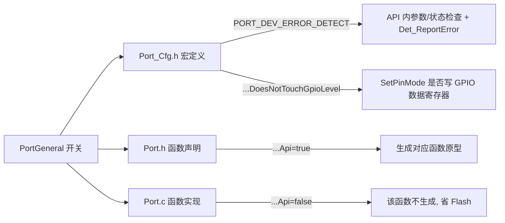
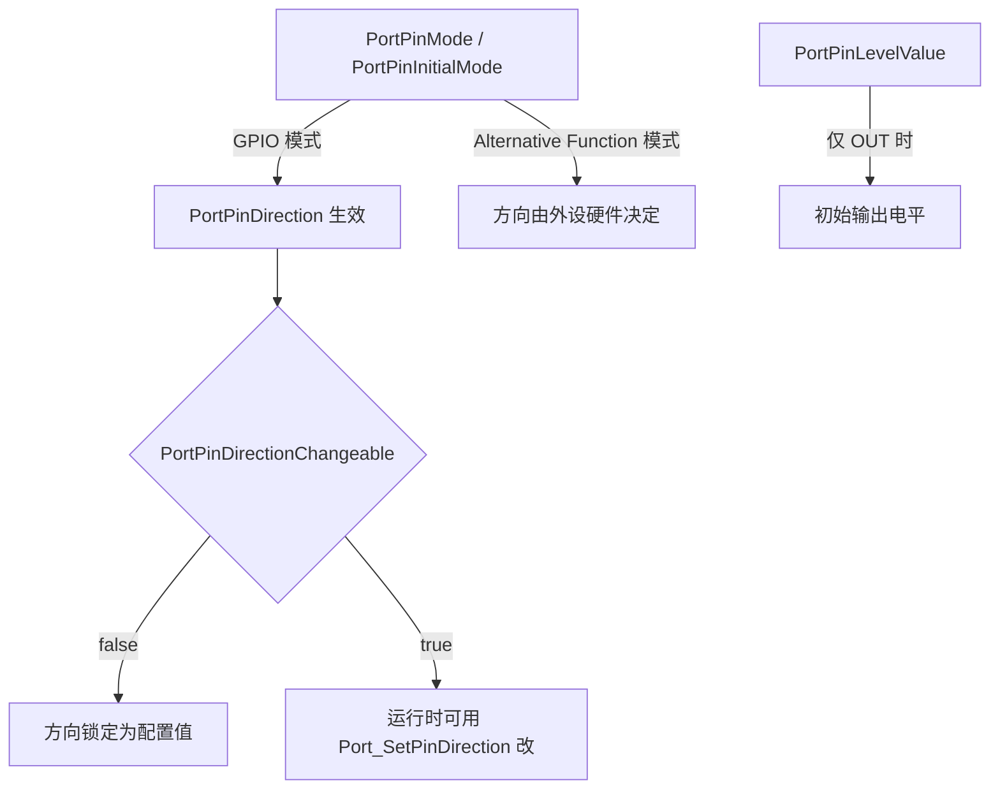
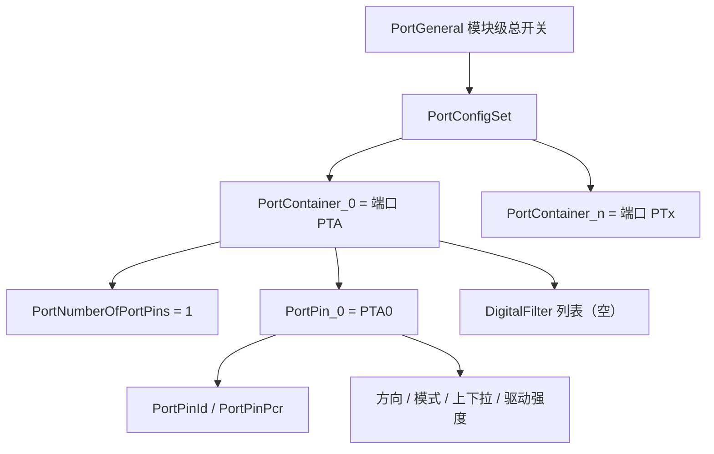
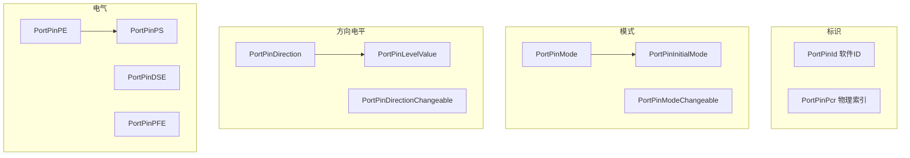

# AUTOSAR / S32K1xx MCAL 配置问答汇总

> 工程：`S32K1X_MCAL_Project`
> 驱动包：`TS_T40D2M10I1R0`（NXP S32K1xx MCAL / RTD 1.0.1），AUTOSAR 4.2.2
> 工具：EB tresos 24.0.1
>
> 说明：本文档汇总所有问答内容。除非明确要求“重新起一个文档”，否则后续回答继续追加到本文档。

## 目录

- [第 1 章 · Port 模块 `PortGeneral` 配置项详解](#第-1-章--port-模块-portgeneral-配置项详解)
- [第 2 章 · `PortPinDirection` 配置项说明](#第-2-章--portpindirection-配置项说明)
- [第 3 章 · `PortPinPE` 配置项说明](#第-3-章--portpinpe-配置项说明)
- [第 4 章 · `PortContainer` 及其 General 说明](#第-4-章--portcontainer-及其-general-说明)
- [第 5 章 · `PortPin` 下各属性详解](#第-5-章--portpin-下各属性详解)
- [第 6 章 · `PortPinPcr` 对 PTE 引脚如何计算](#第-6-章--portpinpcr-对-pte-引脚如何计算)
- [第 7 章 · JTAG / SWD 调试引脚的 Port 配置推荐](#第-7-章--jtag--swd-调试引脚的-port-配置推荐)

---

# 第 1 章 · Port 模块 `PortGeneral` 配置项详解

> 配置来源：`config/Port.xdm` 中的 `PortGeneral` 容器。以下配置项列表来自本工程实际的 `Port.xdm`，是该驱动版本实际暴露的完整项，不是通用猜测。按「通俗 → 原理 → 选项 → 代码 → 坑」展开。

## 1.1 通俗理解：`PortGeneral` 是什么

`PortGeneral` 是整个 **Port 驱动**的“总开关面板”。它管的不是“某个引脚怎么配”（那是 `PortPin` 的事），而是：

- 驱动要不要带**自检/报错**能力；
- **生成哪些运行时 API**（函数），生成的越多，代码越大、越灵活；
- 某些 API 的**行为细节**（比如改模式时要不要动输出电平）；
- 是否支持 **User Mode（非特权模式）** 运行。

比喻：`PortPin` 是“每个房间的装修清单”，`PortGeneral` 是“整栋楼的物业管理规则”。

## 1.2 逐项详解

| 配置项 | 类型 | 本项目当前值 | 一句话作用 | 分类 |
|---|---|---|---|---|
| `PortDevErrorDetect` | BOOLEAN | `true` | 打开开发期参数/状态检查 | AUTOSAR 标准 |
| `PortSetPinDirectionApi` | BOOLEAN | `true` | 生成 `Port_SetPinDirection()` | AUTOSAR 标准 |
| `PortSet2PinsDirectionApi` | BOOLEAN | `false` | 生成一次设两个引脚方向的 API | 厂商扩展 |
| `PortSetPinModeApi` | BOOLEAN | `true` | 生成 `Port_SetPinMode()` | AUTOSAR 标准 |
| `PortVersionInfoApi` | BOOLEAN | `true` | 生成 `Port_GetVersionInfo()` | AUTOSAR 标准 |
| `PortSetPinModeDoesNotTouchGpioLevel` | BOOLEAN | `false` | 改模式时是否不碰 GPIO 电平 | 厂商扩展 |
| `PortEnableUserModeSupport` | BOOLEAN | `false` | 支持用户模式调用 | NXP 扩展 |

> 注：`CommonPublishedInformation` 是另一个容器（软件版本/厂商 ID），**不属于** General 功能配置，不在此讨论。

### 1.2.1 `PortDevErrorDetect` —— 开发错误检测

**通俗**：开车时的“仪表盘报警灯”。打开后，驱动会检查“你传进来的参数对不对、模块有没有初始化”，一旦发现错误就上报（通过 DET），方便开发期抓 bug。量产时可以关掉以省代码/省时间。

**原理**：
- 置 `TRUE` 时，生成的头文件里定义 `PORT_DEV_ERROR_DETECT = STD_ON`；
- 每个 API 入口生成 `#if (PORT_DEV_ERROR_DETECT == STD_ON)` 包裹的检查：
  - 模块未初始化 → `PORT_E_UNINIT`
  - 引脚 ID 越界 → `PORT_E_PARAM_PIN`
  - 方向/模式参数非法 → `PORT_E_PARAM_INVALID_MODE` / `PORT_E_PARAM_INVALID_DIRECTION`
  - 空指针 → `PORT_E_PARAM_POINTER`
- 出错调用 `Det_ReportError(PORT_MODULE_ID, 0, API_ID, ERROR_ID)`。

**选项**：
- `true`：带检查，安全，Debug 阶段建议开（本项目已开）。
- `false`：裁剪检查，省 Flash/CPU，量产可关，但一旦误用参数会静默跑飞。

**代码示例（生成效果示意）**：

```c
/* Port_Cfg.h 中会生成： */
#define PORT_DEV_ERROR_DETECT   (STD_ON)

/* Port.c 中典型实现片段 */
void Port_SetPinDirection(Port_PinType Pin, Port_PinDirectionType Direction)
{
#if (PORT_DEV_ERROR_DETECT == STD_ON)
    if (Port_DriverState != PORT_INITIALIZED)
    {
        Det_ReportError(PORT_MODULE_ID, PORT_INSTANCE_ID,
                        PORT_SETPINDIRECTION_SID, PORT_E_UNINIT);
        return;
    }
    if (Pin >= PORT_NUMBER_OF_PINS)
    {
        Det_ReportError(PORT_MODULE_ID, PORT_INSTANCE_ID,
                        PORT_SETPINDIRECTION_SID, PORT_E_PARAM_PIN);
        return;
    }
#endif
    /* 真正写寄存器的逻辑 */
}
```

> 依赖：使用 DET 需要在工程里配置并链接 `Det` 模块；否则 `Det_ReportError` 无人实现会链接失败。

### 1.2.2 `PortSetPinDirectionApi` —— 是否生成 `Port_SetPinDirection()`

**通俗**：要不要给你一个“运行时改引脚方向”的按钮。打开才有这个函数，能跑起来把某脚从输入临时切成输出。

**原理**：
- 置 `TRUE` → 生成 `Port_SetPinDirection(Port_PinType Pin, Port_PinDirectionType Direction)`；
- 但**能否真正改**还受每个引脚的 `PortPinDirectionChangeable` 约束：若某脚配成不可变，调用该 API 会报 `PORT_E_DIRECTION_UNCHANGEABLE`；
- 置 `FALSE` → 不生成函数，方向只能在 `Port_Init()` 时定死。

**选项**：
- `true`：灵活，占少量代码；适合运行时要切换方向的场景。
- `false`：省代码；方向全静态。

**代码示例**：

```c
/* 运行时把 PortPinId = 1 的引脚切为输出 */
Port_SetPinDirection(1u, PORT_PIN_OUT);
```

> 前提：`PortPin_0` 的 `PortPinDirectionChangeable = true`（本工程正是 `true`），否则会报错。

### 1.2.3 `PortSet2PinsDirectionApi` —— 一次设两个引脚方向（厂商扩展）

**通俗**：有些场景要**同时**把一对引脚切成同方向（例如成对的差分/互补信号），这个开关生成一个“批量设两个脚”的接口，省一次函数调用开销。

**原理与不确定性说明**：
- 这是 **NXP 在该驱动版本上的扩展项**，AUTOSAR 4.2.2 标准 SWS 里没有 `Port_Set2PinsDirection` 这个 API。
- 其**确切函数名/参数签名无法凭记忆 100% 确认**，不同 RTD 小版本可能不同。确认方法：在 tresos 里把它置 `true` → 生成代码 → 打开 `Port.h` / `Port_Cfg.h` 查实际原型。
- 从命名与用途推断：它成对设置方向，必然要求两个引脚都允许改方向，否则报错。

**选项**：
- `false`（本项目）：不生成，最省。
- `true`：仅当硬件确实有成对方向切换需求且确认 API 原型后再开。

**建议**：除非有明确需求，保持 `false`。**不要凭名字去猜函数签名直接调用**。

### 1.2.4 `PortSetPinModeApi` —— 是否生成 `Port_SetPinMode()`

**通俗**：运行时“切换引脚功能”的按钮——比如把某脚从 GPIO 切成 CAN/UART/ADC 的复用功能。

**原理**：
- 置 `TRUE` → 生成 `Port_SetPinMode(Port_PinType Pin, Port_PinModeType Mode)`；
- 实际能否切换受引脚 `PortPinModeChangeable` 约束，不可变则报 `PORT_E_MODE_UNCHANGEABLE`；
- 该函数内部会改 PCR 寄存器（MUX 位等）。

**选项**：
- `true`（本项目）：灵活，推荐。
- `false`：模式静态，省代码。

**代码示例**：

```c
/* 把 PortPinId = 1 切到 GPIO 复用模式（具体枚举名以生成头文件为准） */
Port_SetPinMode(1u, PORT_GPIO_MODE);
```

### 1.2.5 `PortVersionInfoApi` —— 是否生成 `Port_GetVersionInfo()`

**通俗**：给你一个“查询驱动版本号”的函数，返回厂商 ID、模块 ID、软件版本。常用于启动自检或诊断记录。

**原理**：
- 置 `TRUE` → 生成 `Port_GetVersionInfo(Std_VersionInfoType *versioninfo)`；
- 返回 `vendorID`、`moduleID`、`sw_major_version`、`sw_minor_version`、`sw_patch_version`。

**选项**：
- `true`（本项目）：多一个小函数，便于版本追溯。
- `false`：省代码，若无人调用可关。

**代码示例**：

```c
#include "Port.h"

Std_VersionInfoType ver;
Port_GetVersionInfo(&ver);
/* ver.vendorID / ver.moduleID / ver.sw_major_version 等可用 */
```

### 1.2.6 `PortSetPinModeDoesNotTouchGpioLevel` —— 改模式时是否“不碰”GPIO 电平

**通俗**：切换引脚功能时，驱动默认可能会顺手把 GPIO 输出数据寄存器也写一下；打开这个开关就是告诉驱动“**别动我的输出电平**”，避免切换瞬间产生毛刺。

**原理**：
- 在 S32K1xx 上，`Port_SetPinMode()` 若实现中包含对 GPIO PDOR/PSOR/PCOR 的写操作，切 MUX 的瞬间可能改变输出电平，造成毛刺；
- 置 `TRUE` → 生成的 `Port_SetPinMode` **不写** GPIO 数据寄存器，只改 PCR 的模式位；
- 置 `FALSE`（本项目）→ 允许在设模式时同步处理电平（具体行为以实现为准）。

**选项**：
- `false`（本项目当前）：默认行为。
- `true`：对“切换不能有毛刺”的场景更安全，例如通信引脚、时钟输出脚。

**建议**：若应用中 `Port_SetPinMode` 用于会输出信号的引脚，建议评估后置 `true`。

> 该行为在不同小版本实现细节可能不同，最终以生成代码为准。

### 1.2.7 `PortEnableUserModeSupport` —— 用户模式支持

**通俗**：MCU 有“特权模式 / 用户模式”。打开这个，Port 驱动允许**非特权（用户态）代码**去调它的接口，常用于带内存保护（MPU）的安全架构。

**原理**：
- 置 `TRUE` → 生成的接口在实现上适配用户模式访问（例如使用允许用户态访问的寄存器别名，或配合 MPU 配置），并可能影响生成代码中对寄存器的访问方式；
- 置 `FALSE`（本项目）→ 假定全部在特权态调用。

**选项**：
- `false`（本项目）：常规裸机/RTOS 特权态运行。
- `true`：仅当 OS 把 BSW 或应用放在用户态运行、且已规划 MPU 区域时才需要。

**建议**：无用户模式需求就保持 `false`，否则可能引入额外的访问开销与 MPU 配置要求。

## 1.3 它们对生成代码的影响总览



- **裁剪类开关**（`...Api` / `PortVersionInfoApi`）：直接决定**函数是否存在**。不生成 → 链接该函数会报 `undefined reference`。
- **检查类开关**（`PortDevErrorDetect`）：决定**函数内部是否带检查与上报**。
- **行为类开关**（`PortSetPinModeDoesNotTouchGpioLevel`、`PortEnableUserModeSupport`）：函数都存在，只是**实现细节不同**。

## 1.4 常见坑

1. **关掉 API 却仍调用** → 链接错误 `undefined reference to Port_SetPinDirection`。裁剪前先全局搜索调用点。
2. **开 `PortDevErrorDetect` 却没配 DET** → `Det_ReportError` 未实现导致链接失败，或 DET 缓冲爆掉。
3. **`Port_SetPinDirection` 报 `PORT_E_DIRECTION_UNCHANGEABLE`** → 对应引脚 `PortPinDirectionChangeable = false`，General 开关只是“允许函数存在”，单脚可变性在 `PortPin` 里配。
4. **`PortSet2PinsDirectionApi` 不要手写调用** → 厂商扩展 API，签名以生成头文件为准，凭名字猜会编译错。
5. **`PortEnableUserModeSupport` 误开** → 可能要求 MPU 区域与特权分离，裸机场景不要开。

## 1.5 本工程当前值评估

| 项 | 当前值 | 评价 |
|---|---|---|
| `PortDevErrorDetect` | `true` | 开发期合适；量产可评估关闭 |
| `PortSetPinDirectionApi` | `true` | 合理 |
| `PortSet2PinsDirectionApi` | `false` | 合理，无需求保持关 |
| `PortSetPinModeApi` | `true` | 合理 |
| `PortVersionInfoApi` | `true` | 合理 |
| `PortSetPinModeDoesNotTouchGpioLevel` | `false` | 若引脚会输出信号，建议评估改 `true` |
| `PortEnableUserModeSupport` | `false` | 裸机/特权态合适 |

---

# 第 2 章 · `PortPinDirection` 配置项说明

> 对应原文：tresos 中 `PortPin` → `PortPinDirection` 的帮助描述。

## 2.1 原文

> Selects the initial direction of the pin (IN or OUT). If the direction is not changeable, the value configured here is fixed. The pin direction can be set only for the GPIO pins. For the Alternative Function modes the OUT pin direction is hw selected. If the IN direction is needed too, it can be set at runtime.
>
> NOTE: To set the IN direction take care, please, that all the possible module inputs, possible as Alternative Functions for the pad mode, are hw connected together, if IN direction is enabled, to the pad.

## 2.2 通俗理解

这个配置项回答一个问题：**“上电初始化（`Port_Init`）完成后，这个引脚是当输入用，还是当输出用？”**

- 选 `IN`（输入）：引脚被当成“耳朵”，用来读外部电平。
- 选 `OUT`（输出）：引脚被当成“嘴”，用来向外驱动电平。

但有一句关键限定：**这个“方向”只对 GPIO 模式有意义**。如果这个引脚被复用成 UART/CAN/SPI 等外设功能（Alternative Function，AF），那么“是输出还是输入”**由外设硬件自己决定**，不是这个配置项说了算。

## 2.3 逐句拆解

### 第 1 句：`Selects the initial direction of the pin (IN or OUT).`

- **含义**：选择引脚的**初始方向**。
- **何时生效**：在 `Port_Init()` 执行、初始化该引脚时写入。
- **可选项**：`PORT_PIN_IN`（输入）/ `PORT_PIN_OUT`（输出）。
- **本工程当前值**：`PORT_PIN_IN`。

### 第 2 句：`If the direction is not changeable, the value configured here is fixed.`

- **含义**：如果该引脚的 `PortPinDirectionChangeable = false`（方向不可变），那么这里配的方向就是**最终、锁死的值**，运行时不能再改。
- **如果** `PortPinDirectionChangeable = true`（本工程为 `true`），这里只是“初始值”，运行时可以用 `Port_SetPinDirection()` 改。
- **关联配置项**：`PortPinDirectionChangeable`。
  - 可选项：`true` / `false`。
  - `true`：允许 `Port_SetPinDirection()` 改变该脚方向。
  - `false`：方向固定，调用改方向 API 会报 `PORT_E_DIRECTION_UNCHANGEABLE`。

### 第 3 句：`The pin direction can be set only for the GPIO pins.`

- **含义**：**只有 GPIO 模式**下，方向才是由 Port 驱动（`PortPinDirection` + GPIO 数据方向寄存器）来控制的。
- **原理**：S32K1xx 的引脚方向实际由 GPIO 模块的**数据方向寄存器（PDDR）** 决定；当引脚 MUX 选中 GPIO 功能时，该位才真正起作用。
- **关联配置项**：`PortPinMode` / `PortPinInitialMode`。
  - 本工程 `PortPinMode = GPIO`，`PortPinInitialMode = PORT_GPIO_MODE`。

### 第 4 句：`For the Alternative Function modes the OUT pin direction is hw selected.`

- **含义**：当引脚被配置成 **Alternative Function（复用功能，如 UART_TX、CAN_TX）** 时，“输出”这一方向是由**外设硬件自动选择（hardware selected）**的。
- **原理**：此时引脚不再受 GPIO PDDR 控制，而是由对应外设的输出使能（Output Enable）信号决定——外设要发数据时自然驱动引脚为输出。
- **结论**：在 AF 模式下，`PortPinDirection` 这个“OUT”设置基本不参与决定方向。

### 第 5 句：`If the IN direction is needed too, it can be set at runtime.`

- **含义**：有些复用功能是“双向”的（同一引脚既可能输出、也可能需要输入，例如某些通信/定时器捕获）。这类情况下，**输入方向可以在运行时再配置/使能**。
- **理解要点**：不要指望靠 `PortPinDirection` 在 AF 模式下把引脚“配成输入”；AF 模式的输入路径通常由外设侧配置或运行时动作处理。
- **注意**：原文说“direction can be set only for GPIO pins”，又说“IN can be set at runtime”，看似矛盾。合理解释是：**改方向的 GPIO API 只对 GPIO 有效**；而 AF 模式下“需要输入”是通过外设/运行时方式使能输入通路，不是靠改 GPIO 方向位。具体行为以实现为准。

## 2.4 NOTE 那段是什么意思（最容易误解的部分）

> NOTE: To set the IN direction take care, please, that all the possible module inputs, possible as Alternative Functions for the pad mode, are hw connected together, if IN direction is enabled, to the pad.

### 通俗解释

一个物理引脚（pad）背后可能挂着**多个外设的输入口**。当你把这个引脚设为输入（IN 使能）时，**这个引脚上的电平会同时送到所有“可能用到它作输入”的外设输入端**（它们在硬件上被连在一起）。

所以你必须小心：**如果同时有别的外设也开着并把这个脚当输入，它就会读到同一个信号**，可能造成误触发/干扰。

### 拆解要点

| 关键短语 | 含义 |
|---|---|
| `all the possible module inputs` | 所有可能把该 pad 当输入用的外设输入端口 |
| `possible as Alternative Functions for the pad mode` | 该 pad 支持的各个复用功能对应的输入 |
| `are hw connected together` | 这些输入在硬件上是并联到同一个 pad 的 |
| `if IN direction is enabled, to the pad` | 一旦使能输入方向，pad 电平就灌到所有这些输入上 |

### 举例

假设某引脚可复用为 `LPUART0_RX` 和 `LPSPI0_SIN`（两者都把该 pad 当输入）：

- 当你把该脚设为输入，pad 的信号会**同时**进到 LPUART0 和 LPSPI0 的输入端。
- 如果你只想用 LPUART0，却忘了 LPSPI0 那侧状态，可能 LPSPI0 会收到这路信号产生误动作。
- **对策**：明确该脚只给哪个外设用；其它可能复用它的外设要确保未使能/不会误采，或者硬件设计上避免冲突。

## 2.5 与其它配置项的配合关系



| 配置项 | 作用 | 与本项的联动 |
|---|---|---|
| `PortPinDirection` | 初始方向 IN/OUT | 本题主角 |
| `PortPinDirectionChangeable` | 方向能否运行时改 | 决定本项是“初始值”还是“固定值” |
| `PortPinMode` / `PortPinInitialMode` | GPIO 还是复用功能 | 决定本项是否真正生效 |
| `PortPinLevelValue` | 输出初始电平 | 仅当方向为 OUT 时才有意义 |

## 2.6 代码示例

### 2.6.1 初始化后读/写（GPIO 模式）

```c
#include "Port.h"
#include "Dio.h"

/* Port_Init() 已把该脚按 PortPinDirection 配好方向 */

/* 若配置为 OUT：写电平 */
Dio_WriteChannel(DioConf_DioChannel_..., STD_HIGH);

/* 若配置为 IN：读电平 */
Dio_LevelType lvl = Dio_ReadChannel(DioConf_DioChannel_...);
```

### 2.6.2 运行时改方向（需 `PortPinDirectionChangeable = true`）

```c
/* 把 PortPinId = 1 的引脚改为输出 */
Port_SetPinDirection(1u, PORT_PIN_OUT);

/* 再改回输入 */
Port_SetPinDirection(1u, PORT_PIN_IN);
```

> 前提：`PortGeneral.PortSetPinDirectionApi = true` 且该脚 `PortPinDirectionChangeable = true`。
> 若任一条不满足，调用会报 `PORT_E_DIRECTION_UNCHANGEABLE` 或被裁剪掉（链接错误）。

### 2.6.3 AF 模式下的输入（按原文精神）

```c
/* 复用功能下方向由硬件/外设决定；
   若需输入，按对应外设的配置方式使能输入通路，而不是改 GPIO 方向位 */
/* 示例：使能某外设的接收/输入，具体 API 依外设模块而定 */
```

> 这里不臆造具体外设 API，需按你所用的 LPUART/LPSPI/FTM 等模块文档操作。

## 2.7 常见坑

1. **以为 AF 模式下改 `PortPinDirection` 就能改方向** —— 错。AF 模式下方向由外设硬件决定。
2. **`PortPinDirectionChangeable = false` 却调 `Port_SetPinDirection`** —— 报 `PORT_E_DIRECTION_UNCHANGEABLE`。
3. **输出脚没设 `PortPinLevelValue` 期望值** —— 初始化瞬间可能是非预期电平，注意上电毛刺。
4. **输入脚被多个外设复用却没确认** —— 见 2.4 节 NOTE，可能互相干扰。
5. **把本项当“运行时可变的当前方向”** —— 它只是**初始方向**；运行时状态取决于你是否调用过改方向 API。

## 2.8 本工程现状

| 配置项 | 当前值 | 说明 |
|---|---|---|
| `PortPinDirection` | `PORT_PIN_IN` | 初始为输入 |
| `PortPinDirectionChangeable` | `true` | 运行时可改方向 |
| `PortPinMode` | `GPIO` | GPIO 模式，故方向生效 |
| `PortPinInitialMode` | `PORT_GPIO_MODE` | 初始为 GPIO |
| `PortPinLevelValue` | `PORT_PIN_LEVEL_LOW` | 若改输出则为低 |

> 由于当前是 GPIO + 方向可变，本项是“初始输入”，运行时可任意切。

---

# 第 3 章 · `PortPinPE` 配置项说明

> 对应原文：tresos 中 `PortPin`（及 `NotUsedPortPin`）→ `PortPinPE` 的帮助描述。

## 3.1 原文

> Selects if the pull-up or pull-down resistors are enabled.

## 3.2 通俗理解

这个配置项是引脚**内部上拉/下拉电阻的“总开关”**。

- 芯片每个引脚内部都有两个“弹簧电阻”：一个把引脚往高电平拉（**上拉**），一个往低电平拉（**下拉**）。
- 当引脚外部**没人驱动、处于悬空**时，电平会飘（随机读到高/低），这时用上拉或下拉给它一个**确定的默认电平**，避免误读。
- `PortPinPE` 只管**开不开**这个内部电阻；到底**上拉还是下拉**，由另一个配置项 `PortPinPS` 决定。

类比：一根悬空的绳子会乱摆，上拉/下拉就是给它系一根有弹性的皮筋，让它默认停在高位（上拉）或低位（下拉）。

## 3.3 深入原理

### 3.3.1 硬件寄存器层面

在 S32K1xx 上，每个引脚对应 `PORTx` 的一个 `PCRn` 寄存器，其中与本项相关的是两个位/字段：

| 字段 | 含义 | 由哪个配置项控制 |
|---|---|---|
| `PE`（Pull Enable） | 是否启用内部上/下拉 | **`PortPinPE`（本章主角）** |
| `PS`（Pull Select） | 选择上拉还是下拉（通常 0=下拉，1=上拉） | `PortPinPS` |

- 本项 `PortPinPE` 决定 `PE` 位：启用 / 禁用；
- `PortPinPS` 决定 `PS` 位：下拉 / 上拉；
- **两者必须配合**：`PE` 关掉时，`PS` 选什么都**没有效果**。

> 具体位域位置以 S32K1xx 参考手册（RM）的 PORTx_PCRn 描述为准。

### 3.3.2 什么时候真正起作用

- 内部上/下拉主要针对**输入**使用：输入脚悬空时提供默认电平。
- 当引脚被配置为**输出**时，引脚由输出驱动强拉，内部上下拉通常**无意义或自动不生效**——输出的初值应靠 `PortPinLevelValue` 设定，而非上下拉。
- 因此本项与 `PortPinDirection` 强相关：**方向为 IN 时最有意义**。

## 3.4 配置项与可选项

### 3.4.1 `PortPinPE`（本项）

| 可选项 | 含义 |
|---|---|
| `PullDisabled`（本项目当前值） | 不启用内部上/下拉，引脚悬空时无默认电平 |
| 启用项（如 `PullEnabled`，字面以工具为准） | 启用内部上/下拉 |

> 该驱动把它做成**枚举**而非纯布尔，选项文字以 tresos 下拉框为准。

### 3.4.2 `PortPinPS`（配合项）

| 可选项 | 含义 |
|---|---|
| `PullDown`（本项目当前值） | 启用时选下拉，把引脚拉向低电平 |
| `PullUp` | 启用时选上拉，把引脚拉向高电平 |

### 3.4.3 组合效果矩阵

| `PortPinPE` | `PortPinPS` | 实际效果 |
|---|---|---|
| 禁用 | 任意 | **不启用**内部电阻，引脚悬空 → 电平不确定 |
| 启用 | `PullDown` | 内部下拉，默认低电平 |
| 启用 | `PullUp` | 内部上拉，默认高电平 |

## 3.5 代码 / 配置示例

### 3.5.1 配置（xdm 语义）

```text
PortPin_0:
  PortPinPE = PullDisabled   # 不启用内部上下拉
  PortPinPS = PullDown       # 但因 PE 关闭，此设置当前不起作用
```

### 3.5.2 若改为“启用下拉”的效果（概念示意）

```text
PortPin_0:
  PortPinPE = PullEnabled    # 开启内部电阻
  PortPinPS = PullDown       # 选择下拉
# 结果：该输入脚悬空时默认读到低电平
```

### 3.5.3 读取引脚电平（配置生效后）

```c
#include "Dio.h"

/* 若该脚为输入并启用了上拉/下拉，悬空时可读到稳定默认值 */
Dio_LevelType lvl = Dio_ReadChannel(DioConf_DioChannel_...);
```

### 3.5.4 寄存器层面（概念示意，位域以 RM 为准）

```c
/* 伪代码：直接操作 PCRn 的 PE/PS 字段，仅用于理解，不推荐绕过 MCAL */
/* PORT->PCR[n] |=  (1u << PE_BIT);   // 启用内部上下拉 */
/* PORT->PCR[n] &= ~(1u << PS_BIT);   // PS=0 选下拉 */
```

> 实际项目请通过 tresos 配置 + `Port_Init()` 生效，**不要手工改 PCR**，否则与 MCAL 状态不一致。

## 3.6 常见坑

1. **输入脚既没启用内部上下拉、外部也没接电阻** → 引脚悬空，读数随机、易受干扰。
2. **`PortPinPE` 关了却去调 `PortPinPS`** → 白配，`PS` 不生效（本工程当前就是这种状态）。
3. **输出脚想用上下拉决定初值** → 错。输出初值用 `PortPinLevelValue`。
4. **外部已有强上/下拉，又开内部上下拉** → 形成分压/冲突，可能增加漏流、改变电平判定。
5. **内部上下拉阻值较大、驱动弱** → 不能替代外部上拉用于高速、长线或大电容负载场景。
6. **未使用引脚（`NotUsedPortPin`）也要定义上下拉** → 避免悬空漏电/噪声，建议明确拉到一个确定电平。

## 3.7 本工程现状

| 配置项 | 当前值 | 说明 |
|---|---|---|
| `PortPinPE` | `PullDisabled` | **内部上下拉关闭** |
| `PortPinPS` | `PullDown` | 选了“下拉”，但因 `PE` 关闭**当前无效** |
| `PortPinDirection` | `PORT_PIN_IN` | 输入脚，若外部悬空则会浮空 |

> 结论：当前该输入脚**没有内部上下拉**，若硬件上没有外部上/下拉电阻，悬空时会读到不确定电平。若需要默认电平，应把 `PortPinPE` 改为启用，再用 `PortPinPS` 选择上拉或下拉。

---

# 第 4 章 · `PortContainer` 及其 General 说明

> 依据：本工程 `config/Port.xdm` 中 `Port` → `PortConfigSet` → `PortContainer` 的实际结构。

## 4.0 先澄清一个容易混淆的点

在本工程实际 xdm 里，`PortContainer` **并没有一个叫 `PortContainerGeneral` 的独立子容器**。它下面直接挂的是：

```text
PortConfigSet
└─ PortContainer            ← 一个物理端口的“盒子”
   ├─ PortNumberOfPortPins  ← 容器级参数（tresos 上常显示在 General 页）
   ├─ PortPin (list)        ← 该端口下逐个引脚配置
   └─ DigitalFilter (list)  ← 该端口的数字滤波配置（可选）
```

所以你说的「PortContainer 的 General」，实际指的就是**容器级公共设置**那一页，核心就是 `PortNumberOfPortPins`（以及作为列表容器的 `PortPin` / `DigitalFilter`）。它不是模块级的 `PortGeneral`（那是第 1 章讲的全局开关）。

| 名称 | 层级 | 作用 |
|---|---|---|
| `PortGeneral` | 模块级 | 整个 Port 驱动的总开关（API 裁剪、DET 等） |
| `PortContainer` | 端口级 | 代表一个物理端口（PTA/PTB/…），管本端口的引脚集合 |
| `PortContainer` 的 General/容器参数 | 端口级 | `PortNumberOfPortPins` 等本端口公共信息 |
| `PortPin` | 引脚级 | 单个引脚的方向/模式/上下拉等 |

## 4.1 通俗理解

- **`PortContainer` = 一个“楼层”**，对应芯片的一个物理端口（如 PTA、PTB、PTC…）。
- **`PortPin` = 楼层里的“房间”**，对应端口里的具体引脚（如 PTA0、PTA1…）。
- **`PortContainer` 的 General（容器级参数）= 这层楼的“公共信息”**，目前最主要的是：这层楼到底登记了几个房间（`PortNumberOfPortPins`）。

一个 `PortContainer` 对应一个硬件 `PORTx` 外设实例。芯片有几个端口，就建几个 `PortContainer`。你工程里目前只建了 `PortContainer_0`（即端口索引 0），下面只配了 1 个引脚。

## 4.2 深入原理

### 4.2.1 硬件对应关系

S32K1xx 的每个端口（PTA/PTB/…）对应一组寄存器：

- `PORTx_PCRn`：每个引脚的配置（MUX、上下拉、驱动强度、滤波等）；
- `GPIOx_PDDR/PDOR/PSOR/PCOR/PDIR`：端口级数据方向与数据寄存器。

`PortContainer` 就是把「一个 `PORTx` 实例 + 它的引脚集合」打包成一个配置对象。

### 4.2.2 生成的代码怎么用它

- `Port_Init()` 会遍历所有 `PortContainer`，再遍历每个 container 下的 `PortPin`，逐个写 PCR/PDDR 等寄存器；
- `PortNumberOfPortPins` 参与**数组尺寸/循环边界**的生成（具体生成形式以实现为准，通常体现在配置表里）；
- `PortContainer` 的顺序/索引通常对应端口号，因此**增删顺序会影响生成的端口映射**。

## 4.3 容器级配置项说明

### 4.3.1 `PortNumberOfPortPins`

| 项 | 值 |
|---|---|
| 类型 | INTEGER |
| 本工程当前值 | `1` |
| 含义 | 本 `PortContainer` 下实际配置的引脚数量 |
| 影响 | 参与生成配置表的尺寸/校验；通常应与 `PortPin` 列表里的条目数一致 |

> 在 tresos 中它常被标记为 `@CALC`（可自动计算），一般由工具根据下面 `PortPin` 数量自动填写，不建议手工乱改。

### 4.3.2 `PortPin`（引脚列表）

- 类型：MAP/LIST，每个条目是一个 `PortPin` 容器；
- 本工程：`PortPin_0`（`PortPinId = 1`，`PortPinPcr = 0`，GPIO，输入，下拉，低电平）；
- 详细引脚级配置项见第 2、3 章及其他专题。

### 4.3.3 `DigitalFilter`（数字滤波列表）

- 类型：MAP/LIST；
- 本工程：**空**（未配置）；
- 含义：配置该端口的**数字毛刺滤波**（对输入信号做去抖/过滤）；
- 说明：S32K1xx 的 PORT 提供数字滤波相关寄存器（如 DFER/DFCR/DFWR 一类，具体以器件 RM 为准），该列表用于选择哪些引脚启用滤波及滤波参数；未配置即不启用。
- 不确定性：该列表具体子参数名与选项以 tresos 展开为准，本文不臆造字段名。

## 4.4 结构关系图



| 元素 | 含义 |
|---|---|
| `PortGeneral` | 模块级开关，决定 API 与检查（第 1 章） |
| `PortConfigSet` | 配置集合根节点 |
| `PortContainer_n` | 第 n 个物理端口（对应一个 PORTx） |
| `PortNumberOfPortPins` | 该端口配置的引脚数 |
| `PortPin_n` | 该端口下的单个引脚 |
| `DigitalFilter` | 该端口的输入数字滤波配置 |

## 4.5 配置 / 代码示例

### 4.5.1 配置语义（本工程）

```text
PortConfigSet
└─ PortContainer_0
   ├─ PortNumberOfPortPins = 1
   ├─ PortPin_0
   │  ├─ PortPinId   = 1
   │  ├─ PortPinPcr  = 0     # 端口内的引脚索引（PTA0）
   │  ├─ PortPinMode  = GPIO
   │  └─ PortPinDirection = PORT_PIN_IN
   └─ DigitalFilter = (空)
```

### 4.5.2 初始化调用

```c
#include "Port.h"

/* 根据需要先做 Port 引脚级预配置（若有 PostBuild 配置），再初始化 */
Port_Init();
/* Port_Init 内部会遍历所有 PortContainer 及其 PortPin，按配置写寄存器 */
```

## 4.6 常见坑

1. **把 `PortContainer` 的 General 与模块级 `PortGeneral` 搞混** —— 前者是“一个端口的公共设置”，后者是“整个驱动的总开关”。
2. **`PortNumberOfPortPins` 与实际 `PortPin` 数量不一致** —— 可能导致生成表尺寸/循环异常，尽量让工具自动计算（`@CALC`）。
3. **`PortContainer` 顺序/索引没对应真实端口号** —— 生成的端口映射错位，引脚跑到别的 PORTx 上。
4. **只建了一个 `PortContainer` 却要用多个端口** —— 每个物理端口都应有自己的 `PortContainer`。
5. **`DigitalFilter` 空着却以为已滤波** —— 空即未启用数字滤波。
6. **`PortPinPcr` 与引脚物理编号不对应** —— PCR 索引写错，配置落到别的引脚上。

---

# 第 5 章 · `PortPin` 下各属性详解

> 依据：本工程 `config/Port.xdm` 中 `PortPin_0` 实际存在的 12 个属性。

## 5.1 总览

| 属性 | 类型 | 本工程当前值 | 一句话作用 | 分类 |
|---|---|---|---|---|
| `PortPinId` | INTEGER | `1` | 该引脚的符号 ID（运行时 API 用它指定脚） | 标识 |
| `PortPinPcr` | INTEGER | `0` | 该引脚在端口内的 PCR 编号（物理引脚索引） | 标识 |
| `PortPinMode` | ENUM | `GPIO` | 引脚模式（GPIO / 复用功能） | 模式 |
| `PortPinInitialMode` | ENUM | `PORT_GPIO_MODE` | 初始化时的具体模式枚举 | 模式 |
| `PortPinModeChangeable` | BOOLEAN | `true` | 运行时能否用 `Port_SetPinMode` 改模式 | 模式 |
| `PortPinDirection` | ENUM | `PORT_PIN_IN` | 初始方向 IN/OUT（第 2 章） | 方向/电平 |
| `PortPinDirectionChangeable` | BOOLEAN | `true` | 运行时能否用 `Port_SetPinDirection` 改方向 | 方向/电平 |
| `PortPinLevelValue` | ENUM | `PORT_PIN_LEVEL_LOW` | 输出时的初始电平 | 方向/电平 |
| `PortPinPE` | ENUM | `PullDisabled` | 内部上/下拉总开关（第 3 章） | 电气 |
| `PortPinPS` | ENUM | `PullDown` | 上拉还是下拉（第 3 章） | 电气 |
| `PortPinDSE` | ENUM | `Low_drive_strength` | 输出驱动强度（低/高） | 电气 |
| `PortPinPFE` | BOOLEAN | `false` | 被动输入滤波器使能 | 电气 |

> 另：`NotUsedPortPin`（未使用引脚模板）只包含 `PortPinDirection`、`PortPinLevelValue`、`PortPinDSE`、`PortPinPE`、`PortPinPS` 子集，用于给没使用的引脚定一个安全默认状态。

## 5.2 标识类

### 5.2.1 `PortPinId`

- **通俗**：给这个引脚起的“身份证号”。上层调用 `Port_SetPinDirection(id, …)` 等 API 时，传的就是这个号。
- **原理**：`PortPinId` 是 PORT 驱动内部的**符号 ID**，必须全局唯一；生成的 `Port.h` 会把它做成枚举/宏（如 `PortConf_PortPin_…`）。它**不一定**等于物理引脚号。
- **可选项**：任意整数，但同一工程内应唯一且连续（工具可能校验）。
- **影响**：API 参数合法性检查（`PORT_E_PARAM_PIN`）依赖它。
- **与 `PortPinPcr` 的区别**：`PortPinId` 是软件 ID；`PortPinPcr` 是硬件引脚索引。

### 5.2.2 `PortPinPcr`

- **通俗**：告诉驱动“这个配置到底落到端口里的第几个物理引脚”。
- **原理**：S32K1xx 每个端口有 N 个 `PCRn` 寄存器（n=0..31），`PortPinPcr` 就是这个 n。它决定最终写哪个物理引脚。
- **可选项**：`0 … (端口引脚数-1)`。
- **影响**：写错会“配置到别的引脚”，是硬件映射错误的常见原因。
- **示例**：`PortContainer_0` 下的 `PortPinPcr = 0` → 实际是 **PTA0**。

## 5.3 模式类

### 5.3.1 `PortPinMode`

- **通俗**：这个引脚“干什么活”——当普通 GPIO，还是交给 UART/CAN/SPI 等外设复用。
- **原理**：对应 PCR 寄存器的 **MUX** 字段；不同 MUX 值把引脚连到不同外设。
- **可选项**：`GPIO` / 各复用功能（ALT1…ALTn，具体以芯片引脚复用表为准）。
- **影响**：决定引脚的功能通道；选错会导致外设不通。

### 5.3.2 `PortPinInitialMode`

- **通俗**：初始化那一刻，引脚具体进入哪个模式值。
- **原理**：与 `PortPinMode` 配套，`PortPinMode` 给出模式类别，`PortPinInitialMode` 给出**初始化时实际写入的枚举值**（本工程 `PORT_GPIO_MODE`）。
- **可选项**：驱动提供的各模式枚举，本工程为 `PORT_GPIO_MODE`。
- **不确定性**：`PortPinMode` 与 `PortPinInitialMode` 两个枚举的**确切分工以实现/工具提示为准**，建议在 tresos 悬停查看英文 tooltip 或看生成头文件再确认。

### 5.3.3 `PortPinModeChangeable`

- **通俗**：运行时能不能把这个脚“从 GPIO 切成外设功能”。
- **原理**：为 `true` 时允许 `Port_SetPinMode()` 修改；为 `false` 时模式锁死，强改会报 `PORT_E_MODE_UNCHANGEABLE`。
- **可选项**：`true` / `false`（本工程 `true`）。

## 5.4 方向 / 电平类

### 5.4.1 `PortPinDirection`（详见第 2 章）
- 初始方向：`PORT_PIN_IN` / `PORT_PIN_OUT`（本工程 `PORT_PIN_IN`）。

### 5.4.2 `PortPinDirectionChangeable`
- 运行时可改方向？`true` / `false`（本工程 `true`）。为 `false` 时改方向报 `PORT_E_DIRECTION_UNCHANGEABLE`。

### 5.4.3 `PortPinLevelValue`

- **通俗**：当引脚是输出时，初始化后它默认输出高还是低。
- **原理**：对应 GPIO 数据寄存器初值（PDOR/PSOR/PCOR 一类）；只在方向为输出（或输出使能相关场景）时有意义。
- **可选项**：`PORT_PIN_LEVEL_LOW` / `PORT_PIN_LEVEL_HIGH`（本工程 `LOW`）。
- **影响**：决定上电/初始化后的输出电平，避免非预期毛刺。

## 5.5 电气特性类

### 5.5.1 `PortPinPE`（详见第 3 章）
- 内部上/下拉总开关：`PullDisabled` / 启用（本工程 `PullDisabled`）。

### 5.5.2 `PortPinPS`（详见第 3 章）
- 上拉 / 下拉选择：`PullDown` / `PullUp`（本工程 `PullDown`，但 PE 关闭故无效）。

### 5.5.3 `PortPinDSE`

- **通俗**：引脚作为输出时，“力气”大小——低驱动强度还是高驱动强度。
- **原理**：对应 PCR 的 **DSE** 位（Drive Strength Enable）。高驱动强度能驱动更大负载/更快边沿，但功耗与 EMI 更大。
- **可选项**：`Low_drive_strength` / `High_drive_strength`（本工程低）。
- **影响**：影响信号边沿速度、驱动能力、EMI；高速/长线/大电容负载常需高驱动。

### 5.5.4 `PortPinPFE`

- **通俗**：给输入脚加一个“被动滤波器”，把很窄的毛刺滤掉。
- **原理**：对应 PCR 的 **PFE**（Passive Filter Enable）位，启用引脚上的被动输入滤波。
- **可选项**：`true` / `false`（本工程 `false`，不启用）。
- **影响**：启用后可抑制输入毛刺，但会带来额外延时，不适合高速信号。
- **不确定性**：滤波具体强度/延迟由硬件特性决定，需查器件 RM。

## 5.6 各属性关系图



## 5.7 代码示例

### 5.7.1 配置语义（本工程 PortPin_0）

```text
PortPin_0:
  PortPinId                  = 1          # API 用这个 ID
  PortPinPcr                 = 0          # 物理是 PTA0
  PortPinMode                = GPIO       # 当 GPIO 用
  PortPinInitialMode         = PORT_GPIO_MODE
  PortPinModeChangeable      = true
  PortPinDirection           = PORT_PIN_IN
  PortPinDirectionChangeable = true
  PortPinLevelValue          = LOW
  PortPinPE                  = PullDisabled
  PortPinPS                  = PullDown
  PortPinDSE                 = Low_drive_strength
  PortPinPFE                 = false
```

### 5.7.2 运行时 API 使用

```c
#include "Port.h"

/* 传的是 PortPinId，不是 Pcr */
Port_SetPinDirection(1u, PORT_PIN_OUT);   /* 需要 DirectionChangeable=true */
Port_SetPinMode(1u, PORT_GPIO_MODE);      /* 需要 ModeChangeable=true */
```

### 5.7.3 输出高电平（若改为输出）

```c
/* 若该脚已配为 GPIO 输出，运行中写电平用 Dio */
Dio_WriteChannel(DioConf_DioChannel_..., STD_HIGH);
/* PortPinLevelValue 只在初始化时给初值，运行中写电平用 Dio */
```

## 5.8 常见坑

1. **`PortPinId` 与 `PortPinPcr` 混淆** —— API 参数用 `Id`，硬件映射用 `Pcr`。
2. **`PortPinPcr` 写错** —— 配置落到别的引脚，现象是“我明明配了却没反应”。
3. **`PortPinLevelValue` 以为能动态改** —— 它只是初始化初值，运行中写电平用 `Dio_WriteChannel`。
4. **`PortPinPE` 关了却纠结 `PortPinPS`** —— PS 无效。
5. **高速信号开了 `PortPinPFE`** —— 引入延时，可能影响时序。
6. **输出高速/长线却用低驱动 `PortPinDSE`** —— 边沿变慢、可能误码。

---

# 第 6 章 · `PortPinPcr` 对 PTE 引脚如何计算

## 6.1 先给结论

`PortPinPcr` 是**这个引脚在它所属端口内的索引（0 … 31）**，不是全局编号。

所以对 **PTE**：

```text
PortPinPcr = PTE 后面的数字
例：PTE0 → 0，PTE4 → 4，PTE15 → 15
```

同时，这个 `PortPin` 必须放在**对应 PORTE 的 `PortContainer`** 里（而不是 PORTB/PORTC 的容器）。

## 6.2 通俗理解

- 芯片把引脚分成几个“班”：PTA、PTB、PTC、PTD、PTE，每个班叫一个**端口**。
- `PortContainer` 就是“一个班”，`PortPin` 是“班里的学员”。
- `PortPinPcr` 是“学员在班里的座位号”，**重新从 0 开始数**。
- 所以 PTE4 的“座位号”是 4，而不是把 A~D 的都加上。

## 6.3 深入原理

### 6.3.1 S32K1xx 的端口寄存器布局

S32K1xx 的端口是**多个独立外设实例**，各有自己的基地址与 `PCRn` 寄存器组：

| 端口 | 典型基地址（S32K1xx） | PCR 数量 |
|---|---|---|
| PORTA | 0x4004_9000 | 32 |
| PORTB | 0x4004_A000 | 32 |
| PORTC | 0x4004_B000 | 32 |
| PORTD | 0x4004_C000 | 32 |
| PORTE | 0x4004_D000 | 32 |

> 基地址以具体型号 RM 为准，此处用于说明“每个端口独立”。

因此 `PCRn` 的 n 是**端口内局部索引**（0…31），与端口字母无关。PTE4 就是写 `PORTE->PCR[4]`。

### 6.3.2 驱动靠什么区分 PTA / PTE

- 本工程的 `PortContainer` 里**没有“端口 ID / 基地址”参数**（只有 `PortNumberOfPortPins`），说明端口归属靠 **`PortContainer` 的顺序/索引** 决定；
- 于是 `PortPinPcr` 只需给“端口内的第几个脚”，驱动结合容器就知道去哪个 `PORTx`。

> 这也是为什么同一个 `PortPinPcr=0` 在不同 `PortContainer` 下意义不同：一个可能是 PTA0，另一个可能是 PTE0。

## 6.4 计算步骤（以 PTE4 为例）

```text
1. 确定端口字母：PTE → 第 5 个端口（A=0, B=1, C=2, D=3, E=4）
2. 把该引脚放进“对应 PORTE 的 PortContainer”（第 5 个容器）
3. 取数字后缀：PTE4 → PortPinPcr = 4
4. PortPinId 另起一个全局唯一值（与 Pcr 无关）
```

示例配置语义：

```text
PortContainer_4            # 第5个容器 → PORTE
└─ PortPin_0
   ├─ PortPinPcr = 4      # PTE4
   ├─ PortPinId  = 20     # 自定义全局唯一 ID
   └─ ...
```

## 6.5 端口字母 ↔ 容器索引对照

| 端口 | 容器序号（从 0 起） | 引脚示例 | PortPinPcr |
|---|---|---|---|
| PTA | 0 | PTA0 / PTA10 | 0 / 10 |
| PTB | 1 | PTB3 | 3 |
| PTC | 2 | PTC7 | 7 |
| PTD | 3 | PTD2 | 2 |
| PTE | 4 | PTE4 | 4 |

## 6.6 如何最终确认（强烈建议）

由于具体驱动实现可能把“容器序号→端口基地址”映射写成生成表，**最可靠的确认方式是生成代码后看**：

1. 在 tresos 生成代码；
2. 打开 `Port_Cfg.c` / `Port_PBcfg.c` / `Port_Cfg.h`；
3. 找到该引脚的配置项，确认 `PortPinPcr` 与它所对应的 `PORTx` 基地址/实例；
4. 若有 `Port_SetPinDirection` 测试，可反推 ID/PCR 映射是否如你所愿。

> 本章结论基于 S32K1xx 端口寄存器布局与本工程 xdm 结构（容器无端口 ID 参数）。若你的驱动版本把 `PortPinPcr` 定义为**全局线性索引**（形如 `port*32 + pin`），则以生成代码为准——这一点我不能在不看插件定义/生成代码的情况下 100% 保证。

## 6.7 常见坑

1. **把 PTE 当成全局编号去加偏移** —— 本驱动 `PortPinPcr` 是端口内局部索引，直接取数字后缀。
2. **把 PTE4 放进 PTA/PORTB 的容器** —— 硬件写错端口，引脚不动作。
3. **`PortPinId` 也用 `Pcr` 值** —— ID 需全局唯一，建议单独规划，不要与 Pcr 混。
4. **`PortPinPcr` 超出该端口实际引脚数** —— 写到了不存在/复用的寄存器位。
5. **容器顺序不对** —— 若靠容器顺序映射端口，顺序错一位整体错位。

---

# 第 7 章 · JTAG / SWD 调试引脚的 Port 配置推荐

> 本章基于通用 MCAL 配置经验与 S32K1xx 调试口机制给出**通用推荐**，不依赖本工程现有配置。
> ⚠️ 具体**引脚编号**与**复用模式（ALT）号**随派生型号不同，**必须以此型号的参考手册（RM）引脚复用表为准**，本章不臆造具体 ALT 编号。

## 7.1 先搞清一个前提：调试脚默认归“调试口”管

- Cortex-M 的 SWD/JTAG 引脚**复位后默认就是调试功能**，调试器正是靠这个默认状态连接芯片。
- 一旦软件里用 `Port_Init()` 把这些脚改成 **GPIO** 或别的功能，**调试器可能立刻掉线**，严重时无法再连接（只能靠复位时序/擦除引脚恢复）。
- 所以工程上的**常见做法**是二选一：
  1. **不把调试脚放进 Port 配置表**，让它保持复位默认的调试功能；或
  2. 放进去，但 `PortPinMode` 设为对应的**调试复用功能**（而非 GPIO），保证 `Port_Init()` 不会把它改掉。

> 例外：产品量产后若要把调试脚“回收”当 GPIO，需要**谨慎且可恢复**地做（如启动后延时再改，并保留硬件擦除手段）。

## 7.2 S32K1xx 常见调试引脚映射（以 RM 为准）

S32K1xx 系列的调试信号常见落在 **PORTA**（不同派生型号可能有差异）：

| 调试信号 | 典型端口引脚 | 说明 |
|---|---|---|
| `SWD_CLK` / `JTAG_TCLK` | PTA0 | 调试器→MCU 时钟 |
| `SWD_DIO` / `JTAG_TMS` | PTA1 | 双向数据 |
| `SWO` / `JTAG_TDO` | PTA2 | MCU→调试器跟踪 |
| `JTAG_TDI` | PTA3 | 调试器→MCU 数据 |
| `JTAG_TRST`（若有） | 视型号 | 可选复位 |
| `nRESET` | 专用 RESET 脚 | **不属于 Port 配置** |

> 上表为“常见映射”提示。**请在你的型号 RM 的 Signal Multiplexing 章节核实 PTAx 与 ALT 编号**，不同封装/派生可能不同。

## 7.3 各信号电气角色与推荐配置

以 **MCU 视角**判断方向：

| 信号 | MCU 侧角色 | 推荐方向 | 推荐上下拉 | 驱动强度 | 备注 |
|---|---|---|---|---|---|
| `SWD_CLK` / `TCLK` | **输入**（调试器驱动） | IN | **下拉**（PullDown） | 低 | 时钟由调试器给 |
| `SWD_DIO` / `TMS` | **双向** | I/O | **上拉**（PullUp） | 低 | 必须上拉，否则易误触发 |
| `SWO` / `TDO` | **输出**（MCU 驱动） | OUT | 无/弱上拉 | 低 | 跟踪输出，push-pull |
| `JTAG_TDI` | **输入** | IN | **上拉** | 低 | 调试器驱动 |
| `JTAG_TRST` | **输入** | IN | **上拉** | 低 | 若有，高有效/低有效以 RM 为准 |

补充：
- 调试线通常**短、速率有限**，**低驱动强度（Low_drive_strength）足够**；除非长线/排针较远才考虑高驱动。
- **不开被动滤波（PortPinPFE=false）**：调试时钟不应被滤波拖慢边沿。
- **不要开漏**：SWD 的“双向”是靠协议/时序，不是靠把 pad 配成 open-drain；由 ALT 功能硬件处理。

## 7.4 MCAL Port 配置建议（推荐值）

| 配置项 | 推荐值 | 理由 |
|---|---|---|
| `PortPinMode` / `PortPinInitialMode` | **调试复用功能（非 GPIO）** | 保留调试能力；具体枚举名以驱动生成头文件为准 |
| `PortPinDirection` | CLK/TDI/TRST → `IN`；SWO/TDO → `OUT`；DIO/TMS → 按需要（AF 下由硬件决定） | AF 模式下方向由硬件选，但填一个合理值便于理解 |
| `PortPinDirectionChangeable` | `false` | 防止运行时被误改，把调试口改掉 |
| `PortPinModeChangeable` | `false` | 防止运行时误切功能 |
| `PortPinPE` | CLK → 启用；DIO/TMS/TDI/TRST → 启用；SWO/TDO → 可不启用 | 见 7.3 |
| `PortPinPS` | CLK → `PullDown`；DIO/TMS/TDI/TRST → `PullUp`；SWO/TDO → 任意 | 见 7.3 |
| `PortPinDSE` | `Low_drive_strength` | 调试线短，低驱动足够，EMI 小 |
| `PortPinPFE` | `false` | 不滤波，保边沿 |
| `PortPinLevelValue` | 输出脚填 `LOW`（安全） | 避免上电毛刺；输入脚无关 |

> 关键：**只要 `PortPinMode` 不是调试复用功能，方向/上下拉填得再对也救不回调试口。** 先保 MUX，再谈电气。

## 7.5 配置示例（语义示意）

```text
# 仅示意字段组合，具体 ALT 枚举名与引脚号以驱动/RM 为准

PortPin (SWD_CLK  PTA0):
  PortPinMode               = <DEBUG_ALT>   # 调试复用，非 GPIO
  PortPinDirection          = PORT_PIN_IN
  PortPinPE                 = PullEnabled
  PortPinPS                 = PullDown
  PortPinDSE                = Low_drive_strength
  PortPinPFE                = false
  PortPinDirectionChangeable= false
  PortPinModeChangeable     = false

PortPin (SWD_DIO  PTA1):
  PortPinMode               = <DEBUG_ALT>
  PortPinDirection          = PORT_PIN_IN   # AF 下方向由硬件
  PortPinPE                 = PullEnabled
  PortPinPS                 = PullUp
  PortPinDSE                = Low_drive_strength
  PortPinPFE                = false
  PortPinDirectionChangeable= false
  PortPinModeChangeable     = false

PortPin (SWO/TDO  PTA2):
  PortPinMode               = <DEBUG_ALT>
  PortPinDirection          = PORT_PIN_OUT
  PortPinPE                 = PullDisabled # 输出脚可不启用
  PortPinPS                 = PullUp
  PortPinDSE                = Low_drive_strength
  PortPinPFE                = false

PortPin (JTAG_TDI  PTA3):
  PortPinMode               = <DEBUG_ALT>
  PortPinDirection          = PORT_PIN_IN
  PortPinPE                 = PullEnabled
  PortPinPS                 = PullUp
  PortPinDSE                = Low_drive_strength
```

> `<DEBUG_ALT>` 表示该脚对应的调试复用模式；**不要填 `GPIO`**，否则 `Port_Init()` 会切断调试口。

## 7.6 常见坑

1. **把 SWD/TCK/DIO 配成 GPIO** → `Port_Init()` 后调试器掉线，甚至无法再下载。
2. **调试脚也放进 Port 表且填了 GPIO** → 与“不配置”效果相反，直接搞坏调试口。
3. **SWD_DIO 不加上拉** → 空闲电平漂移，连接不稳定。
4. **SWD_CLK 用上拉/无下拉** → 某些调试器要求空闲低，易误触发。
5. **开了 `PortPinPFE` 或高驱动** → 调试时钟被拖慢/抖动。
6. **产品阶段回收调试脚前没留恢复手段** → 一旦改错无法重新连接。
7. **照搬别的型号 PTA0/PTA1 映射** → 不同派生型号引脚号/ALT 可能不同，必须查对应 RM。


